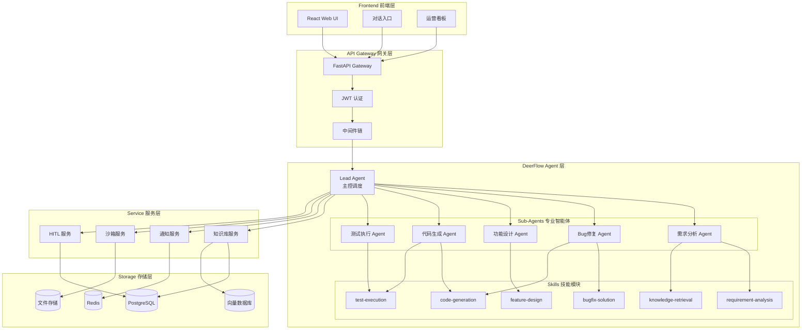

<div align="center">

# 🚀 OpsPilot 运维领航

**智能运维助手 · AI-Powered Operations Platform**

[](https://python.org)
[](https://fastapi.tiangolo.com)
[](https://react.dev)
[](https://typescriptlang.org)
[](https://github.com/bytedance/deer-flow)
[](LICENSE)

<p align="center">
  <strong>基于 DeerFlow 2.0 框架构建的智能运维平台</strong><br>
  <em>从需求分析到代码部署的全流程 AI 自动化</em>
</p>

[English](#) · [快速开始](#-快速开始) · [功能特性](#-核心特性) · [架构设计](#-技术架构) · [API 文档](#-api-文档)

</div>

---

## 📖 项目简介

**OpsPilot 运维领航** 是一个基于 [DeerFlow 2.0](https://github.com/bytedance/deer-flow) 框架构建的智能运维平台。它通过 AI Agent 技术，将传统的运维工作流程（需求分析 → 方案设计 → 代码实现 → 测试验证 → 部署上线）转化为智能化、自动化的协作流程。

### 🎯 解决的问题

| 传统运维痛点 | OpsPilot 解决方案 |
|-------------|------------------|
| 需求分析耗时，分类不准确 | AI 自动分析、智能分类、优先级建议 |
| Bug 定位困难，修复方案不明确 | 根因分析、修复策略、代码建议 |
| 功能设计依赖经验，质量参差不齐 | 标准化设计流程、架构模板、最佳实践 |
| 代码审核效率低 | 自动代码生成、智能审查、质量门禁 |
| 知识沉淀不足，重复问题频发 | 知识库自动积累、智能检索、案例推荐 |

---

## ✨ 核心特性

<table>
<tr>
<td width="50%">

### 🤖 AI Agent 驱动
- **Lead Agent** 统一调度，智能分发任务
- **专业 Sub-Agents** 处理特定领域问题
- **Skills 技能系统** 可扩展的能力模块
- **Memory 记忆系统** 持久化上下文和知识

</td>
<td width="50%">

### 🔄 全流程自动化
- 需求自动分析与分类
- Bug 修复方案智能生成
- 功能设计文档自动编写
- 代码生成与测试执行

</td>
</tr>
<tr>
<td width="50%">

### 👥 人机协作 (HITL)
- 关键决策人工审核
- 方案确认与修改
- 风险控制与回滚
- 审批流程可配置

</td>
<td width="50%">

### 📊 运营可视化
- 实时数据仪表盘
- Agent 性能分析
- 效率指标追踪
- 质量趋势报告

</td>
</tr>
</table>

---

## 🏗 技术架构



### 技术栈

| 层级 | 技术选型 |
|------|----------|
| **前端** | React 18 + TypeScript + Vite + TailwindCSS |
| **后端** | FastAPI + Python 3.11 + Pydantic |
| **Agent 框架** | DeerFlow 2.0 + LangChain + LangGraph |
| **数据库** | PostgreSQL + Redis + Milvus |
| **容器化** | Docker + Docker Compose |
| **AI 模型** | OpenAI GPT-4 / DeepSeek / Claude |

---

## 📦 功能模块

### 九大核心模块

```
┌─────────────────────────────────────────────────────────────────┐
│                      OpsPilot 功能架构                           │
├─────────────────────────────────────────────────────────────────┤
│  ┌─────────┐  ┌─────────┐  ┌─────────┐  ┌─────────┐  ┌───────┐ │
│  │ 🏠 首页 │  │ 💬 对话 │  │ 📁 项目 │  │ 📚 知识 │  │ 📋 需求│ │
│  │  入口   │  │  入口   │  │  管理   │  │  库     │  │  管理  │ │
│  └─────────┘  └─────────┘  └─────────┘  └─────────┘  └───────┘ │
│  ┌─────────┐  ┌─────────┐  ┌─────────┐  ┌─────────┐            │
│  │ 💡 方案 │  │ ✅ 审核 │  │ 💻 代码 │  │ 🧪 测试 │  ┌───────┐ │
│  │  生成   │  │  工作台 │  │  生成   │  │  执行   │  │ 📊 看板│ │
│  └─────────┘  └─────────┘  └─────────┘  └─────────┘  └───────┘ │
└─────────────────────────────────────────────────────────────────┘
```

| 模块 | 功能描述 | 核心能力 |
|------|----------|----------|
| **🏠 首页** | 系统入口与导航 | 快捷操作、统计概览、最近活动 |
| **💬 对话入口** | 自然语言交互 | 需求提交、问题咨询、任务跟踪 |
| **📁 项目管理** | 项目与配置管理 | 项目 CRUD、Agent 配置、成员管理 |
| **📚 知识库** | 运维知识沉淀 | 文档管理、智能检索、案例推荐 |
| **📋 需求管理** | 需求全生命周期 | 自动分类、优先级、状态追踪 |
| **💡 方案生成** | AI 方案设计 | Bug 修复、功能设计、架构建议 |
| **✅ 审核工作台** | HITL 人工审核 | 方案审批、风险评估、修改建议 |
| **💻 代码生成** | 智能代码实现 | 代码生成、Diff 预览、质量检查 |
| **🧪 测试执行** | 自动化测试 | 单元测试、集成测试、覆盖率报告 |
| **📊 运营看板** | 数据可视化 | 效率指标、质量分析、趋势报告 |

### 🦌 DeerFlow 集成

OpsPilot 深度集成 DeerFlow 2.0 框架，提供：

| 组件 | 说明 |
|------|------|
| **DeerFlowClient** | 嵌入式 Python 客户端，无需独立服务 |
| **6 个运维 Skills** | 专为运维场景设计的技能模块 |
| **5 个专业 Agents** | 需求分析、Bug修复、功能设计、代码生成、测试执行 |
| **Sandbox 沙箱** | 安全隔离的代码执行环境 |
| **Memory 记忆** | 持久化知识和上下文 |

---

## 🚀 快速开始

### 前置条件

- Git
- Docker Desktop（方式一）或 Python 3.11+ & Node.js 18+（方式二）
- LLM API Key（OpenAI / DeepSeek / Anthropic 任选其一）

### 方式一：Docker 部署（推荐）

```bash
# 1. 克隆项目
git clone https://github.com/fujincursor/OpsPilot.git
cd OpsPilot

# 2. 克隆 DeerFlow
git clone https://github.com/fujincursor/deer-flow-study.git deerflow

# 3. 配置环境变量
cp .env.example .env
# 编辑 .env，填入你的 API Key

# 4. 启动服务
docker-compose -f docker/docker-compose.yml up -d

# 5. 访问应用
# 前端: http://localhost:5173
# API:  http://localhost:8000/docs
```

### 方式二：本地开发

```bash
# 1. 克隆项目
git clone https://github.com/fujincursor/OpsPilot.git
cd OpsPilot

# 2. 克隆 DeerFlow
git clone https://github.com/fujincursor/deer-flow-study.git deerflow

# 3. 配置环境变量
cp .env.example .env

# 4. 启动后端
cd backend
python -m venv venv
source venv/bin/activate  # Windows: venv\Scripts\activate
pip install -r requirements.txt
uvicorn src.main:app --reload --port 8000

# 5. 启动前端（新终端）
cd frontend
npm install
npm run dev

# 6. 访问 http://localhost:5173
```

> 📖 详细部署指南请参考 [Windows 部署文档](docs/windows-deployment-guide.md)

---

## 📁 项目结构

```
OpsPilot/
├── 📂 backend/                 # 后端服务
│   ├── src/
│   │   ├── api/               # API 路由
│   │   │   ├── routes/        # 各模块路由
│   │   │   └── middleware/    # 中间件
│   │   ├── models/            # 数据模型
│   │   ├── services/          # 业务逻辑
│   │   │   ├── agents/        # Agent 实现
│   │   │   └── deerflow_service.py  # DeerFlow 集成
│   │   ├── config.py          # 配置管理
│   │   └── main.py            # 应用入口
│   └── requirements.txt       # Python 依赖
│
├── 📂 frontend/                # 前端应用
│   ├── src/
│   │   ├── components/        # UI 组件
│   │   ├── pages/             # 页面
│   │   ├── services/          # API 服务
│   │   └── main.tsx           # 入口文件
│   └── package.json           # Node 依赖
│
├── 📂 skills/                  # OpsPilot Skills
│   └── opspilot/
│       ├── requirement-analysis/
│       ├── bugfix-solution/
│       ├── feature-design/
│       ├── code-generation/
│       ├── test-execution/
│       └── knowledge-retrieval/
│
├── 📂 deerflow/                # DeerFlow 框架 (git clone)
│
├── 📂 docker/                  # Docker 配置
│   ├── docker-compose.yml
│   ├── backend/
│   ├── frontend/
│   └── sandbox/
│
├── 📂 docs/                    # 文档
│   ├── deerflow-integration.md
│   ├── windows-deployment-guide.md
│   └── ...
│
├── config.yaml                 # DeerFlow 配置
├── .env.example                # 环境变量模板
├── Makefile                    # 常用命令
└── README.md                   # 本文件
```

---

## 📚 API 文档

启动服务后，访问以下地址查看 API 文档：

| 文档 | 地址 | 说明 |
|------|------|------|
| **Swagger UI** | http://localhost:8000/docs | 交互式 API 文档 |
| **ReDoc** | http://localhost:8000/redoc | 美化版 API 文档 |
| **OpenAPI JSON** | http://localhost:8000/openapi.json | OpenAPI 规范 |

### 主要 API 端点

```
Authentication
├── POST /api/v1/auth/login          # 用户登录
└── POST /api/v1/auth/register       # 用户注册

Projects
├── GET  /api/v1/projects            # 项目列表
├── POST /api/v1/projects            # 创建项目
└── GET  /api/v1/projects/{id}       # 项目详情

Requirements
├── GET  /api/v1/requirements        # 需求列表
├── POST /api/v1/requirements        # 创建需求
└── POST /api/v1/requirements/{id}/analyze  # 分析需求

Solutions
├── GET  /api/v1/solutions/{id}      # 方案详情
├── POST /api/v1/solutions/bugfix    # 生成 Bug 修复方案
└── POST /api/v1/solutions/feature   # 生成功能设计

DeerFlow Agent
├── GET  /api/v1/deerflow/status     # Agent 状态
├── POST /api/v1/deerflow/chat       # Agent 对话
├── POST /api/v1/deerflow/chat/stream # 流式对话
└── POST /api/v1/deerflow/workflow/start  # 启动工作流
```

---

## 🛠 开发指南

### 环境设置

```bash
# 后端开发
cd backend
python -m venv venv
source venv/bin/activate
pip install -r requirements.txt
pip install -r requirements-dev.txt  # 开发依赖

# 前端开发
cd frontend
npm install
```

### 代码规范

```bash
# 后端代码检查
cd backend
ruff check .
mypy src/

# 前端代码检查
cd frontend
npm run lint
```

### 运行测试

```bash
# 后端测试
cd backend
pytest tests/ -v --cov=src

# 前端测试
cd frontend
npm run test
```

### 添加新 Skill

1. 在 `skills/opspilot/` 下创建目录
2. 创建 `SKILL.md` 文件，遵循 DeerFlow Skill 格式
3. 在 `config.yaml` 的 `skills.enabled` 中启用

```yaml
# config.yaml
skills:
  enabled:
    - your-new-skill
```

### 添加新 Agent

1. 在 `backend/src/services/agents/` 创建 Agent 类
2. 在 `config.yaml` 的 `subagents.agents` 中配置
3. 关联相应的 Skills

---

## 🤝 贡献指南

我们欢迎任何形式的贡献！

### 如何贡献

1. **Fork** 本仓库
2. 创建特性分支 (`git checkout -b feature/AmazingFeature`)
3. 提交更改 (`git commit -m 'Add some AmazingFeature'`)
4. 推送到分支 (`git push origin feature/AmazingFeature`)
5. 提交 **Pull Request**

### 贡献类型

- 🐛 **Bug 修复**：发现并修复问题
- ✨ **新功能**：添加新的功能特性
- 📝 **文档**：改进或补充文档
- 🎨 **UI/UX**：优化用户界面和体验
- ⚡ **性能**：提升系统性能
- 🧪 **测试**：增加测试覆盖率

### 提交规范

使用 [Conventional Commits](https://www.conventionalcommits.org/) 规范：

```
feat: 添加新功能
fix: 修复 Bug
docs: 文档更新
style: 代码格式调整
refactor: 代码重构
test: 测试相关
chore: 构建/工具相关
```

### 问题反馈

- 使用 [GitHub Issues](https://github.com/fujincursor/OpsPilot/issues) 报告问题
- 提供详细的复现步骤和环境信息
- 如有可能，附上相关截图或日志

---

## 📄 License

本项目采用 [MIT License](LICENSE) 开源协议。

```
MIT License

Copyright (c) 2024 OpsPilot

Permission is hereby granted, free of charge, to any person obtaining a copy
of this software and associated documentation files (the "Software"), to deal
in the Software without restriction, including without limitation the rights
to use, copy, modify, merge, publish, distribute, sublicense, and/or sell
copies of the Software, and to permit persons to whom the Software is
furnished to do so, subject to the following conditions:

The above copyright notice and this permission notice shall be included in all
copies or substantial portions of the Software.

THE SOFTWARE IS PROVIDED "AS IS", WITHOUT WARRANTY OF ANY KIND, EXPRESS OR
IMPLIED, INCLUDING BUT NOT LIMITED TO THE WARRANTIES OF MERCHANTABILITY,
FITNESS FOR A PARTICULAR PURPOSE AND NONINFRINGEMENT. IN NO EVENT SHALL THE
AUTHORS OR COPYRIGHT HOLDERS BE LIABLE FOR ANY CLAIM, DAMAGES OR OTHER
LIABILITY, WHETHER IN AN ACTION OF CONTRACT, TORT OR OTHERWISE, ARISING FROM,
OUT OF OR IN CONNECTION WITH THE SOFTWARE OR THE USE OR OTHER DEALINGS IN THE
SOFTWARE.
```

---

## 🙏 致谢

- [DeerFlow](https://github.com/bytedance/deer-flow) - 强大的 AI Agent 框架
- [LangChain](https://github.com/langchain-ai/langchain) - LLM 应用开发框架
- [FastAPI](https://fastapi.tiangolo.com/) - 现代 Python Web 框架
- [React](https://react.dev/) - 前端 UI 框架

---

<div align="center">

**⭐ 如果这个项目对你有帮助，请给我们一个 Star！**

[报告问题](https://github.com/fujincursor/OpsPilot/issues) · [功能建议](https://github.com/fujincursor/OpsPilot/issues) · [参与贡献](#-贡献指南)

</div>
