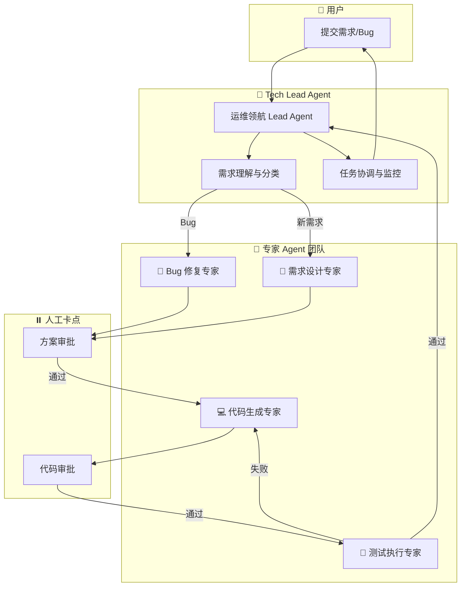

# OpsPilot AI 团队

基于 DeerFlow 2.0 架构的智能运维 AI 团队，采用 Lead Agent + Sub-Agents 编排模式。

## 团队架构



## 团队成员

| 角色 | Agent | 职责 | 触发条件 |
|------|-------|------|----------|
| 🎯 **Tech Lead** | `ops-pilot-lead` | 需求理解、任务分解、团队协调 | 用户提交需求 |
| 🔧 **Bug 修复专家** | `bug-fix-agent` | 问题定位、根因分析、修复方案 | 分类为 Bug |
| 📐 **需求设计专家** | `feature-design-agent` | 技术方案、接口设计、模块划分 | 分类为新需求 |
| 💻 **代码生成专家** | `code-generation-agent` | 代码生成、语法检查、格式化 | 方案审批通过 |
| 🧪 **测试执行专家** | `test-execution-agent` | 用例生成、测试执行、报告生成 | 代码审批通过 |

## 目录结构

```
ai-team/
├── README.md                    # 本文档
├── team-config.yaml             # 团队配置
├── agents/                      # Agent 配置目录
│   ├── lead-agent.yaml          # Lead Agent 配置
│   ├── bug-fix-agent.yaml       # Bug 修复专家配置
│   ├── feature-design-agent.yaml # 需求设计专家配置
│   ├── code-generation-agent.yaml # 代码生成专家配置
│   └── test-execution-agent.yaml  # 测试执行专家配置
└── skills/                      # Skills 配置目录
    └── (待添加)
```

## 工作流程

### Bug 修复流程

```
用户报告 Bug
    ↓
Lead Agent 分析分类
    ↓
Bug Fix Agent 定位问题
    ↓
生成修复方案
    ↓
[HITL] 方案审批 ←── 驳回
    ↓ 通过
Code Gen Agent 生成代码
    ↓
[HITL] 代码审批 ←── 驳回
    ↓ 通过
Test Agent 执行测试
    ↓ 失败 → 返回 Code Gen
    ↓ 通过
完成交付
```

### 新需求开发流程

```
用户提交需求
    ↓
Lead Agent 分析分类
    ↓
Feature Agent 设计方案
    ↓
[HITL] 设计审批 ←── 驳回
    ↓ 通过
Code Gen Agent 生成代码
    ↓
[HITL] 代码审批 ←── 驳回
    ↓ 通过
Test Agent 执行测试
    ↓ 失败 → 返回 Code Gen
    ↓ 通过
完成交付
```

## HITL 人工卡点

| 卡点 | 说明 | 超时时间 | 升级通知 |
|------|------|----------|----------|
| `fix_plan_approve` | Bug 修复方案审批 | 24 小时 | Slack/飞书 |
| `design_doc_approve` | 技术设计方案审批 | 24 小时 | Slack/飞书 |
| `code_change_approve` | 代码变更审批 | 24 小时 | Slack/飞书 |

## 配置说明

### 环境变量

```bash
# 知识库
export RAGFLOW_BASE_URL="http://ragflow:9380"
export RAGFLOW_API_KEY="your-api-key"

# 通知
export SLACK_WEBHOOK_URL="https://hooks.slack.com/..."
export FEISHU_WEBHOOK_URL="https://open.feishu.cn/..."

# 邮件
export SMTP_HOST="smtp.example.com"
```

### 启动团队

```bash
# 使用 DeerFlow CLI 启动
deerflow team start --config ai-team/team-config.yaml

# 或使用 Docker Compose
docker-compose -f docker-compose.ai-team.yaml up -d
```

## 扩展指南

### 添加新的专家 Agent

1. 在 `agents/` 目录创建新的配置文件
2. 在 `team-config.yaml` 的 `members.specialists` 中注册
3. 在工作流中添加新的 stage

### 添加自定义 Skill

1. 在 `skills/` 目录创建 Skill 定义（SKILL.md）
2. 在对应 Agent 配置中启用该 Skill

## 监控与可观测性

- **日志**：JSON 格式，支持 ELK 集成
- **追踪**：LangSmith/Langfuse 追踪
- **指标**：
  - `task_completion_rate` - 任务完成率
  - `review_wait_time` - 审批等待时间
  - `test_pass_rate` - 测试通过率
  - `agent_utilization` - Agent 利用率

---

*OpsPilot AI 团队 v1.0.0*
