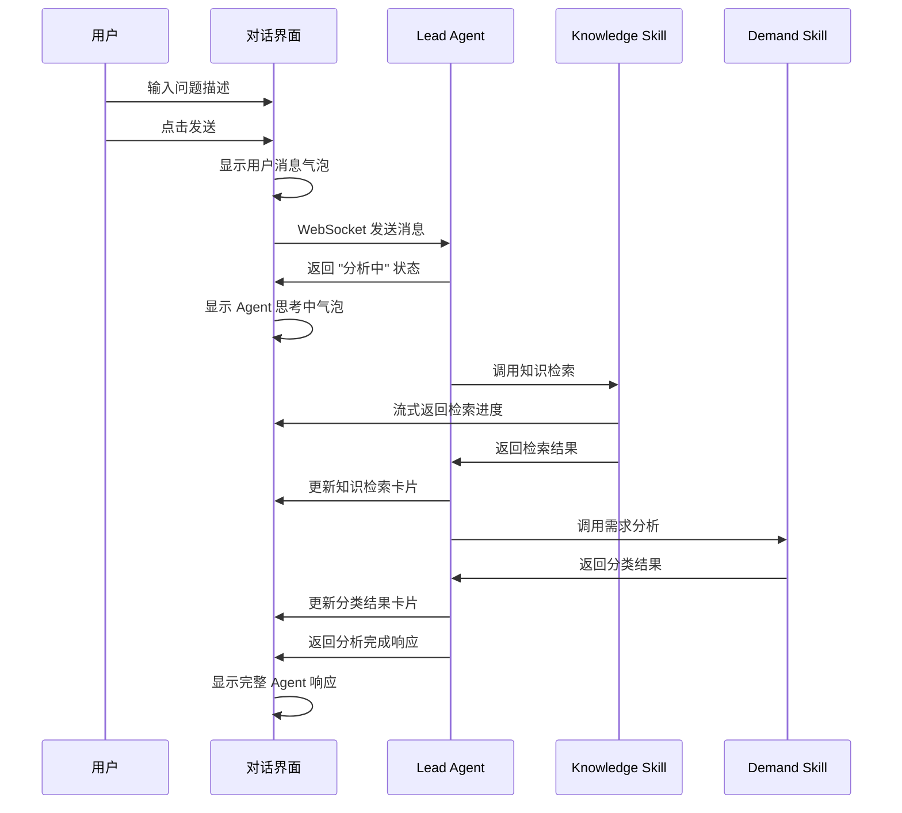

# Phase 1-1: 对话式需求入口 · 页面原型设计稿

基于 DeerFlow 架构重设计，将传统表单式需求提交改为**对话式交互**。本文档遵循 [页面原型风格规范.md](页面原型风格规范.md)。

---

## 1. 设计背景

### 1.1 与旧设计对比

| 维度 | 旧设计（M4 表单） | 新设计（对话式） |
|------|------------------|-----------------|
| 交互模式 | 填写表单 → 提交 → 查看列表 | 自然语言对话 → Agent 实时响应 |
| 反馈时机 | 提交后异步处理 | 实时流式反馈 |
| 知识检索 | 后台静默 | 可视化展示引用来源 |
| 分类过程 | 黑盒 | 透明展示 Agent 分析过程 |

### 1.2 DeerFlow 对应组件

- **Lead Agent**：主编排，接收用户输入
- **Demand Analysis Skill**：需求理解与分类
- **Knowledge Search Skill**：RAG 知识检索
- **Session Goals**：目标追踪

---

## 2. 页面清单与路由

| 序号 | 页面名称 | 路由 | 说明 |
|------|----------|------|------|
| P1 | 对话式需求入口 | `/chat` 或 `/projects/:id/chat` | 主对话界面 |
| P2 | 会话历史列表 | `/chat/history` | 历史会话记录 |
| P3 | 会话详情（只读） | `/chat/:sessionId` | 查看历史会话 |

---

## 3. P1 - 对话式需求入口（主页面）

### 3.1 整体布局

```
┌─────────────────────────────────────────────────────────────────────────┐
│ 顶栏 (56px)                                                              │
│ [Logo] 运维 Agent 工作台        [项目管理] [工作台] [Review]  [头像 ▼]   │
├───────────────┬─────────────────────────────────────────────────────────┤
│ 侧栏 (280px)  │ 主对话区                                                 │
│               │                                                          │
│ ┌───────────┐ │ ┌──────────────────────────────────────────────────────┐│
│ │ 项目选择  │ │ │                                                      ││
│ │ [Alpha ▼] │ │ │                 消息流区域                           ││
│ └───────────┘ │ │                                                      ││
│               │ │                                                      ││
│ ┌───────────┐ │ │                                                      ││
│ │ 历史会话  │ │ │                                                      ││
│ │           │ │ │                                                      ││
│ │ • 会话1   │ │ │                                                      ││
│ │ • 会话2   │ │ │                                                      ││
│ │ • 会话3   │ │ └──────────────────────────────────────────────────────┘│
│ │ [更多...] │ │ ┌──────────────────────────────────────────────────────┐│
│ └───────────┘ │ │ 输入区域                                             ││
│               │ └──────────────────────────────────────────────────────┘│
│ ┌───────────┐ │                                                          │
│ │ + 新会话  │ │                                                          │
│ └───────────┘ │                                                          │
└───────────────┴─────────────────────────────────────────────────────────┘
```

### 3.2 侧栏组件

#### 3.2.1 项目选择器

```
┌─────────────────────────────────┐
│ 当前项目                        │
│ ┌─────────────────────────────┐ │
│ │ 🏢 项目 Alpha            ▼ │ │
│ └─────────────────────────────┘ │
│                                 │
│ 项目状态:                       │
│ • 知识库: ✅ 就绪              │
│ • Agent: ✅ 已配置             │
│ • 成员: 5 人                   │
└─────────────────────────────────┘
```

- **控件**：下拉选择器，展示用户有权限的项目
- **状态提示**：显示知识库就绪状态、Agent 配置状态
- **交互**：切换项目时，清空当前会话或提示保存

#### 3.2.2 历史会话列表

```
┌─────────────────────────────────┐
│ 历史会话                 [🔍]  │
├─────────────────────────────────┤
│ 📌 今天                         │
│ ├─ 数据库连接超时问题           │
│ │  BUG-2024-001 · 进行中       │
│ ├─ 用户权限模块设计             │
│ │  FEAT-2024-003 · 待审批      │
│                                 │
│ 📌 昨天                         │
│ ├─ API 响应优化                 │
│ │  BUG-2024-002 · 已完成       │
│                                 │
│ 📌 更早                         │
│ └─ [查看更多...]               │
└─────────────────────────────────┘
```

- **分组**：按时间分组（今天、昨天、本周、更早）
- **状态标签**：进行中（蓝）、待审批（橙）、已完成（绿）
- **搜索**：支持搜索历史会话标题
- **点击**：进入会话详情/继续对话

#### 3.2.3 新建会话按钮

```
┌─────────────────────────────────┐
│  [+ 开始新会话]                 │
│                                 │
│  快捷入口:                      │
│  [🐛 报告Bug] [✨ 提需求]       │
└─────────────────────────────────┘
```

- **主按钮**：开始新的空白会话
- **快捷入口**：预填分类的快速入口

---

### 3.3 主对话区 - 消息流

#### 3.3.1 欢迎消息（新会话初始状态）

```
┌──────────────────────────────────────────────────────────────────────┐
│                                                                      │
│                         🤖                                           │
│                                                                      │
│                   运维 Agent · 项目 Alpha                            │
│                                                                      │
│        您好！我是项目 Alpha 的智能运维助手。                          │
│        我可以帮您处理 Bug 修复、需求分析、代码生成等任务。             │
│                                                                      │
│        请描述您遇到的问题或需求，我会：                               │
│        1️⃣ 自动检索相关知识库                                         │
│        2️⃣ 分析并分类您的需求                                         │
│        3️⃣ 生成解决方案并提交审批                                     │
│                                                                      │
│        ┌────────────┐ ┌────────────┐ ┌────────────┐                 │
│        │ 🐛 报告Bug │ │ ✨ 提需求  │ │ ❓ 咨询问题 │                 │
│        └────────────┘ └────────────┘ └────────────┘                 │
│                                                                      │
└──────────────────────────────────────────────────────────────────────┘
```

#### 3.3.2 用户消息气泡

```
┌──────────────────────────────────────────────────────────────────────┐
│                                                                      │
│                              ┌─────────────────────────────────────┐ │
│                              │ 用户登录接口报 500 错误，           │ │
│                              │ 日志显示数据库连接超时，            │ │
│                              │ 请帮忙排查一下                      │ │
│                              │                                     │ │
│                              │ 📎 error-log.txt (12KB)            │ │
│                              └─────────────────────────────────────┘ │
│                                                    👤 张三 · 10:30  │
│                                                                      │
└──────────────────────────────────────────────────────────────────────┘
```

- **对齐**：右对齐
- **背景**：主色浅色 (#EEF2FF)
- **附件**：支持附加日志文件、截图
- **时间戳**：右下角，12px 灰色

#### 3.3.3 Agent 消息气泡 - 分析中状态

```
┌──────────────────────────────────────────────────────────────────────┐
│                                                                      │
│ ┌──────────────────────────────────────────────────────────────────┐ │
│ │ 🤖 Lead Agent                                         分析中... │ │
│ ├──────────────────────────────────────────────────────────────────┤ │
│ │                                                                  │ │
│ │ 正在分析您的问题...                                              │ │
│ │                                                                  │ │
│ │ ┌────────────────────────────────────────────────────────────┐  │ │
│ │ │ 📚 知识检索                                        [展开]  │  │ │
│ │ ├────────────────────────────────────────────────────────────┤  │ │
│ │ │ 正在检索相关文档...                                        │  │ │
│ │ │ ████████████░░░░░░░░ 60%                                   │  │ │
│ │ └────────────────────────────────────────────────────────────┘  │ │
│ │                                                                  │ │
│ └──────────────────────────────────────────────────────────────────┘ │
│ 🤖 Lead Agent · 10:31                                                │
│                                                                      │
└──────────────────────────────────────────────────────────────────────┘
```

#### 3.3.4 Agent 消息气泡 - 分析完成

```
┌──────────────────────────────────────────────────────────────────────┐
│                                                                      │
│ ┌──────────────────────────────────────────────────────────────────┐ │
│ │ 🤖 Lead Agent                                         分析完成 ✓ │ │
│ ├──────────────────────────────────────────────────────────────────┤ │
│ │                                                                  │ │
│ │ 我已完成问题分析，以下是结果：                                   │ │
│ │                                                                  │ │
│ │ ┌────────────────────────────────────────────────────────────┐  │ │
│ │ │ 📚 知识检索结果                                    [收起]  │  │ │
│ │ ├────────────────────────────────────────────────────────────┤  │ │
│ │ │ 找到 3 条相关文档：                                        │  │ │
│ │ │                                                            │  │ │
│ │ │ 📄 项目架构说明.md                                         │  │ │
│ │ │    相关度 92% · "数据库连接池配置位于..."                  │  │ │
│ │ │                                                            │  │ │
│ │ │ 📄 数据库配置指南.md                                       │  │ │
│ │ │    相关度 87% · "连接池最大连接数默认为..."                │  │ │
│ │ │                                                            │  │ │
│ │ │ 📄 故障排查手册.md                                         │  │ │
│ │ │    相关度 75% · "常见超时问题处理流程..."                  │  │ │
│ │ └────────────────────────────────────────────────────────────┘  │ │
│ │                                                                  │ │
│ │ ┌────────────────────────────────────────────────────────────┐  │ │
│ │ │ 🏷️ 分类结果                                                │  │ │
│ │ ├────────────────────────────────────────────────────────────┤  │ │
│ │ │ 类型: 🐛 Bug                                               │  │ │
│ │ │ 优先级: 🔴 高                                              │  │ │
│ │ │ 影响模块: auth-service, db-pool                           │  │ │
│ │ │ 工单编号: BUG-2024-001                                     │  │ │
│ │ └────────────────────────────────────────────────────────────┘  │ │
│ │                                                                  │ │
│ │ 问题已创建为 Bug 工单，正在启动修复流程...                       │ │
│ │                                                                  │ │
│ └──────────────────────────────────────────────────────────────────┘ │
│ 🤖 Lead Agent · 10:32                                                │
│                                                                      │
└──────────────────────────────────────────────────────────────────────┘
```

#### 3.3.5 Sub-Agent 执行卡片

```
┌──────────────────────────────────────────────────────────────────────┐
│                                                                      │
│ ┌──────────────────────────────────────────────────────────────────┐ │
│ │ 🔧 Bug Fix Agent                                      执行中... │ │
│ ├──────────────────────────────────────────────────────────────────┤ │
│ │                                                                  │ │
│ │ 正在分析问题根因并生成修复方案...                                │ │
│ │                                                                  │ │
│ │ ┌────────────────────────────────────────────────────────────┐  │ │
│ │ │ 执行步骤                                                   │  │ │
│ │ ├────────────────────────────────────────────────────────────┤  │ │
│ │ │ ✅ 1. 代码定位 - 找到相关代码文件                          │  │ │
│ │ │ ✅ 2. 问题分析 - 识别根本原因                              │  │ │
│ │ │ 🔄 3. 方案生成 - 生成修复方案中...                         │  │ │
│ │ │ ⬚ 4. 方案审批 - 等待人工审批                               │  │ │
│ │ └────────────────────────────────────────────────────────────┘  │ │
│ │                                                                  │ │
│ │ 进度: ████████████░░░░░░░░ 60%                                  │ │
│ │                                                                  │ │
│ └──────────────────────────────────────────────────────────────────┘ │
│ 🔧 Bug Fix Agent · 10:33                                             │
│                                                                      │
└──────────────────────────────────────────────────────────────────────┘
```

---

### 3.4 主对话区 - 输入区域

```
┌──────────────────────────────────────────────────────────────────────┐
│                                                                      │
│ ┌──────────────────────────────────────────────────────────────────┐ │
│ │ [📎] [📷]                                                        │ │
│ │                                                                  │ │
│ │ 请描述您遇到的问题或需求...                                      │ │
│ │                                                                  │ │
│ │                                                                  │ │
│ │                                                      [发送 ➤]   │ │
│ └──────────────────────────────────────────────────────────────────┘ │
│                                                                      │
│ 💡 提示: 按 Enter 发送，Shift+Enter 换行                            │
│                                                                      │
└──────────────────────────────────────────────────────────────────────┘
```

#### 3.4.1 输入框组件

| 元素 | 说明 |
|------|------|
| 📎 附件按钮 | 上传日志文件、配置文件（支持 .txt, .log, .json, .yaml） |
| 📷 截图按钮 | 上传截图或粘贴剪贴板图片 |
| 文本输入框 | 多行文本，最小高度 80px，最大高度 200px |
| 发送按钮 | 主色按钮，禁用态：输入为空时 |

#### 3.4.2 输入状态

```
# Agent 处理中时，输入框状态：

┌──────────────────────────────────────────────────────────────────────┐
│ ┌──────────────────────────────────────────────────────────────────┐ │
│ │ Agent 正在处理中，请稍候...                                      │ │
│ │                                                      [停止 ⏹]   │ │
│ └──────────────────────────────────────────────────────────────────┘ │
└──────────────────────────────────────────────────────────────────────┘
```

---

## 4. 消息类型详细设计

### 4.1 消息类型枚举

| 类型 | 图标 | 发送方 | 说明 |
|------|------|--------|------|
| `user_message` | 👤 | 用户 | 用户输入的文本消息 |
| `agent_thinking` | 🤖 | Lead Agent | Agent 分析中状态 |
| `agent_response` | 🤖 | Lead Agent | Agent 分析完成响应 |
| `sub_agent_start` | 🔧/💻/🧪 | Sub-Agent | 子 Agent 开始执行 |
| `sub_agent_progress` | 🔧/💻/🧪 | Sub-Agent | 子 Agent 执行进度 |
| `sub_agent_complete` | 🔧/💻/🧪 | Sub-Agent | 子 Agent 执行完成 |
| `hitl_approval` | ⏳ | 系统 | HITL 审批卡片（见 Phase1-2） |
| `system_notice` | ℹ️ | 系统 | 系统通知（超时、错误等） |

### 4.2 知识检索结果卡片

```
┌────────────────────────────────────────────────────────────────────┐
│ 📚 知识检索结果                                    [收起] [刷新]  │
├────────────────────────────────────────────────────────────────────┤
│                                                                    │
│ ┌────────────────────────────────────────────────────────────────┐│
│ │ 📄 项目架构说明.md                                     [查看] ││
│ │ 相关度: ████████████░░░░ 92%                                  ││
│ │ 摘要: "...数据库连接池配置位于 config/db-pool.yaml，         ││
│ │       默认最大连接数为 10..."                                 ││
│ │ 来源: M3 知识库 · 更新于 2024-01-10                          ││
│ └────────────────────────────────────────────────────────────────┘│
│                                                                    │
│ ┌────────────────────────────────────────────────────────────────┐│
│ │ 📄 数据库配置指南.md                                   [查看] ││
│ │ 相关度: ████████████░░░░ 87%                                  ││
│ │ 摘要: "...高并发场景建议将 maxConnections 设置为 50 以上..." ││
│ │ 来源: M3 知识库 · 更新于 2024-01-08                          ││
│ └────────────────────────────────────────────────────────────────┘│
│                                                                    │
│ 📊 共检索到 3 条相关文档，显示相关度最高的 2 条                   │
│                                                                    │
└────────────────────────────────────────────────────────────────────┘
```

### 4.3 分类结果卡片

```
┌────────────────────────────────────────────────────────────────────┐
│ 🏷️ 需求分类结果                                                   │
├────────────────────────────────────────────────────────────────────┤
│                                                                    │
│ ┌──────────────┐  ┌──────────────┐  ┌──────────────┐             │
│ │ 类型         │  │ 优先级       │  │ 紧急程度     │             │
│ │ 🐛 Bug       │  │ 🔴 高        │  │ ⚡ 紧急      │             │
│ └──────────────┘  └──────────────┘  └──────────────┘             │
│                                                                    │
│ 工单编号: BUG-2024-001                                            │
│ 影响模块: auth-service, db-pool                                   │
│ 影响范围: 生产环境用户登录                                         │
│                                                                    │
│ 分类依据:                                                          │
│ • 关键词匹配: "500错误", "超时", "数据库连接"                     │
│ • 历史相似问题: BUG-2023-089 (相似度 78%)                         │
│                                                                    │
│ ┌──────────────────────────────────────────────────────────────┐  │
│ │ ❓ 分类有误？                                [修正分类]      │  │
│ └──────────────────────────────────────────────────────────────┘  │
│                                                                    │
└────────────────────────────────────────────────────────────────────┘
```

---

## 5. 交互说明

### 5.1 消息发送流程



### 5.2 实时更新机制

- **WebSocket 连接**：建立长连接，接收 Agent 实时推送
- **流式渲染**：Agent 响应逐字/逐块渲染
- **进度更新**：Sub-Agent 执行进度实时更新
- **状态同步**：会话状态变更实时反映

### 5.3 错误处理

```
┌──────────────────────────────────────────────────────────────────────┐
│                                                                      │
│ ┌──────────────────────────────────────────────────────────────────┐ │
│ │ ⚠️ 系统提示                                                      │ │
│ ├──────────────────────────────────────────────────────────────────┤ │
│ │                                                                  │ │
│ │ Agent 处理超时，请稍后重试。                                     │ │
│ │                                                                  │ │
│ │ 错误代码: AGENT_TIMEOUT                                         │ │
│ │ 错误时间: 2024-01-15 10:35:00                                   │ │
│ │                                                                  │ │
│ │              [🔄 重试]    [📋 查看详情]                         │ │
│ │                                                                  │ │
│ └──────────────────────────────────────────────────────────────────┘ │
│ ℹ️ 系统 · 10:35                                                      │
│                                                                      │
└──────────────────────────────────────────────────────────────────────┘
```

---

## 6. 响应式设计

### 6.1 桌面端（≥1200px）

- 侧栏固定显示，宽度 280px
- 消息流区域自适应剩余宽度
- 消息气泡最大宽度 70%

### 6.2 平板端（768px - 1199px）

- 侧栏可收起，点击按钮展开
- 消息气泡最大宽度 80%

### 6.3 移动端（<768px）

- 侧栏默认隐藏，通过汉堡菜单展开
- 消息气泡最大宽度 90%
- 输入框简化，附件按钮收入更多菜单

---

## 7. 组件规范

### 7.1 消息气泡

| 属性 | 用户消息 | Agent消息 |
|------|----------|-----------|
| 对齐 | 右对齐 | 左对齐 |
| 背景色 | #EEF2FF（主色浅） | #FFFFFF |
| 边框 | 无 | 1px #E5E7EB |
| 圆角 | 12px（右上 4px） | 12px（左上 4px） |
| 最大宽度 | 70% | 85% |
| 内边距 | 12px 16px | 16px 20px |

### 7.2 状态标签

| 状态 | 颜色 | 图标 |
|------|------|------|
| 分析中 | #3B82F6 蓝 | 🔄 旋转 |
| 执行中 | #3B82F6 蓝 | ⏳ |
| 等待审批 | #F59E0B 橙 | ⏸️ |
| 已完成 | #10B981 绿 | ✅ |
| 失败 | #EF4444 红 | ❌ |

### 7.3 进度条

```css
.progress-bar {
  height: 8px;
  background: #E5E7EB;
  border-radius: 4px;
}

.progress-bar-fill {
  background: linear-gradient(90deg, #3B82F6, #6366F1);
  border-radius: 4px;
  transition: width 0.3s ease;
}
```

---

## 8. 与其他模块集成

| 集成点 | 说明 |
|--------|------|
| M1 项目管理 | 项目选择器数据来源 |
| M3 知识库 | 知识检索结果数据源 |
| M4 需求分类 | 分类结果数据写入 |
| M5/M6 工单 | 创建 Bug/需求工单 |
| M7 Review | HITL 审批卡片（见 Phase1-2） |

---

## 9. 原型文件清单

| 文件 | 说明 |
|------|------|
| `chat/index.html` | 对话主页面 |
| `chat/empty-state.html` | 新会话欢迎状态 |
| `chat/analyzing.html` | Agent 分析中状态 |
| `chat/complete.html` | 分析完成带结果 |
| `chat/history.html` | 历史会话列表 |

以上为 Phase1-1 对话式需求入口的完整页面原型设计稿。
