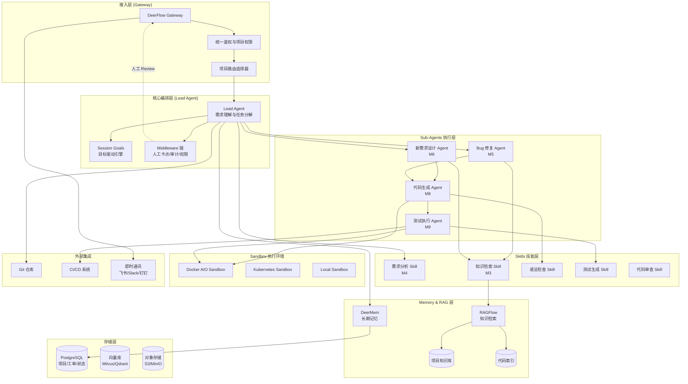
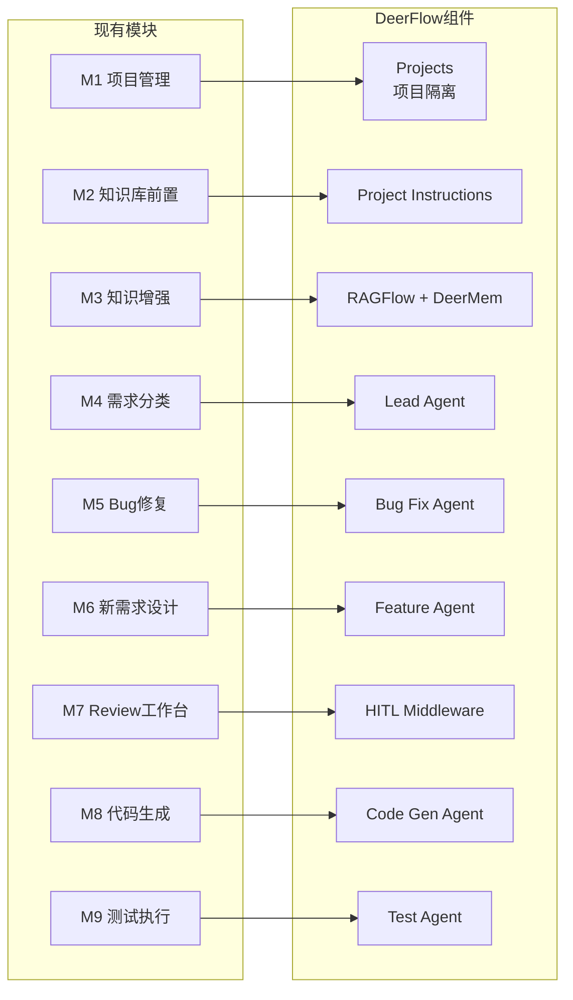
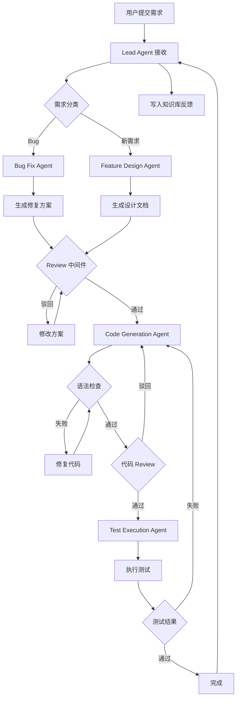
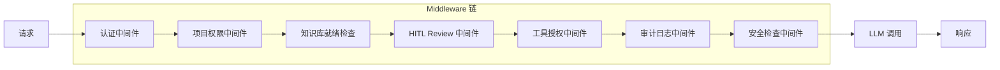
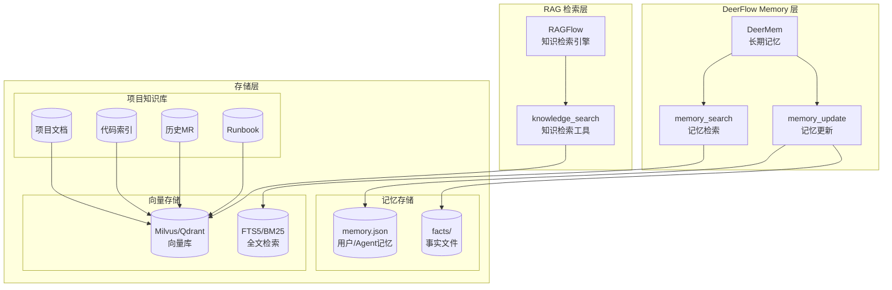
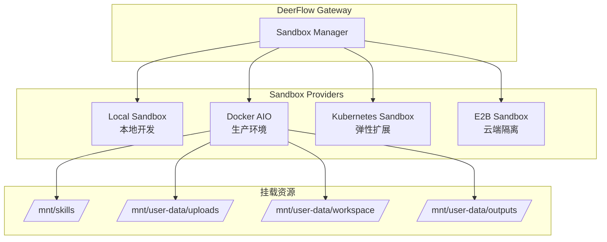
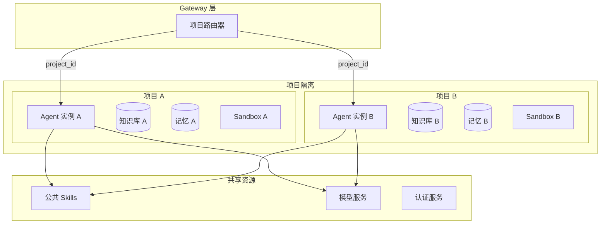
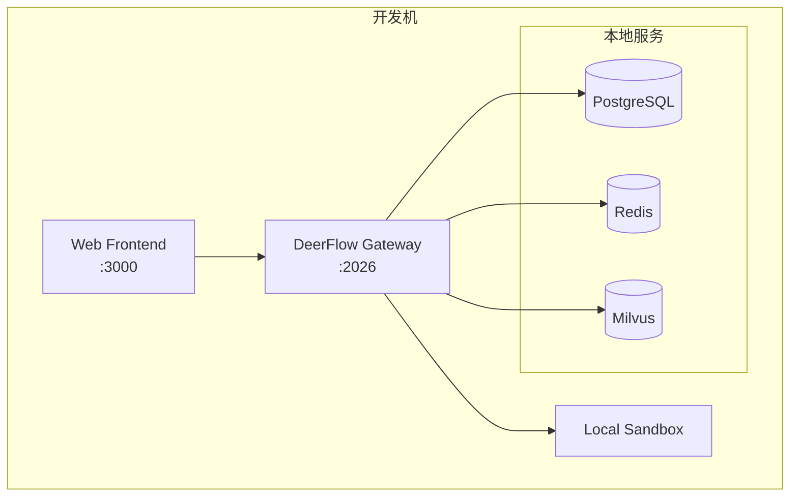
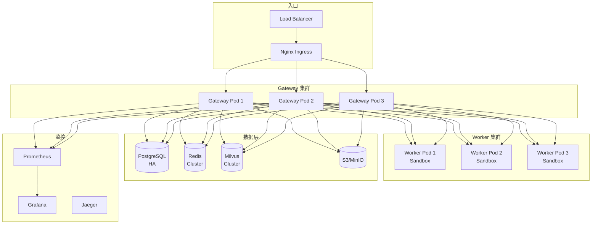

# 运维 Agent 生产系统 - DeerFlow 2.0 架构重设计

## 一、文档目的

本文档基于字节跳动开源的 **DeerFlow 2.0** 超级 Agent 框架，对运维 Agent 生产系统进行架构重设计。通过采用 DeerFlow 的 Lead Agent + Sub-agents 编排模式，结合其 Middleware、Skills、Memory、Sandbox 等核心能力，实现更加灵活、可扩展的运维自动化系统。

---

## 二、DeerFlow 2.0 核心特性概述

DeerFlow 2.0 是一个基于 LangGraph 构建的"Super Agent Harness"，核心特性包括：

| 特性 | 说明 |
|------|------|
| **Lead Agent + Sub-agents** | 主 Agent 负责任务理解和分解，按需生成子 Agent 执行具体任务 |
| **Middleware 链** | 每个 LLM 调用前后执行的中间件管道，支持人工卡点、审计、权限控制 |
| **Skills 系统** | 可扩展的技能模块，按需加载，支持自定义 Skill |
| **Sandbox 执行环境** | 隔离的代码执行环境（Local/Docker/E2B/Kubernetes） |
| **Memory 持久化** | DeerMem 长期记忆系统，支持用户/项目级别的知识持久化 |
| **RAG 知识检索** | 通过 RAGFlow 等实现私有知识检索 |
| **Session Goals** | 目标驱动的工作流，自动推进直到目标达成 |
| **Context Engineering** | 上下文管理、压缩、摘要，保持长任务的上下文一致性 |
| **Extension 插件系统** | 支持自定义中间件、生命周期钩子、HTTP 路由扩展 |

---

## 三、整体架构设计

### 3.1 架构总览图



### 3.2 数据流与工作流

```mermaid
sequenceDiagram
    participant User as 用户/IM
    participant GW as Gateway
    participant LA as Lead Agent
    participant MW as Middleware
    participant SA as Sub-Agents
    participant SK as Skills
    participant SB as Sandbox
    participant KB as 知识库

    User->>GW: 提交需求/Bug
    GW->>GW: 项目权限校验
    GW->>LA: 创建任务会话
    
    LA->>KB: RAG 检索项目上下文
    KB-->>LA: 返回相关知识
    
    LA->>LA: 需求理解与分类
    
    alt Bug 修复流程
        LA->>SA: 委派 Bug 修复 Agent
        SA->>SK: 调用知识检索 Skill
        SA->>SA: 生成修复方案
        SA->>MW: 进入 Review 中间件
        MW->>User: 等待人工 Review
        User->>MW: 通过/驳回
        MW-->>SA: 继续/回退
    else 新需求流程
        LA->>SA: 委派新需求 Agent
        SA->>SK: 调用设计 Skill
        SA->>SA: 生成设计方案
        SA->>MW: 进入 Review 中间件
        MW->>User: 等待人工 Review
        User->>MW: 通过/驳回
        MW-->>SA: 继续/回退
    end
    
    SA->>SA: 委派代码生成 Agent
    SA->>SB: 在 Sandbox 中生成代码
    SA->>SK: 调用语法检查 Skill
    
    SA->>SA: 委派测试 Agent
    SA->>SB: 在 Sandbox 中执行测试
    SA-->>LA: 返回执行结果
    
    LA->>KB: 写入知识库(反馈)
    LA-->>GW: 返回最终结果
    GW-->>User: 推送结果
```



---

## 四、DeerFlow 组件与现有模块映射

### 4.1 模块映射关系表

| 现有模块 | DeerFlow 组件 | 映射说明 |
|----------|---------------|----------|
| **M1** 多项目与 Agent 实例管理 | **Projects + Agent Registry** | DeerFlow Projects 支持项目隔离，每个项目可配置独立的 Agent 实例和 Skills |
| **M2** 项目信息与知识库前置维护 | **Project Instructions + Document Shelf** | 项目级指令和文档架构，知识库就绪校验通过 Middleware 实现 |
| **M3** 知识库与系统理解增强 | **RAGFlow + DeerMem** | RAGFlow 提供向量检索，DeerMem 提供长期记忆持久化 |
| **M4** 需求理解与分类 | **Lead Agent + Demand Analysis Skill** | Lead Agent 负责需求理解，通过 Skill 实现分类逻辑 |
| **M5** Bug 修复流程 | **Bug Fix Sub-Agent** | 独立 Sub-Agent 处理 Bug 定位和修复方案生成 |
| **M6** 新需求设计流程 | **Feature Design Sub-Agent** | 独立 Sub-Agent 处理技术方案设计 |
| **M7** 人工 Review 工作台 | **HITL Middleware + Approval Cards** | 通过 Middleware 实现审批卡点，Web UI 展示审批界面 |
| **M8** 代码生成与语法校验 | **Code Generation Sub-Agent + Sandbox** | Sub-Agent 在 Sandbox 中生成代码，调用 Linter Skill |
| **M9** 测试用例生成与执行 | **Test Execution Sub-Agent + Sandbox** | Sub-Agent 在 Sandbox 中执行测试，生成测试报告 |

### 4.2 详细映射架构图



---

## 五、Lead Agent 与 Sub-Agents 职责划分

### 5.1 Lead Agent（领导 Agent）

Lead Agent 是系统的核心编排器，负责：

```yaml
Lead Agent 职责:
  - 接收用户输入的需求/Bug 描述
  - 调用知识库检索项目上下文
  - 理解需求意图并分类（Bug/新需求）
  - 分解任务并委派给合适的 Sub-Agent
  - 监控 Sub-Agent 执行状态
  - 整合 Sub-Agent 结果返回用户
  - 管理 Session Goals（目标驱动）
  - 触发知识库反馈写入
```

**Lead Agent 配置示例**：

```yaml
# config.yaml - Lead Agent 配置
agents:
  lead_agent:
    name: ops-pilot-lead
    display_name: "运维 Agent 领导"
    model: gpt-4o
    system_prompt: |
      你是运维 Agent 生产系统的领导 Agent。
      你的职责是理解用户提交的运维需求或 Bug，
      分析后委派给合适的 Sub-Agent 执行。
      
      分类规则：
      - Bug：系统故障、错误、异常行为
      - 新需求：功能增强、新特性、优化建议
      
    skills:
      - demand-analysis
      - knowledge-search
      - project-context
      
    tool_groups:
      - knowledge
      - browser
      - file
```

### 5.2 Sub-Agents（子 Agent）

| Sub-Agent | 职责 | 触发条件 | Skills |
|-----------|------|----------|--------|
| **Bug Fix Agent** | 问题定位、根因分析、修复方案生成 | Lead Agent 分类为 Bug | `knowledge-search`, `code-analysis`, `fix-plan` |
| **Feature Design Agent** | 技术方案设计、模块划分、接口定义 | Lead Agent 分类为新需求 | `knowledge-search`, `architecture-design`, `api-design` |
| **Code Generation Agent** | 代码生成、语法检查、代码优化 | 方案 Review 通过后 | `code-generation`, `linter-check`, `code-review` |
| **Test Execution Agent** | 测试用例生成、测试执行、报告生成 | 代码语法检查通过后 | `test-generation`, `test-execution`, `report-generation` |

**Sub-Agent 配置示例**：

```yaml
# subagents.yaml - Sub-Agent 定义
subagents:
  - name: bug-fix-agent
    display_name: "Bug 修复专家"
    model: gpt-4o
    thinking_enabled: true
    reasoning_effort: high
    system_prompt: |
      你是 Bug 修复专家 Agent。
      负责分析 Bug 根因，定位问题代码，生成修复方案。
      
    skills:
      - knowledge-search
      - code-analysis
      - fix-plan-generation
    
    acceptance_criteria:
      - "修复方案包含问题定位"
      - "修复方案包含具体修改建议"
      - "修复方案包含影响范围评估"

  - name: feature-design-agent
    display_name: "需求设计专家"
    model: gpt-4o
    thinking_enabled: true
    system_prompt: |
      你是新需求设计专家 Agent。
      负责分析需求，设计技术方案，定义接口和模块划分。
      
    skills:
      - knowledge-search
      - architecture-design
      - api-design

  - name: code-generation-agent
    display_name: "代码生成专家"
    model: gpt-4o
    sandbox_required: true
    system_prompt: |
      你是代码生成专家 Agent。
      根据设计方案生成代码，并进行语法检查。
      
    skills:
      - code-generation
      - linter-check

  - name: test-execution-agent
    display_name: "测试执行专家"
    model: gpt-4o
    sandbox_required: true
    system_prompt: |
      你是测试执行专家 Agent。
      负责生成测试用例，在 Sandbox 中执行测试，生成测试报告。
      
    skills:
      - test-generation
      - test-execution
```

### 5.3 Agent 委派流程



---

## 六、Middleware 链设计

### 6.1 Middleware 架构

DeerFlow Middleware 在每个 LLM 调用前后执行，支持：
- **人工审批卡点**：HITL (Human-in-the-Loop) 审批
- **权限控制**：工具调用授权
- **审计日志**：操作记录
- **安全检查**：敏感内容过滤



### 6.2 人工 Review 中间件实现

```yaml
# config.yaml - HITL 中间件配置
hitl_approval:
  enabled: true
  tools:
    - fix_plan_approve       # 修复方案审批
    - design_doc_approve     # 设计文档审批
    - code_change_approve    # 代码变更审批
    - deploy_approve         # 部署审批
  
  non_interactive: "block"   # 非交互模式下阻塞
  
  approval_timeout: 86400    # 审批超时时间（秒）
  
  escalation:
    enabled: true
    timeout: 3600            # 超时后自动升级
    notify_channels:
      - slack
      - feishu
```

**Review 中间件实现示例**：

```python
# middleware/review_middleware.py
from deerflow_extension_api import AgentMiddleware, MiddlewareContext

class ReviewMiddleware(AgentMiddleware):
    """人工 Review 中间件"""
    
    async def before_model_call(
        self, 
        context: MiddlewareContext,
        messages: list
    ) -> list:
        # 检查是否需要 Review
        pending_review = self._check_pending_review(context)
        if pending_review:
            # 阻塞等待 Review 结果
            review_result = await self._wait_for_review(
                context.run_id,
                pending_review
            )
            if not review_result.approved:
                # 驳回：注入驳回原因
                messages.append({
                    "role": "system",
                    "content": f"Review 被驳回，原因：{review_result.comment}"
                })
        return messages
    
    async def after_tool_call(
        self,
        context: MiddlewareContext,
        tool_name: str,
        tool_result: any
    ) -> any:
        # 检查工具是否需要触发 Review
        if tool_name in self.review_triggers:
            await self._create_review_task(
                context,
                tool_name,
                tool_result
            )
        return tool_result
```

### 6.3 中间件执行顺序

| 顺序 | 中间件 | 执行时机 | 职责 |
|------|--------|----------|------|
| 1 | `AuthMiddleware` | before_model_call | 验证用户身份和会话 |
| 2 | `ProjectMiddleware` | before_model_call | 加载项目配置和权限 |
| 3 | `KnowledgeReadyMiddleware` | before_model_call | 检查知识库就绪状态 |
| 4 | `ReviewMiddleware` | before/after | 处理人工 Review 卡点 |
| 5 | `ToolAuthMiddleware` | before_tool_call | 工具调用授权检查 |
| 6 | `AuditMiddleware` | after_model_call/after_tool_call | 记录审计日志 |
| 7 | `SecurityMiddleware` | after_model_call | 敏感内容检查和过滤 |

---

## 七、Skills 设计

### 7.1 Skills 目录结构

```
/mnt/skills/
├── public/                          # 内置公共 Skills
│   ├── demand-analysis/
│   │   ├── SKILL.md
│   │   └── scripts/
│   │       └── analyze.py
│   ├── knowledge-search/
│   │   ├── SKILL.md
│   │   └── scripts/
│   │       └── search.py
│   └── code-generation/
│       ├── SKILL.md
│       └── scripts/
│           └── generate.py
├── custom/                          # 自定义 Skills
│   ├── bug-analysis/
│   │   └── SKILL.md
│   └── deploy-check/
│       └── SKILL.md
└── integrations/                    # 集成 Skills
    └── lark-cli/
        └── SKILL.md
```

### 7.2 核心 Skills 定义

#### 7.2.1 需求分析 Skill (M4)

```markdown
---
name: demand-analysis
description: 分析用户提交的需求，进行意图识别和分类（Bug/新需求）
allowed-tools:
  - knowledge_search
  - read_file
---

# 需求分析 Skill

## 职责
1. 解析用户输入的需求文本
2. 调用知识库检索相关上下文
3. 识别需求意图（Bug/新需求/咨询/其他）
4. 输出结构化分析结果

## 输出格式
```json
{
  "type": "bug | feature | inquiry | other",
  "confidence": 0.95,
  "summary": "简要描述",
  "affected_modules": ["模块A", "模块B"],
  "priority": "high | medium | low",
  "context": "相关上下文信息"
}
```
```

#### 7.2.2 知识检索 Skill (M3)

```markdown
---
name: knowledge-search
description: 在项目知识库中检索相关信息
allowed-tools:
  - knowledge_search
  - knowledge_entries_search
required-secrets:
  - RAGFLOW_API_KEY
---

# 知识检索 Skill

## 职责
1. 根据查询语义检索项目知识库
2. 检索代码索引中的相关代码片段
3. 返回带有来源引用的检索结果

## 检索范围
- 项目文档（架构、配置、Runbook）
- 历史 MR/Issue 记录
- 代码片段和注释
```

#### 7.2.3 代码生成 Skill (M8)

```markdown
---
name: code-generation
description: 根据设计方案生成代码，并进行语法检查
allowed-tools:
  - write_file
  - str_replace
  - bash
  - read_file
---

# 代码生成 Skill

## 职责
1. 根据设计方案生成代码
2. 调用语法检查工具
3. 修复语法错误
4. 输出代码变更清单

## 支持的语言
- Python (pylint, black)
- JavaScript/TypeScript (eslint, prettier)
- Go (go vet, gofmt)
- Java (checkstyle)
```

#### 7.2.4 测试生成与执行 Skill (M9)

```markdown
---
name: test-execution
description: 生成测试用例并在 Sandbox 中执行测试
allowed-tools:
  - write_file
  - bash
  - read_file
---

# 测试执行 Skill

## 职责
1. 根据代码变更生成测试用例
2. 在 Sandbox 中执行测试
3. 解析测试结果
4. 生成测试报告

## 支持的测试框架
- Python: pytest
- JavaScript: Jest
- Go: go test
- Java: JUnit
```

### 7.3 Skills 与模块能力对应

| Skill | 对应模块 | 核心能力 |
|-------|----------|----------|
| `demand-analysis` | M4 | 需求解析、意图识别、分类 |
| `knowledge-search` | M3 | RAG 检索、代码索引检索 |
| `bug-analysis` | M5 | 问题定位、根因分析 |
| `fix-plan-generation` | M5 | 修复方案生成 |
| `architecture-design` | M6 | 技术方案设计 |
| `api-design` | M6 | 接口定义、数据流设计 |
| `code-generation` | M8 | 代码生成、补丁生成 |
| `linter-check` | M8 | 语法检查、静态分析 |
| `test-generation` | M9 | 测试用例自动生成 |
| `test-execution` | M9 | 测试执行、结果解析 |
| `code-review` | M7 | 代码审查辅助 |

---

## 八、知识库与 Memory 集成方案

### 8.1 DeerMem 与项目知识库集成架构



### 8.2 项目级知识库隔离

```yaml
# config.yaml - 知识库配置
knowledge_base:
  scope_selection_enabled: true
  
  providers:
    ragflow:
      base_url: "http://ragflow:9380"
      api_key: ${RAGFLOW_API_KEY}
      
  # 按项目隔离数据集
  project_datasets:
    project-alpha:
      dataset_ids:
        - "ds_alpha_docs"
        - "ds_alpha_code"
    project-beta:
      dataset_ids:
        - "ds_beta_docs"
        - "ds_beta_code"
```

### 8.3 Memory 按项目/Agent 隔离

DeerFlow 支持按用户和 Agent 隔离记忆：

```
{DEER_FLOW_HOME}/
├── users/
│   └── {user_id}/
│       ├── memory.json          # 用户全局记忆
│       └── agents/
│           ├── __default__/     # 默认 Agent 记忆
│           │   └── facts/
│           ├── bug-fix-agent/   # Bug 修复 Agent 记忆
│           │   └── facts/
│           └── feature-agent/   # 新需求 Agent 记忆
│               └── facts/
└── projects/
    └── {project_id}/
        └── memory/              # 项目级记忆
```

### 8.4 知识库更新策略

```yaml
# config.yaml - 知识库更新配置
knowledge_update:
  # MR 合并后触发增量索引
  triggers:
    - type: webhook
      event: merge_request_merged
      action: incremental_index
      
    - type: schedule
      cron: "0 2 * * *"          # 每天凌晨2点全量索引
      action: full_index
  
  # 反馈写入配置
  feedback:
    enabled: true
    write_on_completion: true    # 任务完成后写入摘要
    categories:
      - bug_fix_summary
      - feature_implementation
      - lesson_learned
```

---

## 九、沙箱执行环境设计

### 9.1 Sandbox 架构



### 9.2 生产环境推荐配置

```yaml
# config.yaml - Sandbox 配置
sandbox:
  use: aio                       # 使用 Docker AIO 沙箱
  
  aio:
    image: "deerflow-sandbox:latest"
    memory_limit: "4g"
    cpu_limit: "2.0"
    timeout: 600                 # 命令执行超时（秒）
    
  # 网络隔离策略
  network:
    mode: allowlist              # 白名单模式
    allowed_domains:
      - "pypi.org"
      - "registry.npmjs.org"
      - "github.com"
    block_private: true          # 阻止访问私有网络
    block_metadata: true         # 阻止访问云元数据
    
  # 文件系统配置
  filesystem:
    workspace_path: "/mnt/user-data/workspace"
    outputs_path: "/mnt/user-data/outputs"
    skills_path: "/mnt/skills"
    
  # 资源限制
  limits:
    max_file_size: "50M"
    max_total_files: 2000
    max_total_size: "512M"
```

### 9.3 Kubernetes 部署配置

```yaml
# helm/values.yaml - K8s Sandbox 配置
provisioner:
  enabled: true
  
  sandbox:
    image: "deerflow-sandbox:latest"
    pullPolicy: IfNotPresent
    
    resources:
      requests:
        memory: "2Gi"
        cpu: "1"
      limits:
        memory: "4Gi"
        cpu: "2"
    
    # 共享存储
    persistence:
      skills:
        enabled: true
        storageClass: "nfs"
        size: "10Gi"
      workspace:
        enabled: true
        storageClass: "nfs"
        size: "50Gi"
    
    # 网络策略
    networkPolicy:
      enabled: true
      egress:
        - to:
            - ipBlock:
                cidr: 0.0.0.0/0
                except:
                  - 10.0.0.0/8
                  - 172.16.0.0/12
                  - 192.168.0.0/16
```

---

## 十、多项目隔离方案

### 10.1 项目隔离架构



### 10.2 项目配置结构

```yaml
# projects/project-alpha/config.yaml
project:
  id: "project-alpha"
  name: "Alpha 项目"
  
  # Agent 实例配置
  agent:
    model: "gpt-4o"
    temperature: 0.7
    thinking_enabled: true
    
  # Skills 白名单
  skills:
    enabled:
      - demand-analysis
      - knowledge-search
      - code-generation
      - test-execution
    disabled:
      - deploy-production
      
  # 知识库配置
  knowledge:
    dataset_ids:
      - "ds_alpha_docs"
      - "ds_alpha_code"
    code_index:
      repo_url: "https://github.com/org/project-alpha"
      include_paths:
        - "src/"
        - "lib/"
        
  # 工具权限
  tools:
    allowed:
      - read_file
      - write_file
      - bash
      - knowledge_search
    denied:
      - web_fetch  # 禁止外部网络访问
      
  # Sandbox 配置
  sandbox:
    network:
      mode: isolated
    resources:
      memory: "4g"
      cpu: "2"
```

### 10.3 项目级权限控制

| 权限类型 | 说明 | 配置位置 |
|----------|------|----------|
| **Agent 模型** | 每个项目可配置不同的 LLM 模型 | `project.agent.model` |
| **Skills 白名单** | 项目可启用/禁用特定 Skills | `project.skills.enabled/disabled` |
| **工具权限** | 项目级工具调用授权 | `project.tools.allowed/denied` |
| **知识库范围** | 项目只能检索自己的知识库 | `project.knowledge.dataset_ids` |
| **Sandbox 配置** | 项目级沙箱资源和网络配置 | `project.sandbox.*` |
| **Review 流程** | 项目可自定义 Review 节点 | `project.review.checkpoints` |

---

## 十一、部署架构

### 11.1 单机开发部署



**启动命令**：

```bash
# 使用 Docker Compose 启动所有服务
make up

# 或分别启动
make backend  # 启动 Gateway
make frontend # 启动 Web UI
```

### 11.2 生产环境部署（Kubernetes）



### 11.3 Helm Chart 配置

```yaml
# helm/values.yaml
replicaCount:
  gateway: 3
  worker: 5

gateway:
  image:
    repository: deerflow/gateway
    tag: "2.0.0"
  
  resources:
    requests:
      memory: "2Gi"
      cpu: "1"
    limits:
      memory: "4Gi"
      cpu: "2"
      
  env:
    - name: DATABASE_URL
      valueFrom:
        secretKeyRef:
          name: deerflow-secrets
          key: database-url
    - name: REDIS_URL
      valueFrom:
        secretKeyRef:
          name: deerflow-secrets
          key: redis-url

provisioner:
  enabled: true
  image:
    repository: deerflow/provisioner
    tag: "2.0.0"
  
  sandbox:
    image: deerflow/sandbox:latest
    resources:
      requests:
        memory: "2Gi"
        cpu: "1"
      limits:
        memory: "4Gi"
        cpu: "2"

postgresql:
  enabled: true
  auth:
    database: deerflow
    username: deerflow
  primary:
    persistence:
      size: 100Gi
      
redis:
  enabled: true
  architecture: replication
  
milvus:
  enabled: true
  standalone:
    persistence:
      size: 50Gi
```

### 11.4 高可用配置

```yaml
# config.yaml - 高可用配置
database:
  backend: postgres
  url: ${DATABASE_URL}
  pool_size: 20
  
# Redis 用于分布式锁和会话
redis:
  url: ${REDIS_URL}
  
# 多实例部署标记
deployment:
  multi_instance: true
  
# Run 事件持久化
run_events:
  backend: db
  producer_fencing: strict
  
# Sandbox 所有权存储
sandbox:
  ownership:
    backend: redis
    key_prefix: "deerflow:sandbox"
    
# 记忆检索索引路径（每个 Pod 独立）
memory:
  backend_config:
    retrieval_index_path: "/tmp/deerflow/retrieval-index"
```

---

## 十二、监控与可观测性

### 12.1 指标采集

```yaml
# config.yaml - 可观测性配置
logging:
  enhance:
    enabled: true
    format: json
    
# LangSmith 追踪
langsmith:
  tracing: true
  endpoint: "https://api.smith.langchain.com"
  api_key: ${LANGSMITH_API_KEY}
  project: "opspilot"
  
# Langfuse 追踪
langfuse:
  tracing: true
  public_key: ${LANGFUSE_PUBLIC_KEY}
  secret_key: ${LANGFUSE_SECRET_KEY}
  
# 自定义指标
metrics:
  enabled: true
  endpoint: "/metrics"
  
  custom:
    - name: "task_duration_seconds"
      type: histogram
      labels: ["project", "task_type", "status"]
    - name: "review_wait_time_seconds"
      type: histogram
      labels: ["project", "review_type"]
    - name: "test_pass_rate"
      type: gauge
      labels: ["project"]
```

### 12.2 关键监控指标

| 指标 | 说明 | 告警阈值 |
|------|------|----------|
| `task_completion_rate` | 任务完成率 | < 90% 告警 |
| `review_wait_time_p99` | Review 等待时间 P99 | > 24h 告警 |
| `sandbox_utilization` | Sandbox 利用率 | > 80% 告警 |
| `llm_latency_p99` | LLM 调用延迟 P99 | > 30s 告警 |
| `test_pass_rate` | 测试通过率 | < 80% 告警 |
| `knowledge_search_latency` | 知识检索延迟 | > 5s 告警 |

---

## 十三、迁移计划

### 13.1 迁移阶段

| 阶段 | 内容 | 依赖 |
|------|------|------|
| **Phase 1** | DeerFlow 基础设施部署 | 无 |
| **Phase 2** | Lead Agent + M4 需求分类迁移 | Phase 1 |
| **Phase 3** | M3 知识库迁移到 RAGFlow | Phase 1 |
| **Phase 4** | M5/M6 Bug修复/新需求设计 Agent 迁移 | Phase 2, 3 |
| **Phase 5** | M7 Review 中间件迁移 | Phase 4 |
| **Phase 6** | M8/M9 代码生成/测试执行 Agent 迁移 | Phase 5 |
| **Phase 7** | M1 多项目管理迁移 | Phase 6 |
| **Phase 8** | 全量切换与旧系统下线 | Phase 7 |

### 13.2 数据迁移

```yaml
# 迁移脚本配置
migration:
  # 知识库迁移
  knowledge:
    source: "existing_vector_db"
    target: "ragflow"
    batch_size: 1000
    
  # 项目配置迁移
  projects:
    source: "existing_db"
    target: "deerflow_projects"
    
  # 历史任务迁移
  tasks:
    source: "existing_workflow_db"
    target: "deerflow_threads"
    preserve_history: true
```

---

## 十四、总结

本文档基于 DeerFlow 2.0 框架对运维 Agent 生产系统进行了全面的架构重设计，主要改进包括：

1. **统一的 Agent 编排模型**：采用 Lead Agent + Sub-agents 模式，清晰划分职责
2. **灵活的 Middleware 链**：通过中间件实现人工 Review 卡点、权限控制、审计
3. **可扩展的 Skills 系统**：模块化的技能设计，支持按需加载和自定义
4. **强大的 Memory 系统**：DeerMem 提供长期记忆，支持项目/Agent 级隔离
5. **安全的 Sandbox 环境**：生产级的代码执行隔离，支持多种后端
6. **完善的多项目隔离**：利用 DeerFlow Projects 实现配置、知识库、资源的完全隔离
7. **云原生部署架构**：支持 Kubernetes 高可用部署，完善的监控和追踪

通过采用 DeerFlow 2.0 框架，系统将获得更好的扩展性、维护性和安全性，同时保持与现有模块设计的兼容性。
