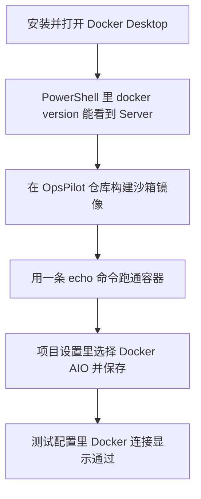

# Docker 沙箱启用操作手册

这份手册给没有用过 Docker 的人。按顺序做，做完后你能确认两件事：本机的 Docker 已经能启动，OpsPilot 的沙箱配置页也能连上它。

当前这台电脑上，PowerShell 不认识 `docker` 这个命令，说明 Docker 还没有安装。先从第 1 步安装 Docker Desktop。



## 做完以后实际发生的事

页面里的「Docker 连接」通过，只说明本机 Docker 引擎可用，沙箱镜像也能自己跑起来。

OpsPilot 生成代码和自动测试时，仍然使用后端本机的临时目录，不会按页面上的内存、CPU、磁盘和网络白名单去启动容器。这些限制会保存下来，测试结果里会写明「当前执行未按该限制约束进程」。

不要用 `docker compose up` 把 `docker/docker-compose.yml` 整份拉起来。那份文件还会启动数据库和向量库，并且挂载的目录和现在本机运行的后端不一致，会干扰正在使用的 http://127.0.0.1:8000 和 http://127.0.0.1:5173 。

## 1. 安装 Docker Desktop

1. 用浏览器打开 https://docs.docker.com/desktop/setup/install/windows-install/ ，下载 **Docker Desktop for Windows**。
2. 双击安装包。安装选项里保持勾选 **Use WSL 2 instead of Hyper-V**。
3. 安装结束如果要求重启电脑，先重启。
4. 从开始菜单打开 **Docker Desktop**。第一次会问是否接受协议，接受即可。登录账号可以跳过，本地使用不需要登录。
5. 看窗口左下角。等到出现 **Engine running**，再进行下一步。左下角如果一直是 Starting，就再等一两分钟。

如果安装程序提示虚拟化没有打开：重启电脑，开机时进入 BIOS，打开 CPU 的虚拟化（Intel 叫 VT-x，AMD 叫 SVM），保存后再继续安装。

## 2. 确认引擎已经起来

1. 在开始菜单搜索 **PowerShell**，打开它。
2. 输入下面这一行，然后按回车：

```powershell
docker version
```

3. 输出里要同时有 **Client** 和 **Server** 两段。只有 Client、没有 Server，或者命令一直不返回，回到 Docker Desktop 窗口，确认已经是 Engine running，然后再执行一次。

## 3. 构建 OpsPilot 沙箱镜像

镜像是一个单独的执行环境，里面有 Python 3.11。构建要下载基础镜像，第一次可能要十几分钟。

在 PowerShell 里执行：

```powershell
cd d:\workspace\OpsPilot
docker build -f docker/sandbox/Dockerfile -t opspilot-sandbox .
```

最后一行出现 `Successfully tagged opspilot-sandbox:latest` 才算完成。中途如果出现网络超时，把同一条命令再执行一次，Docker 会接着用已经下载的部分。

## 4. 亲手跑通一次容器

```powershell
docker run --rm opspilot-sandbox echo Hello from Sandbox
```

成功时能看到类似下面的输出：

```text
Sandbox starting in development mode
Executing command: echo Hello from Sandbox
Hello from Sandbox
Sandbox execution completed
```

这条命令后面的 `echo Hello from Sandbox` 不能省略。不带命令时，沙箱入口会认为没有任务并退出。

## 5. 在 OpsPilot 页面里启用 Docker AIO

保持现在的后端 http://127.0.0.1:8000 和前端 http://127.0.0.1:5173 继续运行，不用把它们放进 Docker。

1. 浏览器打开 http://127.0.0.1:5173 ，用 `admin` / `admin123` 登录。
2. 进入 **项目管理**，打开项目 **OpsPilot**。
3. 打开 **项目设置**，点 **Sandbox 配置**。
4. 执行环境选择 **Docker AIO**。
5. 基础镜像保持 `python:3.11-slim`。这是页面上记录的期望镜像名。第 3 步构建出来的镜像名是 `opspilot-sandbox`，页面目前不会用这个下拉框去自动拉取或创建容器。
6. 内存、CPU、超时、磁盘、网络策略按需要点选。当前项目已保存的值是内存 512MB、CPU 1 核、超时 300 秒、网络禁用。
7. 点 **保存配置**。页面出现「已保存」。
8. 点 **测试配置**。

## 6. 怎么判断这一步成功

测试结果窗口里：

| 测试项 | 成功时 |
| --- | --- |
| 本机 Python | 通过，并显示 Python 版本 |
| Docker 连接 | 通过，并显示 Docker 引擎版本 |
| 资源限制 | 未通过。配置已保存，执行时还没有按内存和 CPU 限制进程 |
| 网络策略 | 未通过。配置已保存，执行时还没有强制网络策略 |

Docker 连接这一行显示通过，这次启用就做完了。

如果 Docker 连接是「未找到 docker」或「本机没有可用的 Docker」，回到第 2 步，确认 PowerShell 里的 `docker version` 能看到 Server。
