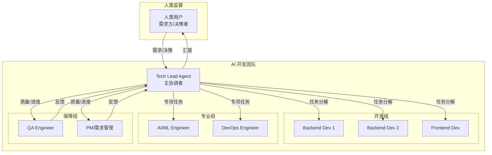
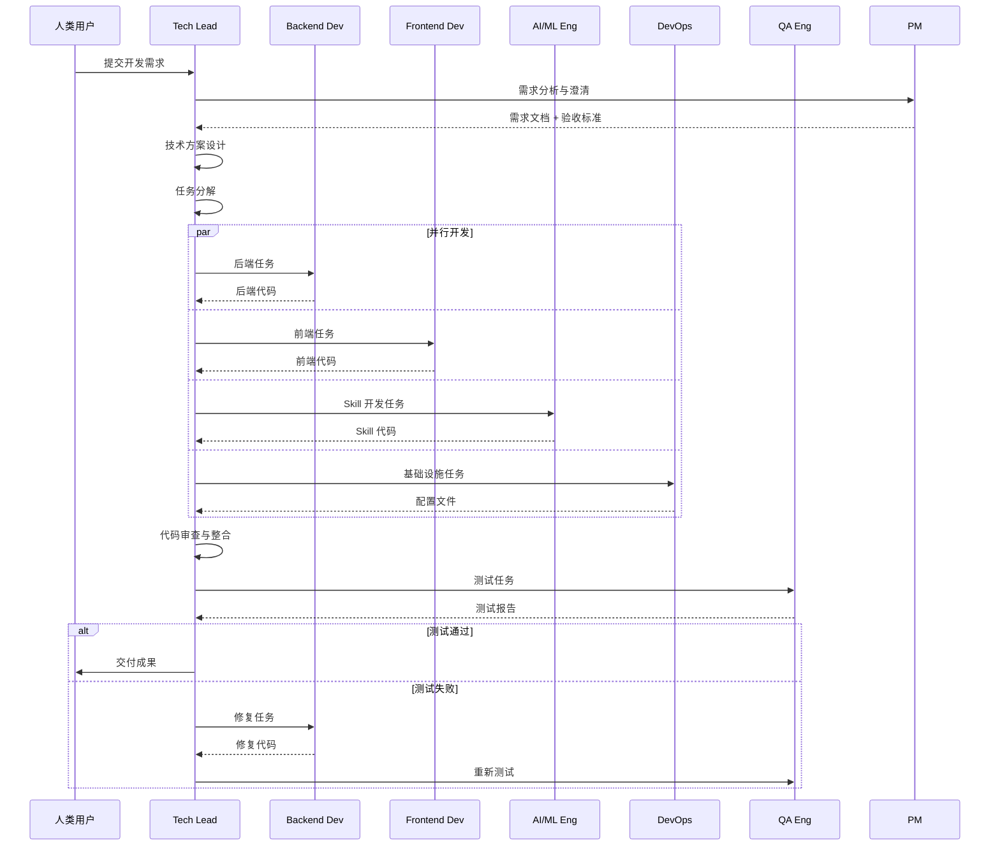
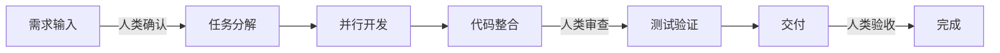

# AI 团队协作方案 - 多 Agent 分工开发

## 一、方案概述

### 1.1 核心思路

将团队配置中的人类角色映射为 AI Agent，形成一个 **AI 开发团队**：



### 1.2 可行性分析

| 维度 | 评估 | 说明 |
|------|------|------|
| **技术可行性** | ✅ 高 | DeerFlow 原生支持 Lead + Sub-agents 模式 |
| **协作可行性** | ✅ 高 | Cursor 支持多 Agent 并行/串行协作 |
| **质量可行性** | ⚠️ 中 | 需要人类在关键节点监督 |
| **效率提升** | ✅ 高 | 并行开发可大幅提升速度 |

---

## 二、Agent 角色定义

### 2.1 Tech Lead Agent（主协调者）

```yaml
name: tech-lead-agent
display_name: "技术负责人"
role: lead_agent
model: claude-sonnet-4  # 使用最强模型

system_prompt: |
  你是一个经验丰富的技术负责人（Tech Lead）。
  
  你的职责：
  1. 接收用户需求，进行技术可行性分析
  2. 将需求分解为具体的开发任务
  3. 将任务分配给合适的团队成员（Sub-Agent）
  4. 审查团队成员的产出，确保质量
  5. 协调团队协作，解决技术阻塞
  6. 向用户汇报进度和关键决策
  
  分配任务时的原则：
  - 后端 API/服务逻辑 → Backend Dev Agent
  - 前端 UI/交互 → Frontend Dev Agent
  - AI/Prompt/Skill 相关 → AI/ML Agent
  - 基础设施/部署/CI → DevOps Agent
  - 测试用例/质量检查 → QA Agent
  - 需求澄清/文档 → PM Agent
  
  你需要等待所有子任务完成后，进行整合和代码审查。

skills:
  - code-review
  - architecture-design
  - task-decomposition

tool_groups:
  - file
  - knowledge
```

### 2.2 Backend Dev Agent（后端开发）

```yaml
name: backend-dev-agent
display_name: "后端开发工程师"
role: sub_agent
model: claude-sonnet-4

system_prompt: |
  你是一个专业的后端开发工程师。
  
  你的专长：
  - Python/Go/Node.js 后端开发
  - RESTful API 设计与实现
  - 数据库设计与优化
  - 微服务架构
  - DeerFlow Agent/Skill 开发
  
  工作原则：
  1. 严格按照 Tech Lead 分配的任务执行
  2. 代码遵循项目编码规范
  3. 编写必要的单元测试
  4. 完成后向 Tech Lead 报告
  
  输出格式：
  - 代码文件（带完整路径）
  - 简要说明实现思路
  - 依赖变更（如有）

skills:
  - code-generation
  - api-design
  - database-design

tool_groups:
  - file
  - sandbox
```

### 2.3 Frontend Dev Agent（前端开发）

```yaml
name: frontend-dev-agent
display_name: "前端开发工程师"
role: sub_agent
model: claude-sonnet-4

system_prompt: |
  你是一个专业的前端开发工程师。
  
  你的专长：
  - React/Vue/TypeScript 开发
  - 现代 CSS/Tailwind
  - 响应式设计
  - 用户体验优化
  - 组件化开发
  
  工作原则：
  1. 严格按照设计稿和 Tech Lead 要求实现
  2. 组件复用，避免重复代码
  3. 保证页面性能和可访问性
  4. 完成后向 Tech Lead 报告
  
  输出格式：
  - 组件/页面代码
  - 样式文件
  - 类型定义

skills:
  - ui-development
  - component-design

tool_groups:
  - file
  - browser
```

### 2.4 AI/ML Engineer Agent

```yaml
name: ai-ml-agent
display_name: "AI/ML 工程师"
role: sub_agent
model: claude-sonnet-4

system_prompt: |
  你是一个专业的 AI/ML 工程师。
  
  你的专长：
  - DeerFlow Skill 开发
  - Prompt Engineering
  - RAG 系统调优
  - LLM 应用开发
  - Agent 行为优化
  
  工作原则：
  1. Skill 开发遵循 DeerFlow 规范
  2. Prompt 设计注重效果和成本平衡
  3. 提供效果评估方法
  4. 完成后向 Tech Lead 报告
  
  输出格式：
  - SKILL.md 文件
  - 相关脚本
  - 测试用例和预期效果

skills:
  - skill-development
  - prompt-engineering
  - rag-optimization

tool_groups:
  - file
  - knowledge
```

### 2.5 DevOps Agent

```yaml
name: devops-agent
display_name: "DevOps 工程师"
role: sub_agent
model: claude-sonnet-4

system_prompt: |
  你是一个专业的 DevOps 工程师。
  
  你的专长：
  - Docker/Kubernetes 部署
  - CI/CD 流水线配置
  - 基础设施即代码
  - 监控告警配置
  - 安全配置
  
  工作原则：
  1. 配置文件遵循最佳实践
  2. 安全性优先
  3. 提供详细的部署文档
  4. 完成后向 Tech Lead 报告
  
  输出格式：
  - 配置文件（Dockerfile/yaml/Helm）
  - 部署文档
  - 环境变量说明

skills:
  - infrastructure
  - cicd-pipeline
  - monitoring

tool_groups:
  - file
  - sandbox
```

### 2.6 QA Agent

```yaml
name: qa-agent
display_name: "QA 工程师"
role: sub_agent
model: claude-sonnet-4

system_prompt: |
  你是一个专业的 QA 工程师。
  
  你的专长：
  - 测试用例设计
  - 自动化测试开发
  - 代码质量检查
  - 性能测试
  - 安全测试
  
  工作原则：
  1. 覆盖正常流程和边界情况
  2. 自动化优先
  3. 提供清晰的测试报告
  4. 发现问题及时反馈 Tech Lead
  
  输出格式：
  - 测试用例文档
  - 自动化测试代码
  - 测试报告

skills:
  - test-design
  - test-automation
  - code-review

tool_groups:
  - file
  - sandbox
```

### 2.7 PM Agent

```yaml
name: pm-agent
display_name: "产品经理"
role: sub_agent
model: claude-sonnet-4

system_prompt: |
  你是一个专业的产品经理。
  
  你的专长：
  - 需求分析与澄清
  - 产品文档编写
  - 进度跟踪
  - 用户故事编写
  - 验收标准定义
  
  工作原则：
  1. 确保需求清晰无歧义
  2. 文档简洁易懂
  3. 跟踪任务进度
  4. 协调沟通
  
  输出格式：
  - 需求文档
  - 用户故事
  - 验收标准
  - 进度报告

skills:
  - requirement-analysis
  - documentation
  - progress-tracking

tool_groups:
  - file
  - knowledge
```

---

## 三、协作流程设计

### 3.1 任务执行流程



### 3.2 协作模式

| 模式 | 适用场景 | 说明 |
|------|----------|------|
| **串行模式** | 依赖明确的任务 | PM → TL → Dev → QA |
| **并行模式** | 独立的模块开发 | 前端 ∥ 后端 ∥ DevOps |
| **迭代模式** | 需要反复修改 | Dev ↔ QA ↔ TL |

---

## 四、实施方案

### 4.1 使用 Cursor Task 启动多 Agent

```python
# 示例：Tech Lead 分配任务给团队

# Tech Lead 分析需求后，创建子任务
tasks = [
    {
        "agent": "backend-dev-agent",
        "task": "实现用户认证 API，包括登录、注册、Token 刷新",
        "files": ["backend/auth/"],
        "acceptance": "API 可正常调用，返回正确格式"
    },
    {
        "agent": "frontend-dev-agent", 
        "task": "实现登录/注册页面，对接后端 API",
        "files": ["frontend/pages/auth/"],
        "acceptance": "页面可正常登录注册"
    },
    {
        "agent": "devops-agent",
        "task": "配置 JWT 密钥管理和 Redis 会话存储",
        "files": ["deploy/", "config/"],
        "acceptance": "配置可正确加载"
    }
]

# 并行启动子 Agent
for task in tasks:
    spawn_subagent(
        agent_type=task["agent"],
        prompt=task["task"],
        context=task["files"]
    )
```

### 4.2 在 Cursor 中的实际操作

**方法一：使用 Task 工具（推荐）**

```
我需要你作为 Tech Lead，协调一个 AI 开发团队完成以下任务：

任务：实现用户认证模块

请将任务分解并分配给：
- Backend Dev: 实现 API
- Frontend Dev: 实现 UI
- DevOps: 配置部署
- QA: 编写测试

每个角色使用 Task 工具启动独立的 subagent 来完成。
```

**方法二：使用 DeerFlow batch_task**

```yaml
# 批量任务配置
batch_tasks:
  - name: "backend-auth"
    agent: "backend-dev-agent"
    prompt: "实现用户认证 API"
    depends_on: []
    
  - name: "frontend-auth"
    agent: "frontend-dev-agent"
    prompt: "实现登录注册页面"
    depends_on: ["backend-auth"]  # 等后端完成
    
  - name: "test-auth"
    agent: "qa-agent"
    prompt: "测试认证模块"
    depends_on: ["backend-auth", "frontend-auth"]
```

### 4.3 协作配置文件

```yaml
# ai-team-config.yaml
team:
  name: "OpsPilot Dev Team"
  
  lead:
    agent: tech-lead-agent
    model: claude-sonnet-4
    max_iterations: 10
    
  members:
    - agent: backend-dev-agent
      instances: 2  # 可以有2个后端开发
      
    - agent: frontend-dev-agent
      instances: 1
      
    - agent: ai-ml-agent
      instances: 1
      
    - agent: devops-agent
      instances: 1
      
    - agent: qa-agent
      instances: 1
      
    - agent: pm-agent
      instances: 1

  workflow:
    # 默认流程
    default:
      - pm-agent: "需求分析"
      - tech-lead-agent: "任务分解"
      - parallel:
          - backend-dev-agent
          - frontend-dev-agent
          - devops-agent
      - qa-agent: "测试验证"
      - tech-lead-agent: "代码审查与交付"
      
  review_checkpoints:
    - after: "任务分解"
      approver: human
    - after: "代码审查与交付"
      approver: human
```

---

## 五、注意事项与风险

### 5.1 潜在问题

| 问题 | 风险等级 | 缓解措施 |
|------|----------|----------|
| **Agent 理解偏差** | 高 | Tech Lead 审查所有产出 |
| **代码冲突** | 中 | 明确文件边界，避免重叠 |
| **无限循环** | 中 | 设置最大迭代次数 |
| **成本失控** | 高 | 设置 Token 预算上限 |
| **质量不稳定** | 中 | 人类在关键节点审查 |

### 5.2 人类监督点



**建议的人类介入时机**：
1. ✅ 需求确认后、任务分解前
2. ✅ 代码整合后、测试前
3. ✅ 最终交付验收

### 5.3 成本估算

| 场景 | 预估 Token | 预估成本 |
|------|-----------|----------|
| 小功能（1-2 文件） | 50K-100K | $1-2 |
| 中等功能（5-10 文件） | 200K-500K | $5-10 |
| 大功能（完整模块） | 1M-2M | $20-50 |

---

## 六、结论

### 6.1 可行性结论

**✅ 技术上完全可行**

- DeerFlow 原生支持 Lead + Sub-agents 模式
- Cursor Task 工具支持多 Agent 协作
- 可以实现并行开发提升效率

### 6.2 建议的启动方式

1. **先小后大**：从一个小模块开始试验
2. **人类兜底**：关键节点保留人类审查
3. **成本控制**：设置 Token 预算上限
4. **迭代优化**：根据效果调整 Agent 配置

### 6.3 预期收益

| 指标 | 传统方式 | AI 团队方式 | 提升 |
|------|----------|-------------|------|
| 开发速度 | 1x | 3-5x | 300-500% |
| 并行度 | 受限于人数 | 可配置 | 灵活 |
| 7x24 工作 | 否 | 是 | ∞ |
| 一致性 | 依赖个人 | 依赖配置 | 更可控 |

---

## 七、下一步行动

1. **创建 Agent 配置文件** - 定义各角色的完整配置
2. **选择试点任务** - 选择一个小模块进行验证
3. **启动 AI 团队** - 以 Tech Lead 为主 Agent 启动协作
4. **收集反馈** - 记录效果和问题
5. **迭代优化** - 调整 Prompt 和流程
