# 运维 Agent 生产系统 - 产品开发计划

## 一、功能依赖关系分析

### 1.1 模块依赖图

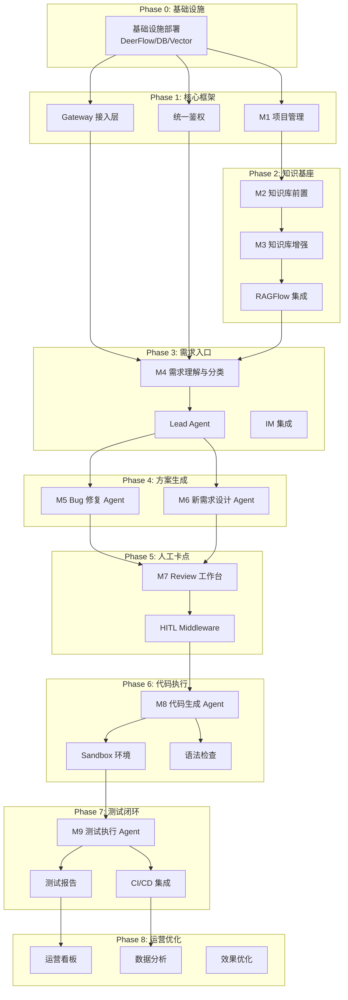

### 1.2 关键依赖说明

| 模块 | 前置依赖 | 被依赖于 |
|------|----------|----------|
| **基础设施** | 无 | 所有模块 |
| **M1 项目管理** | 基础设施 | M2, M4, 所有 Agent |
| **M2 知识库前置** | M1 | M3 |
| **M3 知识库增强** | M2 | M4, M5, M6 |
| **M4 需求分类** | M1, M3, Gateway | M5, M6 |
| **M5 Bug 修复** | M4, M3 | M7 |
| **M6 新需求设计** | M4, M3 | M7 |
| **M7 Review 工作台** | M5, M6 | M8 |
| **M8 代码生成** | M7, Sandbox | M9 |
| **M9 测试执行** | M8, Sandbox | 知识反馈 |

---

## 二、开发阶段规划

### Phase 0: 基础设施搭建

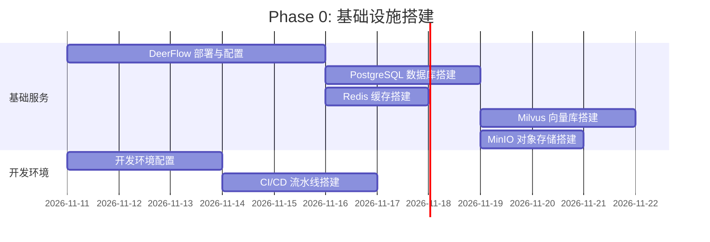

**交付物**:
- [x] DeerFlow Gateway 运行
- [x] 数据库/缓存/向量库就绪
- [x] 开发/测试环境可用
- [x] CI/CD 流水线就绪

**验收标准**:
- `make up` 一键启动所有服务
- `make dev` 进入开发模式
- 健康检查接口返回 200

---

### Phase 1: 核心框架与项目管理

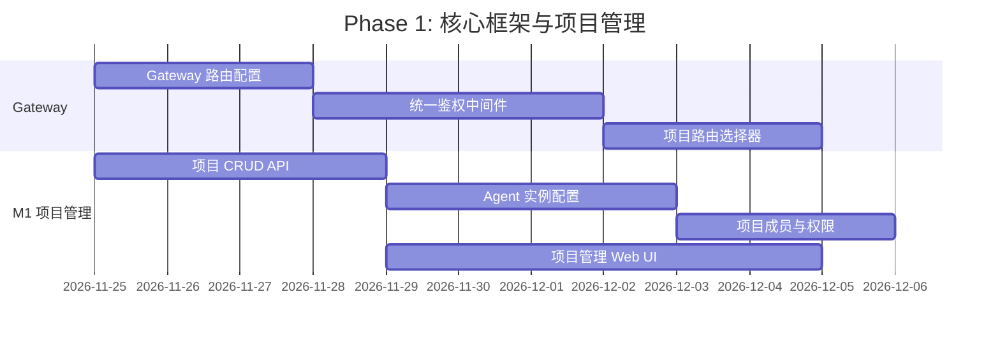

**交付物**:
- [x] 项目创建/编辑/删除 API
- [x] Agent 实例配置功能
- [x] 项目权限管理
- [x] 项目管理 Web UI

**验收标准**:
- 可创建项目并配置 Agent 参数
- 支持多项目切换
- 项目间数据隔离

---

### Phase 2: 知识库基座

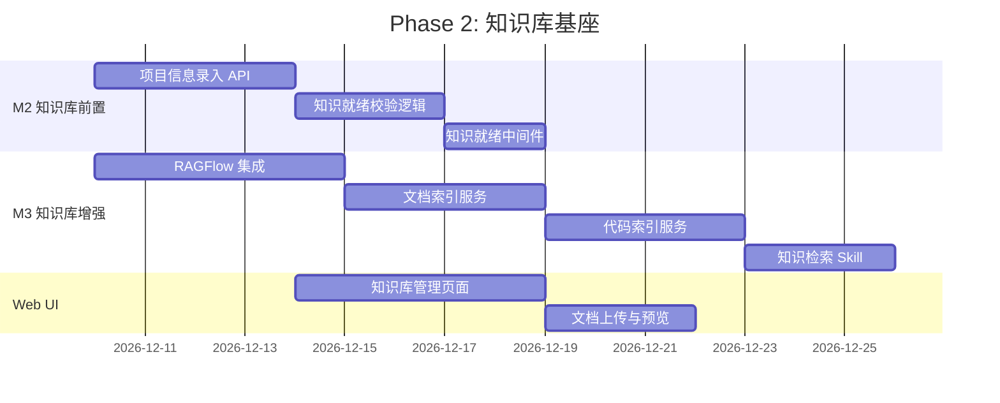

**交付物**:
- [x] 项目信息录入（概述、架构、配置等）
- [x] RAGFlow 集成完成
- [x] 文档/代码索引服务
- [x] `knowledge-search` Skill
- [x] 知识库管理 Web UI

**验收标准**:
- 上传文档后可被语义检索
- 代码仓库可被索引和检索
- 知识就绪校验阻止未准备项目进入流程

---

### Phase 3: 需求入口与分类

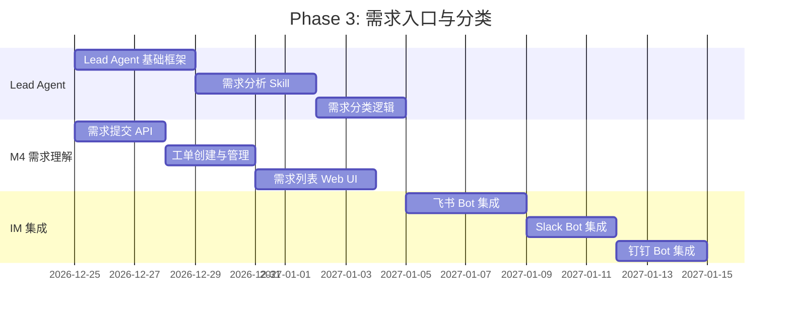

**交付物**:
- [x] Lead Agent 核心框架
- [x] `demand-analysis` Skill
- [x] 需求提交 API
- [x] 工单管理系统
- [x] IM Bot 集成（飞书/Slack/钉钉）

**验收标准**:
- 通过 Web/IM 提交需求
- 自动分类为 Bug 或新需求
- 创建工单并关联项目

---

### Phase 4: 方案生成 Agents

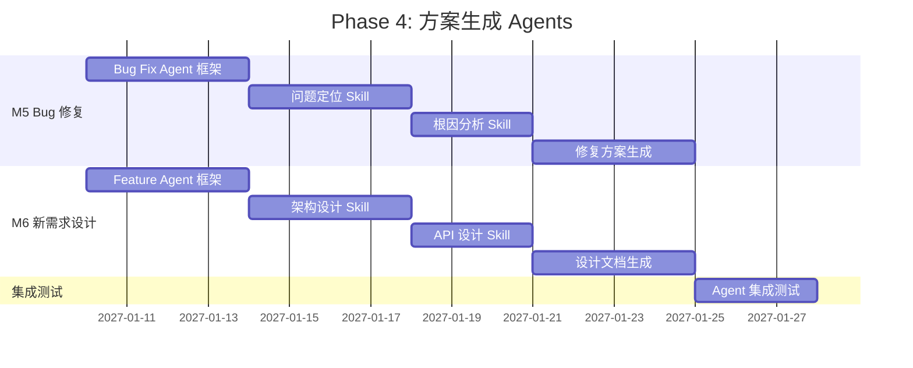

**交付物**:
- [x] Bug Fix Sub-Agent
- [x] Feature Design Sub-Agent
- [x] 问题定位/根因分析 Skills
- [x] 架构设计/API 设计 Skills
- [x] 结构化方案输出

**验收标准**:
- Bug 工单自动生成修复方案
- 新需求工单自动生成设计文档
- 方案包含影响范围评估

---

### Phase 5: 人工 Review 工作台

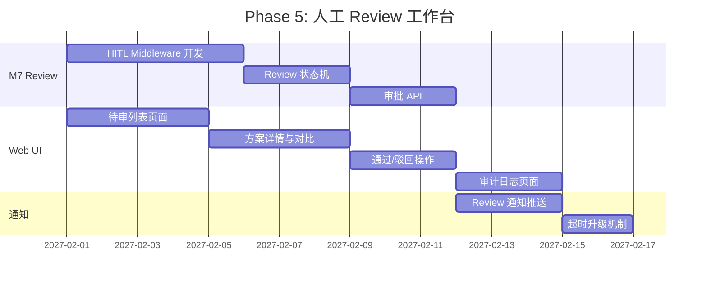

**交付物**:
- [x] HITL Middleware
- [x] Review 状态管理
- [x] 待审列表 Web UI
- [x] 通过/驳回/评论功能
- [x] 审计日志
- [x] 通知与超时升级

**验收标准**:
- 方案生成后进入待审状态
- 支持多级 Review（方案→代码）
- 驳回后自动回退重新生成
- 所有操作有审计记录

---

### Phase 6: 代码生成与执行

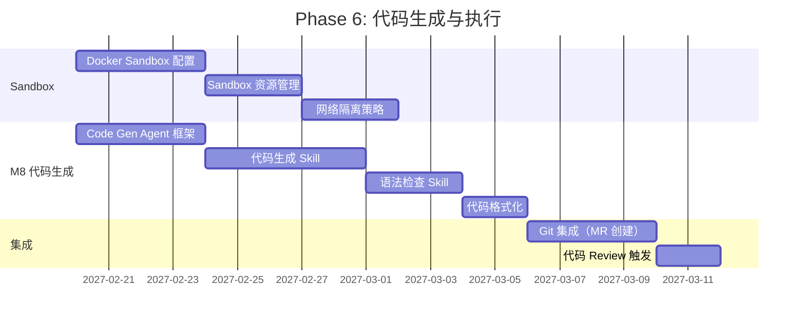

**交付物**:
- [x] Docker AIO Sandbox
- [x] Code Generation Sub-Agent
- [x] `code-generation` Skill
- [x] `linter-check` Skill
- [x] Git MR 自动创建

**验收标准**:
- 在隔离 Sandbox 中生成代码
- 自动语法检查并修复
- 生成代码 diff 预览
- 自动创建 Git MR

---

### Phase 7: 测试执行与闭环

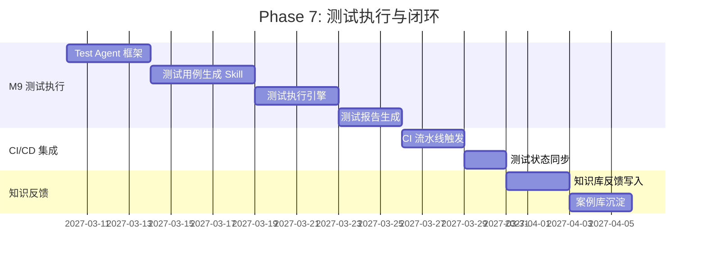

**交付物**:
- [x] Test Execution Sub-Agent
- [x] `test-generation` Skill
- [x] `test-execution` Skill
- [x] 测试报告生成
- [x] CI/CD 集成
- [x] 知识反馈写入

**验收标准**:
- 自动生成测试用例
- 在 Sandbox 中执行测试
- 生成测试报告（通过率、覆盖率）
- 完成后自动沉淀知识

---

### Phase 8: 运营优化

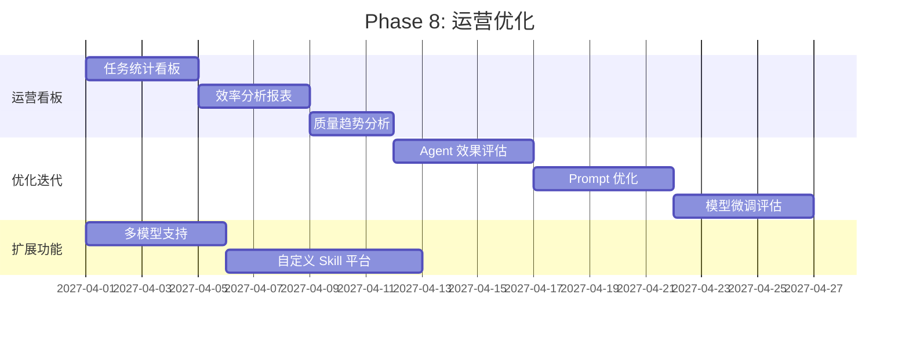

**交付物**:
- [x] 运营数据看板
- [x] 效率/质量分析报表
- [x] Agent 效果评估体系
- [x] 多模型支持
- [x] 自定义 Skill 平台

**验收标准**:
- 可视化任务处理统计
- 可追踪效率提升数据
- 支持切换不同 LLM 模型

---

## 三、里程碑总览

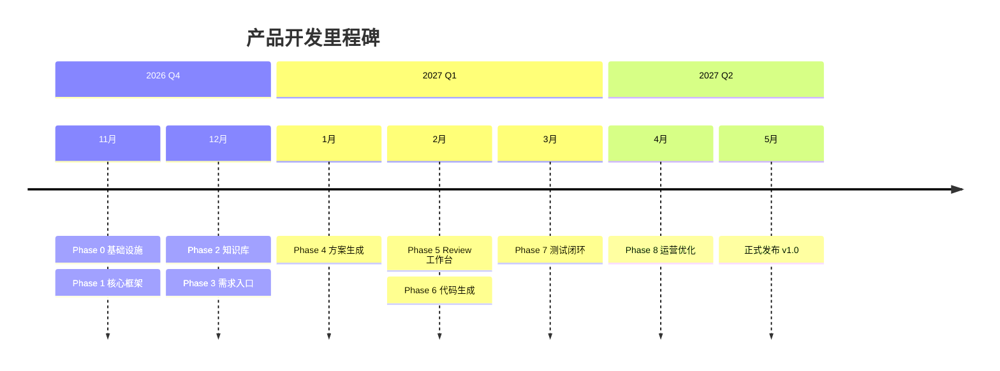

### 里程碑定义

| 里程碑 | 目标日期 | 关键交付 | 验收标准 |
|--------|----------|----------|----------|
| **M0: 环境就绪** | 2026-11-24 | 基础设施部署完成 | 所有服务健康运行 |
| **M1: 框架可用** | 2026-12-09 | 项目管理 + Gateway | 可创建项目并配置 |
| **M2: 知识就绪** | 2026-12-24 | 知识库完整功能 | 文档/代码可检索 |
| **M3: 需求可入** | 2027-01-09 | Lead Agent + 分类 | 需求自动分类 |
| **M4: 方案可出** | 2027-01-31 | Bug/Feature Agent | 自动生成方案 |
| **M5: 流程闭环** | 2027-02-28 | Review + 代码生成 | 端到端流程可用 |
| **M6: MVP 完成** | 2027-03-31 | 测试执行 + 知识反馈 | 完整闭环可用 |
| **M7: GA 发布** | 2027-05-15 | 运营优化 + 稳定性 | 生产环境就绪 |

---

## 四、资源需求估算

### 4.1 团队配置建议

| 角色 | 人数 | 主要职责 |
|------|------|----------|
| **Tech Lead** | 1 | 架构设计、技术决策、代码审查 |
| **后端开发** | 2-3 | Agent 开发、API、Middleware |
| **前端开发** | 1-2 | Web UI、工作台 |
| **AI/ML 工程师** | 1 | Skill 开发、Prompt 优化、RAG 调优 |
| **DevOps** | 1 | 基础设施、CI/CD、监控 |
| **QA** | 1 | 测试、质量保障 |
| **PM** | 1 | 产品管理、需求协调 |

### 4.2 基础设施资源

| 资源 | 开发环境 | 生产环境 |
|------|----------|----------|
| **计算** | 8C16G * 2 | 16C32G * 3 (Gateway) |
| **数据库** | PostgreSQL 单节点 | PostgreSQL HA |
| **向量库** | Milvus 单节点 | Milvus 集群 |
| **缓存** | Redis 单节点 | Redis Cluster |
| **存储** | 100GB | 1TB+ |
| **LLM API** | 测试额度 | 生产额度 |

---

## 五、风险与缓解

| 风险 | 影响 | 概率 | 缓解措施 |
|------|------|------|----------|
| DeerFlow 框架限制 | 功能受限 | 中 | 提前评估，必要时 fork 定制 |
| LLM 效果不稳定 | 方案质量波动 | 高 | 多模型备选，人工 Review 兜底 |
| RAG 检索精度低 | 上下文不准确 | 中 | 调优 embedding，混合检索 |
| Sandbox 安全风险 | 代码逃逸 | 低 | 严格网络隔离，资源限制 |
| 人工 Review 瓶颈 | 流程堵塞 | 中 | 超时升级，批量审批 |

---

## 六、成功指标

### 6.1 效率指标

| 指标 | 基线 | 目标 |
|------|------|------|
| Bug 修复时间 | 4h（人工） | 1h（含 Review） |
| 需求设计时间 | 8h（人工） | 2h（含 Review） |
| 代码编写时间 | 2h（人工） | 30min |
| 测试覆盖率 | 60% | 80%+ |

### 6.2 质量指标

| 指标 | 目标 |
|------|------|
| 方案一次通过率 | > 70% |
| 代码语法检查通过率 | > 95% |
| 测试一次通过率 | > 80% |
| 生产缺陷率 | < 5% |

### 6.3 运营指标

| 指标 | 目标 |
|------|------|
| 日活跃项目数 | > 10 |
| 月处理任务数 | > 500 |
| 用户满意度 | > 4.0/5.0 |
