# OpsPilot 运维领航 - 产品功能展示

## 产品概述

**OpsPilot 运维领航**是一款基于 DeerFlow 2.0 架构的智能运维 Agent 生产系统，通过 AI 驱动的自动化流程，帮助团队高效处理日常运维需求，包括 Bug 修复、需求分析、代码生成和测试执行。

### 核心特性

- 🤖 **Lead Agent + Sub-Agents** 编排模式
- 💬 **对话式交互**：自然语言提交需求
- 📚 **知识库检索**：RAG 增强的上下文理解
- ⏸️ **HITL 人工卡点**：关键环节人工审批
- 📊 **实时监控**：Agent 执行状态可视化
- 🔧 **Skills 可扩展**：灵活的技能配置

---

## 业务流程概览

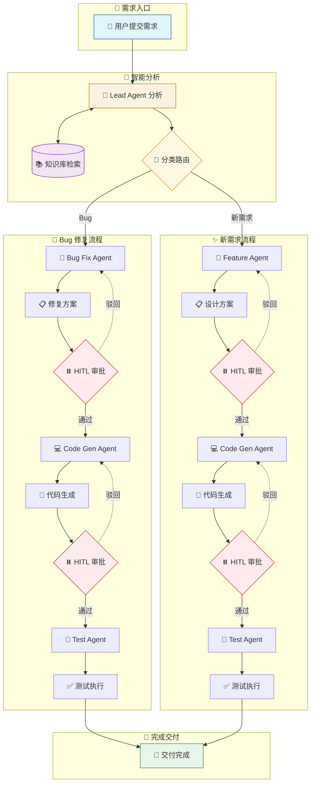

---

## 功能模块展示

### 1. 统一登录

用户通过统一登录页面进入系统，支持单点登录（SSO）集成。

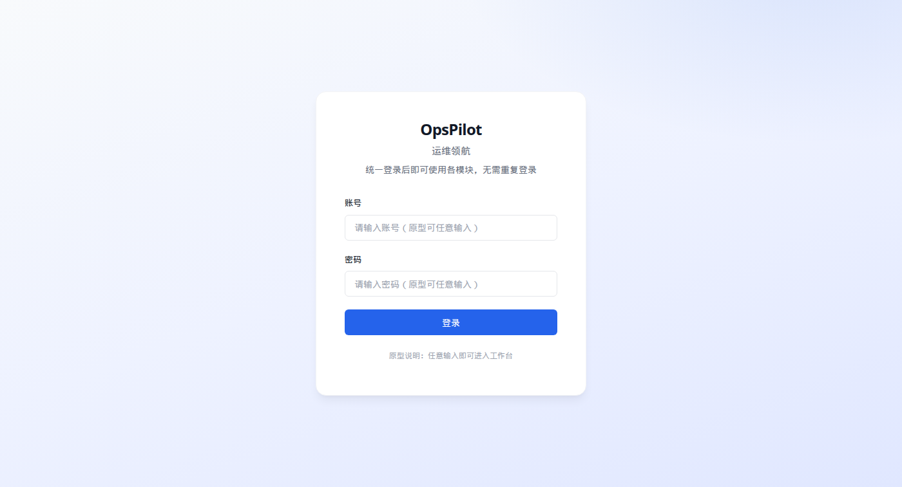

**功能要点**：
- 简洁的登录界面设计
- 支持企业账号集成
- 项目/角色权限控制

---

### 2. 工作台首页

登录后进入统一工作台，包含两个核心视图。

#### 2.1 整体业务流程

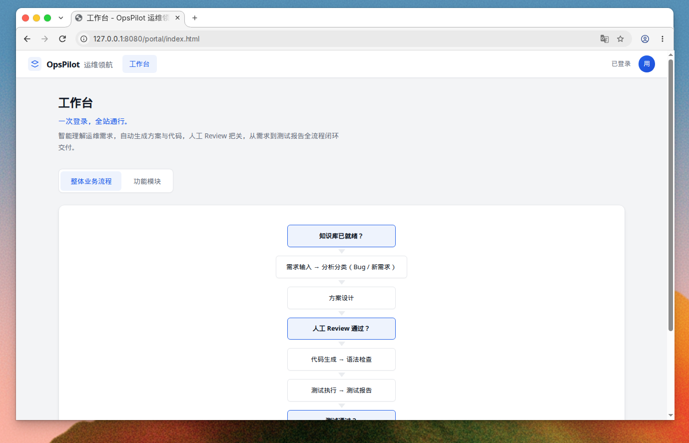

**功能要点**：
- 业务流程可视化展示
- 从需求到交付的完整闭环
- 关键决策节点标识（知识库就绪、Review 通过、测试通过）

#### 2.2 功能模块导航

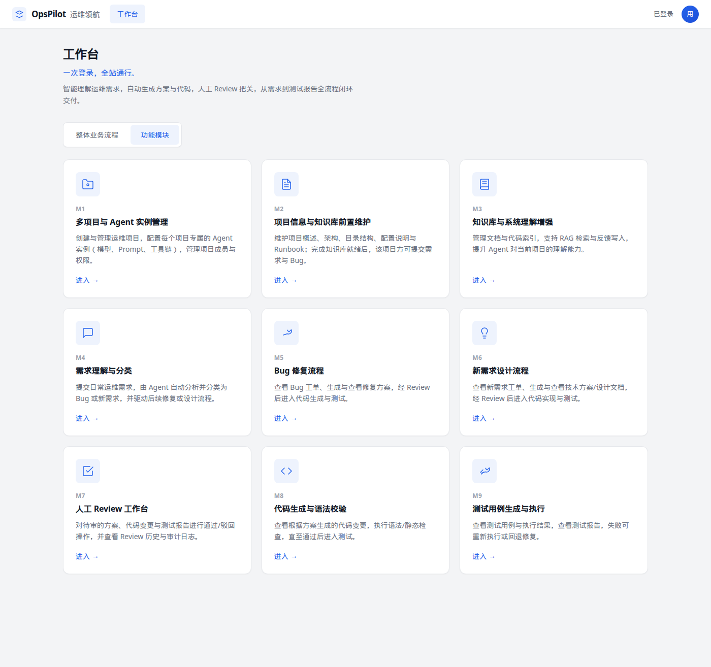

**9 大功能模块与 DeerFlow 组件映射**：

| 模块 | 名称 | 说明 | DeerFlow 组件 |
|------|------|------|--------------|
| **M1** | 多项目与 Agent 实例管理 | 创建运维项目，配置 Agent 实例（模型、Prompt、工具链），管理成员权限 | Projects + Agent Registry |
| **M2** | 项目信息与知识库前置维护 | 维护项目概述、架构、目录结构、配置说明与 Runbook | Project Instructions + Document Shelf |
| **M3** | 知识库与系统理解增强 | 管理文档与代码索引，支持 RAG 检索，提升 Agent 理解能力 | RAGFlow + DeerMem |
| **M4** | 需求理解与分类 | 提交运维需求，Agent 自动分析并分类为 Bug 或新需求 | Lead Agent + Demand Analysis Skill |
| **M5** | Bug 修复流程 | 查看 Bug 工单、生成修复方案，经 Review 后进入代码生成 | Bug Fix Sub-Agent |
| **M6** | 新需求设计流程 | 查看新需求工单、生成技术方案，经 Review 后进入代码实现 | Feature Design Sub-Agent |
| **M7** | 人工 Review 工作台 | 对方案、代码、测试报告进行通过/驳回，查看审计日志 | HITL Middleware + Approval Cards |
| **M8** | 代码生成与语法校验 | 查看生成的代码变更，执行语法/静态检查 | Code Gen Sub-Agent + Sandbox |
| **M9** | 测试用例生成与执行 | 查看测试用例与执行结果，失败可重新执行或回退 | Test Sub-Agent + Sandbox |

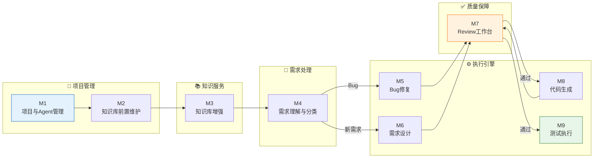

---

### 3. 对话式需求入口

**DeerFlow 核心特性**：通过自然语言对话提交运维需求，替代传统表单。

#### 3.1 新会话欢迎页

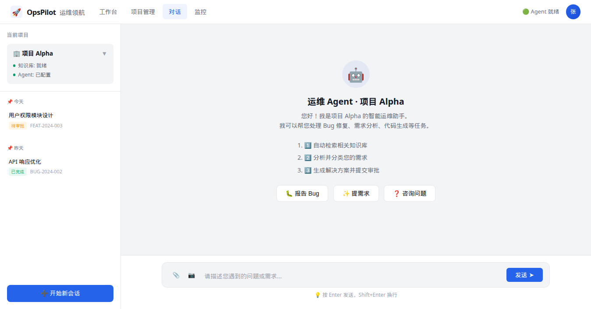

**功能要点**：
- 智能助手欢迎引导
- 快捷操作入口（报告 Bug / 提需求 / 咨询）
- 历史会话记录侧栏

#### 3.2 对话交互界面

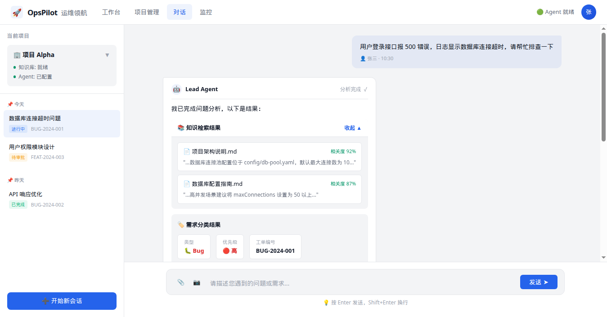

**功能要点**：
- 自然语言输入需求描述
- **知识检索卡片**：实时展示 RAG 检索结果
- **分类结果卡片**：自动识别 Bug/需求类型
- **Agent 执行进度**：实时展示子 Agent 工作状态
- 支持附件上传（日志、截图）

#### 3.3 HITL 审批卡片

**功能要点**：
- **内嵌审批卡片**：方案审批直接在对话流中完成
- 根因分析展示
- 修复建议详情
- 涉及文件列表
- **超时升级机制**：24 小时超时自动通知管理员
- 一键通过/驳回操作

---

### 4. Agent 执行监控

实时监控所有 Agent 任务的执行状态。

#### 4.1 监控主页

**功能要点**：
- **统计概览**：执行中 / 等待审批 / 今日完成 / 失败
- **任务卡片**：展示每个任务的执行进度
- 执行阶段进度条
- 资源消耗统计（Tokens / API 调用 / 知识引用）
- 操作按钮（暂停 / 终止 / 查看日志）

#### 4.2 任务详情页

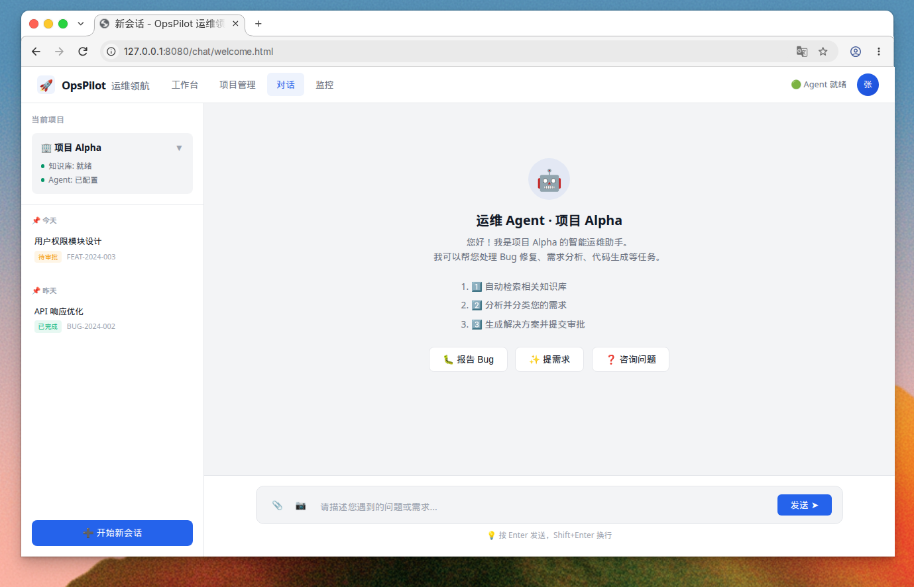

**功能要点**：
- **执行流程图**：可视化展示 Agent 编排流程
- 节点状态（完成 / 执行中 / 等待）
- HITL 卡点标识
- **实时日志**：终端风格的执行日志流
- **资源消耗**：Token 消耗、成本预估

---

### 5. Skills 配置

配置项目可用的技能模块。

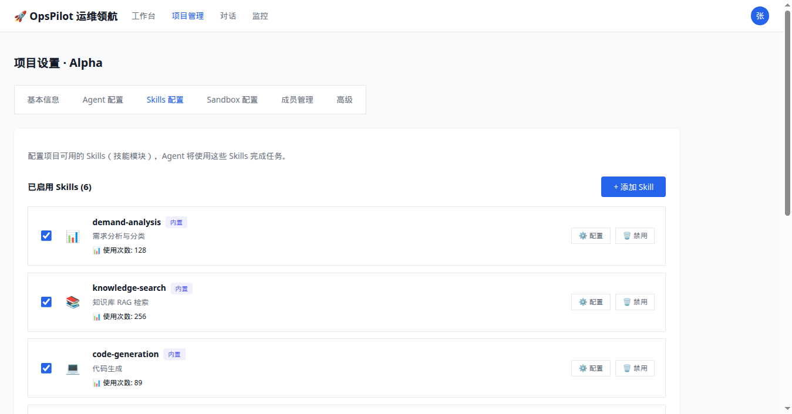

**功能要点**：
- **内置 Skills**：需求分析、知识检索、代码生成、测试执行等
- **自定义 Skills**：支持 Webhook / Python 脚本扩展
- Skills 启用/禁用管理
- 使用次数统计
- 技能配置详情

---

### 6. Sandbox 配置

配置代码执行的隔离环境。

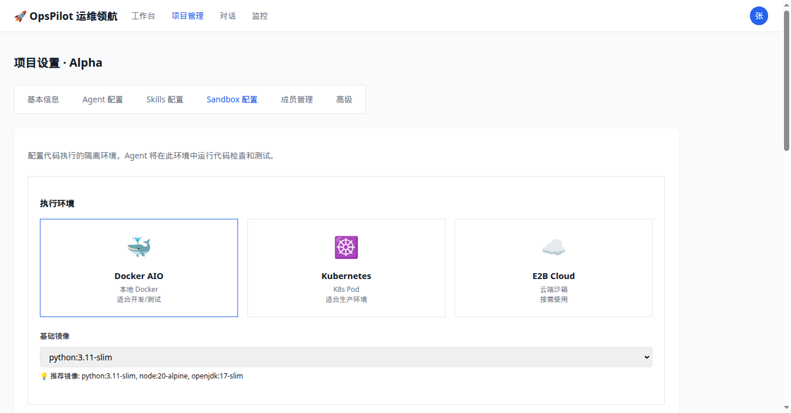

**功能要点**：
- **环境类型选择**：Docker AIO / Kubernetes / E2B Cloud
- **资源限制**：内存、CPU、超时时间、磁盘空间
- **网络策略**：禁用网络 / 白名单模式 / 允许所有
- 域名白名单管理
- **安全配置**：非 root 运行、禁用特权模式等

---

## 典型业务场景

### 场景 1：Bug 修复流程

```mermaid
flowchart LR
    subgraph 输入["💬 用户输入"]
        A["🗣️ 用户登录接口报 500 错误<br/>日志显示数据库连接超时"]
    end
    
    subgraph 分析["🔍 智能分析"]
        B["📚 知识库检索<br/><small>架构文档 + 配置指南</small>"]
        C["🏷️ 自动分类<br/><small>类型: Bug | 优先级: 高</small>"]
    end
    
    subgraph 方案["📋 方案生成"]
        D["🔧 Bug Fix Agent<br/><small>根因分析 + 修复方案</small>"]
        E{{"⏸️ HITL 审批<br/><small>方案确认</small>"}}
    end
    
    subgraph 编码["💻 代码生成"]
        F["⚙️ Code Gen Agent<br/><small>生成代码变更</small>"]
        G{{"⏸️ HITL 审批<br/><small>代码 Review</small>"}}
    end
    
    subgraph 测试["🧪 测试验证"]
        H["✅ Test Agent<br/><small>执行测试用例</small>"]
    end
    
    subgraph 交付["🎉 完成"]
        I["🚀 交付完成"]
    end
    
    A --> B --> C --> D --> E
    E -->|✓ 通过| F --> G
    G -->|✓ 通过| H --> I
    
    style A fill:#e3f2fd,stroke:#1565c0
    style E fill:#fff3e0,stroke:#ef6c00
    style G fill:#fff3e0,stroke:#ef6c00
    style I fill:#e8f5e9,stroke:#2e7d32
```

### 场景 2：新需求设计流程

```mermaid
flowchart LR
    subgraph 输入["💬 用户输入"]
        A["🗣️ 新增用户权限管理模块<br/>支持 RBAC 模型"]
    end
    
    subgraph 分析["🔍 智能分析"]
        B["📚 知识库检索<br/><small>理解现有架构</small>"]
        C["🏷️ 自动分类<br/><small>类型: 新需求</small>"]
    end
    
    subgraph 设计["📐 方案设计"]
        D["✨ Feature Design Agent<br/><small>生成技术方案</small>"]
        E{{"⏸️ HITL 审批<br/><small>设计确认</small>"}}
    end
    
    subgraph 编码["💻 代码生成"]
        F["⚙️ Code Gen Agent<br/><small>生成代码框架</small>"]
        G{{"⏸️ HITL 审批<br/><small>代码 Review</small>"}}
    end
    
    subgraph 测试["🧪 测试验证"]
        H["✅ Test Agent<br/><small>执行测试用例</small>"]
    end
    
    subgraph 交付["🎉 完成"]
        I["🚀 交付完成"]
    end
    
    A --> B --> C --> D --> E
    E -->|✓ 通过| F --> G
    G -->|✓ 通过| H --> I
    
    style A fill:#f3e5f5,stroke:#7b1fa2
    style E fill:#fff3e0,stroke:#ef6c00
    style G fill:#fff3e0,stroke:#ef6c00
    style I fill:#e8f5e9,stroke:#2e7d32
```

---

## 产品优势

| 维度 | 传统方式 | OpsPilot |
|------|----------|----------|
| **需求提交** | 填写繁琐表单 | 自然语言对话 |
| **问题分析** | 人工排查 | AI 自动分析 + 知识检索 |
| **方案生成** | 人工编写 | Agent 自动生成 |
| **代码编写** | 开发人员手动 | Code Gen Agent 生成 |
| **审批流程** | 跳转独立页面 | 内嵌对话流审批 |
| **状态追踪** | 查询工单系统 | 实时监控面板 |
| **执行透明度** | 黑盒 | 全流程可视化 |

---

## 技术架构

基于 **DeerFlow 2.0** 框架构建：

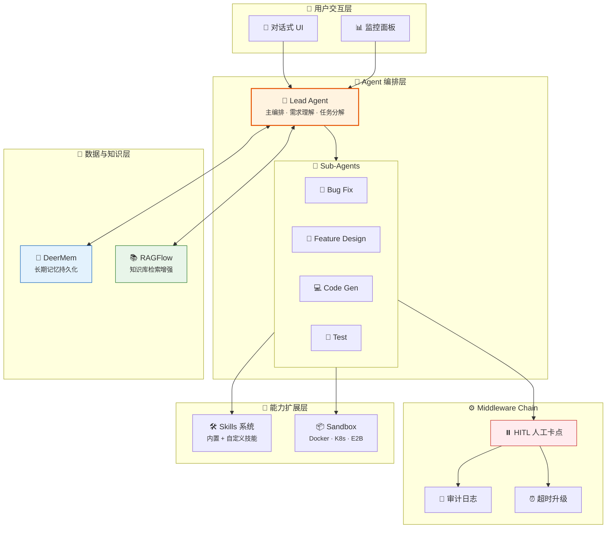

**核心组件说明**：

| 组件 | 功能 |
|------|------|
| **Lead Agent** | 主编排器，负责需求理解与任务分解 |
| **Sub-Agents** | 专业子 Agent（Bug Fix / Feature Design / Code Gen / Test） |
| **Middleware Chain** | HITL 人工卡点、审计日志、超时升级 |
| **Skills 系统** | 可扩展技能模块（内置 + 自定义） |
| **Sandbox** | 隔离代码执行环境（Docker / K8s / E2B） |
| **DeerMem** | 长期记忆持久化 |
| **RAGFlow** | 知识库检索增强 |

---

## 总结

OpsPilot 运维领航通过 AI Agent 技术，将传统的运维工单流程转变为智能化、对话式的协作体验。系统在保证人工控制（HITL）的前提下，大幅提升了运维效率和代码交付速度。

**适用场景**：
- 日常 Bug 修复
- 运维需求处理
- 代码自动生成
- 测试用例执行
- 运维知识沉淀

---

*文档版本：v1.1 | 更新时间：2026-11-10 | 新增 Mermaid 流程图*
