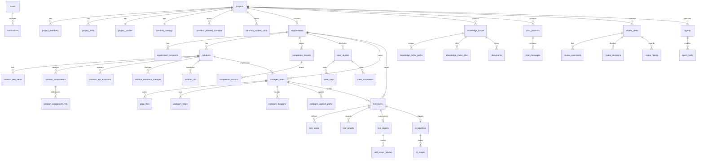

# OpsPilot 数据字典

本文与 `backend/src/schema.py` 中的 SQLAlchemy 模型一致，描述 `opspilot.db` 里的全部关系表，以及不在 SQLite 中的 Qdrant 分块集合。

## 库说明

| 项 | 约定 |
| --- | --- |
| 文件 | `backend/data/opspilot.db`。也可用环境变量 `DATABASE_URL` 指向另一个 SQLite 文件。 |
| 引擎 | SQLite。文本按 UTF-8 存储。 |
| 时间 | 无时区的 UTC 时间，类型为 `DateTime`。接口里的时间字符串按 ISO 8601 解析后再写入。 |
| 主键 | 业务对象主键多为 `String(36)` 的 UUID。用户主键是 `String(64)`，允许 `admin-001` 这类固定测试编号。子表行号是自增整数。 |
| 外键 | 连接时执行 `PRAGMA foreign_keys=ON`。下文“删除”列写的是子表外键的 `ON DELETE` 行为。 |
| 旧表 | `records(collection, record_id, payload)` 已退出使用。若发现只有这张旧表、还没有 `users` 表，启动时把文件改名为 `opspilot.legacy.db`，不读取、不复制里面的项目、需求和知识库。 |

空库第一次启动只写入四类测试用户、`skill_catalog` 和 `agent_prompt_templates`。不写入演示项目、演示需求、演示知识库或演示文档。

## 表关系

`skill_catalog` 和 `agent_prompt_templates` 是全局目录，不从项目外键挂出。新项目创建时把目录里的技能复制到 `project_skills`。Agent 提示为空时读取 `agent_prompt_templates`。

## 关系说明

| 父表 | 子表 | 基数 | 删除父行时 |
| --- | --- | --- | --- |
| users | notifications | 一对多 | 级联删除通知 |
| projects | project_members、project_skills、sandbox_allowed_domains、sandbox_system_tools | 一对多 | 级联删除 |
| projects | project_profiles、sandbox_settings | 一对一 | 级联删除 |
| projects | requirements、knowledge_bases、chat_sessions、review_items、agents | 一对多 | 级联删除，并沿外键继续删除下游 |
| requirements | requirement_keywords、solutions、codegen_tasks、test_tasks、completion_records、case_studies | 一对多 | 级联删除 |
| solutions | solution_text_items、solution_components、solution_api_endpoints、solution_database_changes、solution_nfr、codegen_tasks | 一对多 | 级联删除 |
| solution_components | solution_component_refs | 一对多 | 级联删除 |
| codegen_tasks | code_files、codegen_steps、codegen_locations、codegen_applied_paths、test_tasks | 一对多 | 级联删除 |
| test_tasks | test_cases、test_results | 一对多 | 级联删除 |
| test_tasks | test_reports、ci_pipelines | 一对零或一 | 级联删除 |
| test_reports | test_report_failures | 一对多 | 级联删除 |
| ci_pipelines | ci_stages | 一对多 | 级联删除 |
| review_items | review_comments、review_decisions、review_history | 一对多 | 级联删除 |
| chat_sessions | chat_messages | 一对多 | 级联删除 |
| knowledge_bases | knowledge_index_paths、knowledge_index_jobs、documents | 一对多 | 级联删除文档正文；分块向量在 Qdrant，由服务按文档删除 |
| agents | agent_skills | 一对多 | 级联删除 |
| completion_records | completion_lessons | 一对多 | 级联删除 |
| case_studies | case_tags、case_documents | 一对多 | 级联删除 |

以下字段只保存标识，不建外键：`review_items.requirement_id`、`review_items.session_id`、`notifications.review_item_id`、`requirements.session_id`、`knowledge_updates` 的知识库、文档和需求标识，以及 `case_documents.document_id`。删除被引用对象时，这些字段不会自动清空。

## 逐表数据字典

类型一列里的“可空”表示允许 `NULL`。没有写出默认值的字段，数据库不设默认，由写入方提供。

### users

登录账号。主键 `id`。唯一约束：`username`。

| 字段 | 类型 | 可空 | 默认 | 含义 |
| --- | --- | --- | --- | --- |
| id | String(64) | 否 | | 用户主键 |
| username | String(50) | 否 | | 登录名，唯一 |
| email | String(200) | 否 | | 邮箱 |
| role | String(32) | 否 | | 角色，见枚举 |
| hashed_password | String(200) | 否 | | bcrypt 密码哈希 |
| is_active | Boolean | 否 | true | 是否允许登录 |
| created_at | DateTime | 否 | | 创建时间 |
| updated_at | DateTime | 是 | | 最近修改时间 |

`role`：`admin` 管理员，`operator` 开发者，`reviewer` 审批，`viewer` 只读需求方。

空表时写入且不覆盖已有同名用户：`admin/admin123`、`operator/operator123`、`reviewer/reviewer123`、`viewer/viewer123`。

### projects

项目。主键 `id`。

| 字段 | 类型 | 可空 | 默认 | 含义 |
| --- | --- | --- | --- | --- |
| id | String(36) | 否 | | 项目主键 |
| name | String(100) | 否 | | 名称 |
| description | String(500) | 是 | | 描述 |
| repo_url | String(500) | 是 | | 仓库地址 |
| status | String(32) | 否 | active | 项目状态 |
| prompt_template | Text | 否 | 空串 | 项目提示模板 |
| toolchain | Text | 否 | 空串 | 工具链说明 |
| code_origin | String(32) | 否 | none | 代码来源：`none`、`git`、`upload` |
| code_status | String(32) | 否 | empty | 代码状态：`empty`、`ready`、`failed` |
| code_branch | String(200) | 否 | 空串 | Git 分支 |
| code_revision | String(200) | 否 | 空串 | 提交号或上传包校验值 |
| code_message | Text | 否 | 空串 | 最近一次导入说明 |
| code_updated_at | DateTime | 是 | | 代码最近更新时间 |
| created_at | DateTime | 否 | | 创建时间 |
| updated_at | DateTime | 否 | | 修改时间 |

`status`：`active`、`inactive`、`archived`。

导入后的源码在 `backend/data/workspaces`，不写入本表。旧工作区不会自动挂到新库。

### project_members

项目成员。主键 `id`。外键 `project_id` → `projects.id`。

| 字段 | 类型 | 可空 | 默认 | 含义 |
| --- | --- | --- | --- | --- |
| id | Integer | 否 | 自增 | 行主键 |
| project_id | String(36) | 否 | | 所属项目 |
| username | String(50) | 否 | | 成员用户名 |
| role | String(32) | 否 | developer | 项目内角色 |

### project_skills

项目技能开关。主键 `id`。唯一约束：`(project_id, skill_key)`。外键 `project_id` → `projects.id`。

| 字段 | 类型 | 可空 | 默认 | 含义 |
| --- | --- | --- | --- | --- |
| id | Integer | 否 | 自增 | 行主键 |
| project_id | String(36) | 否 | | 所属项目 |
| skill_key | String(80) | 否 | | 技能键，对应 `skill_catalog.skill_key` |
| name | String(100) | 否 | | 显示名 |
| description | Text | 否 | 空串 | 说明 |
| agent | String(100) | 否 | 空串 | 使用该技能的 Agent |
| enabled | Boolean | 否 | true | 是否启用 |
| usage_count | Integer | 否 | 0 | 使用次数 |

### project_profiles

提交需求前的项目资料。主键兼外键 `project_id` → `projects.id`。

| 字段 | 类型 | 可空 | 默认 | 含义 |
| --- | --- | --- | --- | --- |
| project_id | String(36) | 否 | | 项目 |
| overview | Text | 否 | 空串 | 概述 |
| architecture | Text | 否 | 空串 | 架构 |
| directory_layout | Text | 否 | 空串 | 目录结构 |
| key_modules | Text | 否 | 空串 | 关键模块 |
| config_notes | Text | 否 | 空串 | 配置说明 |
| runbook | Text | 否 | 空串 | 运行手册 |

### sandbox_settings

项目沙箱配置。主键兼外键 `project_id` → `projects.id`。

| 字段 | 类型 | 可空 | 默认 | 含义 |
| --- | --- | --- | --- | --- |
| project_id | String(36) | 否 | | 项目 |
| backend | String(32) | 否 | local | 执行后端 |
| image | String(200) | 否 | python:3.11-slim | 容器镜像 |
| memory_mb | Integer | 否 | 512 | 内存上限，MB |
| cpu | Float | 否 | 1.0 | CPU 配额 |
| timeout_seconds | Integer | 否 | 300 | 超时秒数 |
| disk_gb | Integer | 否 | 10 | 磁盘配额，GB，当前容器执行未强制 |
| network_policy | String(32) | 否 | disabled | 网络策略 |
| python_requirements | Text | 否 | 空串 | 额外 Python 依赖 |
| run_as_non_root | Boolean | 否 | true | 以非 root 运行 |
| disable_privileged | Boolean | 否 | true | 禁止特权 |
| read_only_root | Boolean | 否 | true | 根文件系统只读 |
| disable_setuid | Boolean | 否 | true | 禁止 setuid |
| seccomp | Boolean | 否 | false | 是否启用 seccomp |
| kubeconfig_mode | String(32) | 否 | default | kubeconfig 来源 |
| kubeconfig | Text | 否 | 空串 | kubeconfig 内容 |
| namespace | String(200) | 否 | 空串 | Kubernetes 命名空间 |
| service_account | String(200) | 否 | 空串 | 服务账号 |
| e2b_api_key | String(500) | 否 | 空串 | E2B 密钥 |
| e2b_template | String(100) | 否 | python-3.11 | E2B 模板 |

`network_policy` 使用业务里的 `disabled` 或开启值。正在执行的容器只留在进程中，不入库。

### sandbox_allowed_domains

沙箱允许访问的域名。主键 `id`。外键 `project_id` → `projects.id`。

| 字段 | 类型 | 可空 | 默认 | 含义 |
| --- | --- | --- | --- | --- |
| id | Integer | 否 | 自增 | 行主键 |
| project_id | String(36) | 否 | | 项目 |
| domain | String(200) | 否 | | 域名 |
| position | Integer | 否 | 0 | 顺序 |

### sandbox_system_tools

沙箱系统工具。主键 `id`。外键 `project_id` → `projects.id`。

| 字段 | 类型 | 可空 | 默认 | 含义 |
| --- | --- | --- | --- | --- |
| id | Integer | 否 | 自增 | 行主键 |
| project_id | String(36) | 否 | | 项目 |
| tool_name | String(100) | 否 | | 工具名 |
| position | Integer | 否 | 0 | 顺序 |

### requirements

需求。主键 `id`。外键 `project_id` → `projects.id`。

| 字段 | 类型 | 可空 | 默认 | 含义 |
| --- | --- | --- | --- | --- |
| id | String(36) | 否 | | 需求主键 |
| project_id | String(36) | 否 | | 所属项目 |
| title | String(200) | 否 | | 标题 |
| description | Text | 否 | 空串 | 描述 |
| source | String(32) | 否 | web | 来源 |
| type | String(32) | 否 | feature | 类型 |
| priority | String(32) | 否 | medium | 优先级 |
| status | String(32) | 否 | pending | 状态 |
| assignee | String(50) | 是 | | 处理人 |
| created_by | String(50) | 是 | | 创建人 |
| analysis_confidence | Float | 否 | 0 | 分析置信度 |
| session_id | String(36) | 是 | | 来源对话，逻辑关联 |
| auto_advance | Boolean | 否 | true | 是否自动推进 |
| rework_count | Integer | 否 | 0 | 返工次数 |
| failure_reason | Text | 是 | | 失败原因 |
| created_at | DateTime | 否 | | 创建时间 |
| updated_at | DateTime | 否 | | 修改时间 |

`source`：`web`、`im`、`api`。`type`：`bug`、`feature`、`question`。`priority`：`low`、`medium`、`high`、`critical`。`status`：`pending`、`analyzing`、`designing`、`reviewing`、`coding`、`testing`、`completed`、`closed`。

### requirement_keywords

需求关键词。主键 `id`。外键 `requirement_id` → `requirements.id`。

| 字段 | 类型 | 可空 | 默认 | 含义 |
| --- | --- | --- | --- | --- |
| id | Integer | 否 | 自增 | 行主键 |
| requirement_id | String(36) | 否 | | 需求 |
| keyword | String(100) | 否 | | 关键词 |
| position | Integer | 否 | 0 | 顺序 |

### solutions

方案。主键 `id`。外键 `requirement_id` → `requirements.id`。

| 字段 | 类型 | 可空 | 默认 | 含义 |
| --- | --- | --- | --- | --- |
| id | String(36) | 否 | | 方案主键 |
| requirement_id | String(36) | 否 | | 需求 |
| title | String(200) | 否 | | 标题 |
| content | Text | 否 | | 方案正文 |
| type | String(32) | 否 | | 方案类型 |
| status | String(32) | 否 | draft | 状态 |
| impact_level | String(32) | 否 | medium | 影响级别 |
| impact_scope | Text | 否 | 空串 | 影响范围 |
| created_by_agent | String(100) | 否 | 空串 | 生成该方案的 Agent |
| skill_key | String(80) | 否 | 空串 | 技能键 |
| skill_name | String(100) | 否 | 空串 | 技能名 |
| reviewed_by | String(50) | 是 | | 审核人 |
| review_comment | Text | 是 | | 审核意见 |
| root_cause | Text | 否 | 空串 | Bug 方案根因 |
| regression_risk | Text | 否 | 空串 | 回归风险 |
| rollback_plan | Text | 否 | 空串 | 回滚方案 |
| created_at | DateTime | 否 | | 创建时间 |
| updated_at | DateTime | 否 | | 修改时间 |

`type`：`bugfix`、`feature_design`。`status`：`draft`、`pending_review`、`approved`、`rejected`、`implemented`。`impact_level`：`low`、`medium`、`high`、`critical`。

### solution_text_items

方案中的有序文本。主键 `id`。外键 `solution_id` → `solutions.id`。同一方案的影响列表、修复步骤和阶段都在这张表，用 `item_kind` 区分，不再拆成多张只含一列文本的表。

| 字段 | 类型 | 可空 | 默认 | 含义 |
| --- | --- | --- | --- | --- |
| id | Integer | 否 | 自增 | 行主键 |
| solution_id | String(36) | 否 | | 方案 |
| item_kind | String(32) | 否 | | 文本种类 |
| value | Text | 否 | | 文本内容 |
| position | Integer | 否 | 0 | 顺序 |

`item_kind`：`affected_file` 受影响文件，`fix_step` 修复步骤，`test_suggestion` 测试建议，`dependency` 依赖，`phase` 实施阶段，`impact_module` 受影响模块，`impact_service` 受影响服务，`impact_risk` 风险点，`impact_mitigation` 缓解措施。

### solution_components

功能方案的架构组件。主键 `id`。外键 `solution_id` → `solutions.id`。

| 字段 | 类型 | 可空 | 默认 | 含义 |
| --- | --- | --- | --- | --- |
| id | Integer | 否 | 自增 | 行主键 |
| solution_id | String(36) | 否 | | 方案 |
| name | String(200) | 否 | | 组件名 |
| component_type | String(100) | 否 | 空串 | 组件类型 |
| description | Text | 否 | 空串 | 说明 |
| position | Integer | 否 | 0 | 顺序 |

### solution_component_refs

组件依赖或接口。主键 `id`。外键 `component_id` → `solution_components.id`。

| 字段 | 类型 | 可空 | 默认 | 含义 |
| --- | --- | --- | --- | --- |
| id | Integer | 否 | 自增 | 行主键 |
| component_id | Integer | 否 | | 组件 |
| ref_kind | String(32) | 否 | | `dependency` 或 `interface` |
| value | String(200) | 否 | | 依赖名或接口名 |
| position | Integer | 否 | 0 | 顺序 |

### solution_api_endpoints

功能方案的接口。主键 `id`。外键 `solution_id` → `solutions.id`。

| 字段 | 类型 | 可空 | 默认 | 含义 |
| --- | --- | --- | --- | --- |
| id | Integer | 否 | 自增 | 行主键 |
| solution_id | String(36) | 否 | | 方案 |
| method | String(16) | 否 | | HTTP 方法 |
| path | String(300) | 否 | | 路径 |
| description | Text | 否 | 空串 | 说明 |
| request_body | Text | 是 | | 请求体 JSON |
| response_body | Text | 是 | | 响应体 JSON |
| position | Integer | 否 | 0 | 顺序 |

### solution_database_changes

功能方案的数据库变更。主键 `id`。外键 `solution_id` → `solutions.id`。

| 字段 | 类型 | 可空 | 默认 | 含义 |
| --- | --- | --- | --- | --- |
| id | Integer | 否 | 自增 | 行主键 |
| solution_id | String(36) | 否 | | 方案 |
| change_type | String(64) | 否 | | 变更类型，如建表、改表 |
| table_name | String(100) | 否 | | 表名 |
| description | Text | 否 | 空串 | 说明 |
| sql_migration | Text | 是 | | SQL 脚本 |
| position | Integer | 否 | 0 | 顺序 |

### solution_nfr

非功能需求。主键 `id`。外键 `solution_id` → `solutions.id`。

| 字段 | 类型 | 可空 | 默认 | 含义 |
| --- | --- | --- | --- | --- |
| id | Integer | 否 | 自增 | 行主键 |
| solution_id | String(36) | 否 | | 方案 |
| name | String(100) | 否 | | 指标名 |
| value | Text | 否 | 空串 | 指标值 |

### codegen_tasks

代码生成任务。主键 `id`。外键 `solution_id` → `solutions.id`，`requirement_id` → `requirements.id`。

| 字段 | 类型 | 可空 | 默认 | 含义 |
| --- | --- | --- | --- | --- |
| id | String(36) | 否 | | 任务主键 |
| solution_id | String(36) | 否 | | 方案 |
| requirement_id | String(36) | 否 | | 需求 |
| status | String(32) | 否 | pending | 状态 |
| language | String(32) | 否 | python | 主要语言 |
| error_message | Text | 是 | | 错误信息 |
| sandbox_id | String(80) | 是 | | 本次沙箱编号，容器结束后不保留 |
| sandbox_profile | Text | 是 | | 执行时的沙箱配置摘要 |
| lint_json | Text | 是 | | Lint 结果 JSON |
| mr_json | Text | 是 | | 合并请求 JSON |
| applied_at | DateTime | 是 | | 写回项目的时间 |
| created_at | DateTime | 否 | | 创建时间 |
| updated_at | DateTime | 否 | | 修改时间 |
| completed_at | DateTime | 是 | | 完成时间 |

`status`：`pending`、`generating`、`linting`、`completed`、`failed`。

### code_files

生成或步骤产出的文件。主键 `id`。外键 `task_id` → `codegen_tasks.id`。`step_index` 为空表示任务级文件，非空表示该步骤的文件。

| 字段 | 类型 | 可空 | 默认 | 含义 |
| --- | --- | --- | --- | --- |
| id | Integer | 否 | 自增 | 行主键 |
| task_id | String(36) | 否 | | 代码任务 |
| step_index | Integer | 是 | | 步骤序号；空表示任务级文件 |
| path | String(500) | 否 | | 相对路径 |
| content | Text | 否 | 空串 | 文件内容 |
| language | String(32) | 否 | python | 语言 |
| action | String(32) | 否 | create | 操作 |
| diff_json | Text | 否 | `[]` | 差异行 JSON |
| position | Integer | 否 | 0 | 顺序 |

`action`：`create`、`modify`、`delete`、`view`。

### codegen_steps

代码任务步骤。主键 `id`。外键 `task_id` → `codegen_tasks.id`。

| 字段 | 类型 | 可空 | 默认 | 含义 |
| --- | --- | --- | --- | --- |
| id | Integer | 否 | 自增 | 行主键 |
| task_id | String(36) | 否 | | 代码任务 |
| step_index | Integer | 否 | | 步骤序号，从 1 开始 |
| title | Text | 否 | | 步骤标题 |
| status | String(32) | 否 | pending | 状态 |
| output | Text | 否 | 空串 | 执行结论 |
| error_message | Text | 是 | | 失败原因 |

`status`：`pending`、`running`、`completed`、`failed`。

### codegen_locations

步骤定位到的源码位置。主键 `id`。外键 `task_id` → `codegen_tasks.id`。

| 字段 | 类型 | 可空 | 默认 | 含义 |
| --- | --- | --- | --- | --- |
| id | Integer | 否 | 自增 | 行主键 |
| task_id | String(36) | 否 | | 代码任务 |
| step_index | Integer | 否 | | 所属步骤 |
| path | String(500) | 否 | | 相对路径 |
| line | Integer | 否 | 1 | 行号 |
| snippet | Text | 否 | 空串 | 代码片段 |
| reason | Text | 否 | 空串 | 相关原因 |
| position | Integer | 否 | 0 | 顺序 |

### codegen_applied_paths

已写回项目的路径。主键 `id`。外键 `task_id` → `codegen_tasks.id`。

| 字段 | 类型 | 可空 | 默认 | 含义 |
| --- | --- | --- | --- | --- |
| id | Integer | 否 | 自增 | 行主键 |
| task_id | String(36) | 否 | | 代码任务 |
| path | String(500) | 否 | | 相对路径 |
| position | Integer | 否 | 0 | 顺序 |

### test_tasks

测试任务。主键 `id`。外键 `codegen_task_id` → `codegen_tasks.id`，`requirement_id` → `requirements.id`。

| 字段 | 类型 | 可空 | 默认 | 含义 |
| --- | --- | --- | --- | --- |
| id | String(36) | 否 | | 任务主键 |
| codegen_task_id | String(36) | 否 | | 代码任务 |
| requirement_id | String(36) | 否 | | 需求 |
| status | String(32) | 否 | pending | 状态 |
| error_message | Text | 是 | | 错误信息 |
| sandbox_id | String(80) | 是 | | 本次沙箱编号 |
| sandbox_profile | Text | 是 | | 沙箱配置摘要 |
| coverage_json | Text | 是 | | 覆盖率 JSON |
| ci_pipeline_id | String(80) | 是 | | 外部流水线编号 |
| created_at | DateTime | 否 | | 创建时间 |
| updated_at | DateTime | 否 | | 修改时间 |
| completed_at | DateTime | 是 | | 完成时间 |

`status`：`pending`、`generating`、`running`、`completed`、`failed`。

### test_cases

测试用例。主键 `id`。外键 `task_id` → `test_tasks.id`。

| 字段 | 类型 | 可空 | 默认 | 含义 |
| --- | --- | --- | --- | --- |
| id | String(36) | 否 | | 用例主键 |
| task_id | String(36) | 否 | | 测试任务 |
| name | String(200) | 否 | | 名称 |
| description | Text | 否 | 空串 | 描述 |
| type | String(32) | 否 | unit | 用例类型 |
| code | Text | 否 | 空串 | 测试代码 |
| expected_result | Text | 是 | | 预期结果 |
| file_path | String(500) | 否 | 空串 | 测试文件路径 |
| target_function | String(200) | 是 | | 目标函数 |
| created_at | DateTime | 否 | | 创建时间 |
| position | Integer | 否 | 0 | 顺序 |

`type`：`unit`、`integration`、`e2e`。

### test_results

用例执行结果。主键 `id`。外键 `task_id` → `test_tasks.id`。`test_case_id` 对应 `test_cases.id`，不另建外键，以便保留已删除用例的结果文本。

| 字段 | 类型 | 可空 | 默认 | 含义 |
| --- | --- | --- | --- | --- |
| id | Integer | 否 | 自增 | 行主键 |
| task_id | String(36) | 否 | | 测试任务 |
| test_case_id | String(36) | 否 | | 用例 |
| status | String(32) | 否 | | 结果 |
| actual_result | Text | 是 | | 实际结果 |
| error_message | Text | 是 | | 错误信息 |
| stack_trace | Text | 是 | | 堆栈 |
| duration_ms | Integer | 否 | 0 | 耗时毫秒 |
| executed_at | DateTime | 否 | | 执行时间 |
| position | Integer | 否 | 0 | 顺序 |

`status`：`passed`、`failed`、`skipped`。

### test_reports

一份测试任务一份报告。主键兼外键 `task_id` → `test_tasks.id`。

| 字段 | 类型 | 可空 | 默认 | 含义 |
| --- | --- | --- | --- | --- |
| task_id | String(36) | 否 | | 测试任务 |
| total | Integer | 否 | 0 | 用例总数 |
| passed | Integer | 否 | 0 | 通过数 |
| failed | Integer | 否 | 0 | 失败数 |
| skipped | Integer | 否 | 0 | 跳过数 |
| coverage_percent | Float | 否 | 0 | 覆盖率百分比 |
| coverage_json | Text | 是 | | 详细覆盖率 JSON |
| duration_ms | Integer | 否 | 0 | 总耗时毫秒 |
| summary | Text | 否 | 空串 | 摘要 |
| generated_at | DateTime | 否 | | 生成时间 |

### test_report_failures

报告中的失败用例名。主键 `id`。外键 `task_id` → `test_reports.task_id`。

| 字段 | 类型 | 可空 | 默认 | 含义 |
| --- | --- | --- | --- | --- |
| id | Integer | 否 | 自增 | 行主键 |
| task_id | String(36) | 否 | | 测试报告 |
| case_name | String(200) | 否 | | 失败用例名 |
| position | Integer | 否 | 0 | 顺序 |

### ci_pipelines

测试任务对应的 CI 记录。主键兼外键 `id` → `test_tasks.id`，取值就是测试任务编号。`pipeline_id` 是外部流水线编号。

| 字段 | 类型 | 可空 | 默认 | 含义 |
| --- | --- | --- | --- | --- |
| id | String(36) | 否 | | 测试任务编号 |
| pipeline_id | String(80) | 否 | | 外部流水线编号 |
| status | String(32) | 否 | pending | 流水线状态 |
| url | String(500) | 是 | | 流水线链接 |
| triggered_at | DateTime | 否 | | 触发时间 |
| completed_at | DateTime | 是 | | 完成时间 |

### ci_stages

流水线阶段。主键 `id`。外键 `pipeline_row_id` → `ci_pipelines.id`。`detail` 保存整个阶段对象的 JSON，避免只保留名称和状态时丢掉其余字段。

| 字段 | 类型 | 可空 | 默认 | 含义 |
| --- | --- | --- | --- | --- |
| id | Integer | 否 | 自增 | 行主键 |
| pipeline_row_id | String(36) | 否 | | 流水线 |
| name | String(100) | 否 | 空串 | 阶段名 |
| status | String(32) | 否 | 空串 | 阶段状态 |
| detail | Text | 否 | 空串 | 阶段对象 JSON |
| position | Integer | 否 | 0 | 顺序 |

### review_items

审核项。主键 `id`。外键 `project_id` → `projects.id`。

| 字段 | 类型 | 可空 | 默认 | 含义 |
| --- | --- | --- | --- | --- |
| id | String(36) | 否 | | 审核项主键 |
| title | String(200) | 否 | | 标题 |
| description | Text | 否 | 空串 | 描述 |
| item_type | String(32) | 否 | | 审核对象类型 |
| item_id | String(36) | 否 | | 方案、代码任务或测试任务编号 |
| project_id | String(36) | 否 | | 项目 |
| requirement_id | String(36) | 是 | | 需求，逻辑关联 |
| session_id | String(36) | 是 | | 对话，逻辑关联 |
| status | String(32) | 否 | pending | 审核状态 |
| priority | String(32) | 否 | medium | 优先级 |
| reviewer | String(50) | 是 | | 审核人 |
| created_at | DateTime | 否 | | 创建时间 |
| updated_at | DateTime | 否 | | 修改时间 |
| due_at | DateTime | 是 | | 截止时间 |

`item_type`：`solution`、`code`、`test`。`status`：`pending`、`in_review`、`approved`、`rejected`、`revision_requested`。`priority`：`low`、`medium`、`high`、`urgent`。

### review_comments

审核评论。主键 `id`。外键 `review_item_id` → `review_items.id`。

| 字段 | 类型 | 可空 | 默认 | 含义 |
| --- | --- | --- | --- | --- |
| id | String(36) | 否 | | 评论主键 |
| review_item_id | String(36) | 否 | | 审核项 |
| author | String(50) | 否 | | 作者 |
| content | Text | 否 | | 内容 |
| created_at | DateTime | 否 | | 创建时间 |
| position | Integer | 否 | 0 | 顺序 |

### review_decisions

审核决定。主键 `id`。外键 `review_item_id` → `review_items.id`。

| 字段 | 类型 | 可空 | 默认 | 含义 |
| --- | --- | --- | --- | --- |
| id | String(36) | 否 | | 决定主键 |
| review_item_id | String(36) | 否 | | 审核项 |
| decision | String(32) | 否 | | 决定 |
| reviewer | String(50) | 否 | | 审核人 |
| reason | Text | 否 | 空串 | 理由 |
| created_at | DateTime | 否 | | 时间 |
| position | Integer | 否 | 0 | 顺序 |

`decision`：`approve`、`reject`、`request_revision`。

### review_history

审核操作历史。主键 `id`。外键 `review_item_id` → `review_items.id`。同一审核项的多条历史按 `position` 排列。

| 字段 | 类型 | 可空 | 默认 | 含义 |
| --- | --- | --- | --- | --- |
| id | String(36) | 否 | | 历史条目主键 |
| review_item_id | String(36) | 否 | | 审核项 |
| action | String(64) | 否 | | 操作 |
| actor | String(50) | 否 | | 操作人 |
| details | Text | 否 | 空串 | 详情 |
| created_at | DateTime | 否 | | 时间 |
| position | Integer | 否 | 0 | 顺序 |

### notifications

通知。主键 `id`。外键 `user_id` → `users.id`。

| 字段 | 类型 | 可空 | 默认 | 含义 |
| --- | --- | --- | --- | --- |
| id | String(36) | 否 | | 通知主键 |
| user_id | String(64) | 否 | | 接收用户 |
| type | String(64) | 否 | | 通知类型 |
| title | String(200) | 否 | | 标题 |
| content | Text | 否 | 空串 | 内容 |
| review_item_id | String(36) | 是 | | 关联审核项，逻辑关联 |
| is_read | Boolean | 否 | false | 是否已读 |
| created_at | DateTime | 否 | | 创建时间 |

`type`：`review_created`、`review_assigned`、`review_approved`、`review_rejected`、`review_revision_requested`、`review_commented`、`review_timeout_warning`。

### chat_sessions

对话会话。主键 `id`。外键 `project_id` → `projects.id`。

| 字段 | 类型 | 可空 | 默认 | 含义 |
| --- | --- | --- | --- | --- |
| id | String(36) | 否 | | 会话主键 |
| project_id | String(36) | 否 | | 项目 |
| title | String(200) | 否 | | 标题 |
| created_at | DateTime | 否 | | 创建时间 |
| updated_at | DateTime | 否 | | 修改时间 |

### chat_messages

对话消息。主键 `id`。外键 `session_id` → `chat_sessions.id`。检索引用、分类和审批卡片以 JSON 保存。

| 字段 | 类型 | 可空 | 默认 | 含义 |
| --- | --- | --- | --- | --- |
| id | String(36) | 否 | | 消息主键 |
| session_id | String(36) | 否 | | 会话 |
| role | String(32) | 否 | | `user` 或 `agent` |
| content | Text | 否 | 空串 | 正文 |
| sender | String(100) | 否 | 空串 | 发送者 |
| status | String(32) | 是 | | 消息状态 |
| knowledge_blocked | Boolean | 否 | false | 是否因知识未就绪而拦截 |
| knowledge_json | Text | 否 | `[]` | 引用的知识片段 JSON |
| classification_json | Text | 是 | | 分类结果 JSON |
| review_json | Text | 是 | | 审批卡片 JSON |
| created_at | DateTime | 否 | | 创建时间 |
| position | Integer | 否 | 0 | 顺序 |

### knowledge_bases

知识库。主键 `id`。外键 `project_id` → `projects.id`。分块向量不在本表。

| 字段 | 类型 | 可空 | 默认 | 含义 |
| --- | --- | --- | --- | --- |
| id | String(36) | 否 | | 知识库主键 |
| project_id | String(36) | 否 | | 项目 |
| name | String(100) | 否 | | 名称 |
| description | String(500) | 是 | | 描述 |
| type | String(32) | 否 | doc | 类型 |
| status | String(32) | 否 | pending | 状态 |
| document_count | Integer | 否 | 0 | 文档数 |
| index_trigger | String(32) | 否 | manual | 索引触发方式 |
| update_policy | String(32) | 否 | incremental | 更新策略 |
| created_at | DateTime | 否 | | 创建时间 |
| updated_at | DateTime | 否 | | 修改时间 |

`type`：`doc`、`code`、`faq`。`status`：`pending`、`indexing`、`ready`、`error`。

### knowledge_index_paths

索引范围。主键 `id`。外键 `knowledge_base_id` → `knowledge_bases.id`。

| 字段 | 类型 | 可空 | 默认 | 含义 |
| --- | --- | --- | --- | --- |
| id | Integer | 否 | 自增 | 行主键 |
| knowledge_base_id | String(36) | 否 | | 知识库 |
| path | String(300) | 否 | | 路径 |
| position | Integer | 否 | 0 | 顺序 |

### knowledge_index_jobs

索引任务记录。主键 `id`。外键 `knowledge_base_id` → `knowledge_bases.id`。

| 字段 | 类型 | 可空 | 默认 | 含义 |
| --- | --- | --- | --- | --- |
| id | String(64) | 否 | | 任务编号 |
| knowledge_base_id | String(36) | 否 | | 知识库 |
| status | String(32) | 否 | | 任务状态 |
| message | Text | 否 | 空串 | 说明 |
| created_at | DateTime | 否 | | 创建时间 |
| position | Integer | 否 | 0 | 顺序 |

### documents

知识文档正文。主键 `id`。外键 `knowledge_base_id` → `knowledge_bases.id`。没有向量列。

| 字段 | 类型 | 可空 | 默认 | 含义 |
| --- | --- | --- | --- | --- |
| id | String(36) | 否 | | 文档主键 |
| knowledge_base_id | String(36) | 否 | | 知识库 |
| title | String(200) | 否 | | 标题 |
| content | Text | 是 | | 正文 |
| file_path | String(500) | 是 | | 文件路径 |
| file_type | String(32) | 是 | | 文件类型 |
| embedding_status | String(32) | 否 | pending | 向量化状态 |
| embedding_model | String(100) | 是 | | 嵌入模型名 |
| chunk_count | Integer | 否 | 0 | 分块数量 |
| error_message | Text | 是 | | 失败原因 |
| created_at | DateTime | 否 | | 创建时间 |

`embedding_status`：`pending`、`processing`、`completed`、`failed`。

### skill_catalog

全局技能目录。主键 `skill_key`。表为空时从 `skills/opspilot` 写入一次，之后以库内记录为准。

| 字段 | 类型 | 可空 | 默认 | 含义 |
| --- | --- | --- | --- | --- |
| skill_key | String(80) | 否 | | 技能键 |
| name | String(100) | 否 | | 名称 |
| description | Text | 否 | 空串 | 说明 |
| agent | String(100) | 否 | 空串 | 对应 Agent |
| content | Text | 否 | 空串 | 技能正文 |

### agent_prompt_templates

Agent 默认提示。主键 `agent_type`。表为空时写入一次，之后以库内记录为准。

| 字段 | 类型 | 可空 | 默认 | 含义 |
| --- | --- | --- | --- | --- |
| agent_type | String(32) | 否 | | Agent 类型 |
| prompt | Text | 否 | | 提示词 |

`agent_type`：`lead`、`bugfix`、`feature`、`codegen`、`test`。

### agents

项目内的 Agent 配置。主键 `id`。外键 `project_id` → `projects.id`。

| 字段 | 类型 | 可空 | 默认 | 含义 |
| --- | --- | --- | --- | --- |
| id | String(36) | 否 | | 配置主键 |
| project_id | String(36) | 否 | | 项目 |
| name | String(100) | 否 | | 名称 |
| agent_type | String(32) | 否 | | 类型，取值同提示模板 |
| description | String(500) | 是 | | 描述 |
| model_name | String(100) | 否 | deepseek-v4 | 模型 |
| temperature | Float | 否 | 0.7 | 温度 |
| max_tokens | Integer | 否 | 4096 | 最大 token |
| prompt | Text | 否 | 空串 | 提示词；空则回读模板表 |
| enabled | Boolean | 否 | true | 是否启用 |
| created_at | DateTime | 否 | | 创建时间 |
| updated_at | DateTime | 否 | | 修改时间 |

### agent_skills

Agent 启用的技能键。主键 `id`。外键 `agent_id` → `agents.id`。

| 字段 | 类型 | 可空 | 默认 | 含义 |
| --- | --- | --- | --- | --- |
| id | Integer | 否 | 自增 | 行主键 |
| agent_id | String(36) | 否 | | Agent |
| skill_key | String(80) | 否 | | 技能键 |
| position | Integer | 否 | 0 | 顺序 |

### completion_records

需求完成记录。主键 `id`。外键 `requirement_id` → `requirements.id`。

| 字段 | 类型 | 可空 | 默认 | 含义 |
| --- | --- | --- | --- | --- |
| id | String(36) | 否 | | 记录主键 |
| requirement_id | String(36) | 否 | | 需求 |
| solution_id | String(36) | 是 | | 方案，逻辑关联 |
| codegen_task_id | String(36) | 是 | | 代码任务，逻辑关联 |
| test_task_id | String(36) | 是 | | 测试任务，逻辑关联 |
| status | String(32) | 否 | completed | 完成状态 |
| success | Boolean | 否 | true | 是否成功 |
| summary | Text | 否 | 空串 | 摘要 |
| metrics_json | Text | 否 | `{}` | 指标 JSON |
| created_at | DateTime | 否 | | 创建时间 |

### completion_lessons

完成记录中的经验。主键 `id`。外键 `record_id` → `completion_records.id`。

| 字段 | 类型 | 可空 | 默认 | 含义 |
| --- | --- | --- | --- | --- |
| id | Integer | 否 | 自增 | 行主键 |
| record_id | String(36) | 否 | | 完成记录 |
| lesson | Text | 否 | | 经验 |
| position | Integer | 否 | 0 | 顺序 |

### case_studies

案例。主键 `id`。外键 `requirement_id` → `requirements.id`。

| 字段 | 类型 | 可空 | 默认 | 含义 |
| --- | --- | --- | --- | --- |
| id | String(36) | 否 | | 案例主键 |
| requirement_id | String(36) | 否 | | 需求 |
| title | String(200) | 否 | | 标题 |
| description | Text | 否 | 空串 | 描述 |
| problem | Text | 否 | 空串 | 问题 |
| solution_summary | Text | 否 | 空串 | 方案摘要 |
| implementation | Text | 否 | 空串 | 实现 |
| results | Text | 否 | 空串 | 结果 |
| created_at | DateTime | 否 | | 创建时间 |

### case_tags

案例标签。主键 `id`。外键 `case_id` → `case_studies.id`。

| 字段 | 类型 | 可空 | 默认 | 含义 |
| --- | --- | --- | --- | --- |
| id | Integer | 否 | 自增 | 行主键 |
| case_id | String(36) | 否 | | 案例 |
| tag | String(80) | 否 | | 标签 |
| position | Integer | 否 | 0 | 顺序 |

### case_documents

案例引用的文档。主键 `id`。外键 `case_id` → `case_studies.id`。`document_id` 是逻辑关联。

| 字段 | 类型 | 可空 | 默认 | 含义 |
| --- | --- | --- | --- | --- |
| id | Integer | 否 | 自增 | 行主键 |
| case_id | String(36) | 否 | | 案例 |
| document_id | String(36) | 否 | | 文档 |
| position | Integer | 否 | 0 | 顺序 |

### knowledge_updates

知识更新流水。主键 `id`。不设外键。

| 字段 | 类型 | 可空 | 默认 | 含义 |
| --- | --- | --- | --- | --- |
| id | String(36) | 否 | | 流水主键 |
| knowledge_base_id | String(36) | 是 | | 知识库 |
| document_id | String(36) | 是 | | 文档 |
| update_type | String(32) | 否 | | `create`、`update` 或 `link` |
| content_summary | Text | 否 | 空串 | 摘要 |
| source_requirement_id | String(36) | 是 | | 来源需求 |
| created_at | DateTime | 否 | | 创建时间 |

## Qdrant 集合 opspilot_chunks

分块向量不在 SQLite 中。集合使用余弦距离，维度与当前嵌入一致，默认模型 `local-hash-256` 为 256 维。点的编号是分块 UUID。每个点的 payload：

| 字段 | 含义 |
| --- | --- |
| document_id | 文档编号，对应 `documents.id` |
| knowledge_base_id | 知识库编号，检索时按它过滤 |
| project_id | 项目编号 |
| content | 分块文本 |
| chunk_index | 分块序号 |
| embedding_model | 写入时的嵌入模型名，检索时必须一致 |

删除文档时按 `document_id` 删除对应点。不把旧的 `knowledge_chunks` 导入该集合。Qdrant 未启动时，检索接口返回 503。启动方式见 [Qdrant启动说明.md](Qdrant启动说明.md)。
