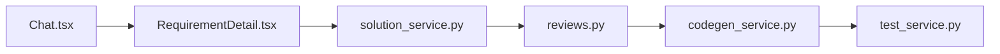

# OpsPilot 代码地图

文件：frontend/src/pages/Chat.tsx，backend/src/services/solution_service.py，backend/src/api/routes/reviews.py。分析 Bug 或新需求时，按症状打开同目录文档，修改点写到文档里的文件和函数。

- 对话与需求：Chat.tsx，RequirementDetail.tsx，deerflow_service.py
- 方案：SolutionDetail.tsx，solution_service.py，bugfix_agent.py
- Review：Reviews.tsx，ReviewDetail.tsx，hitl_service.py
- 知识库：Knowledge.tsx，knowledge_service.py
- 代码与沙箱：codegen_service.py，sandbox_service.py
- 测试：TestDetail.tsx，test_service.py
- 监控：Monitor.tsx，analytics.py
- 登录与 Agent：Login.tsx，agent_runtime.py
