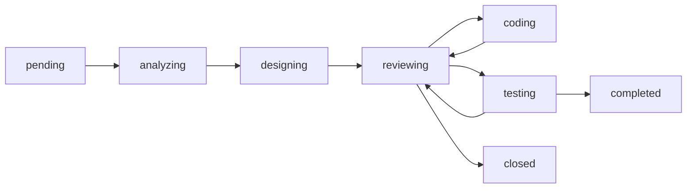

# M4: 需求理解与分类模块

## 1. 模块概述

需求理解与分类模块是 OpsPilot 的核心入口模块，负责接收、分析和分类运维需求，为后续处理提供基础。

### 1.1 核心功能

- 需求接收与解析
- 智能类型分类
- 优先级评估
- 关键词提取
- 历史关联

### 1.2 模块定位

```
需求输入 → 需求理解与分类 → 分类结果
                │
                ├─ Bug → Bug 修复流程 (M5)
                │
                ├─ Feature → 新需求设计流程 (M6)
                │
                └─ Question → 知识库检索 (M3)
```

## 2. 需求数据模型

### 2.1 需求实体

```python
class Requirement:
    id: str                      # 需求 ID
    project_id: str              # 所属项目
    title: str                   # 标题
    description: str             # 描述
    source: RequirementSource    # 来源
    type: RequirementType        # 类型
    priority: RequirementPriority # 优先级
    status: RequirementStatus    # 状态
    keywords: List[str]          # 关键词
    analysis: RequirementAnalysis # 分析结果
    created_at: datetime         # 创建时间
    updated_at: datetime         # 更新时间
    created_by: str              # 创建者
```

### 2.2 需求类型

| 类型 | 说明 | 示例 |
|------|------|------|
| `bug` | 缺陷/错误 | 登录报 500 错误 |
| `feature` | 新功能 | 添加导出功能 |
| `enhancement` | 功能增强 | 优化查询性能 |
| `maintenance` | 日常维护 | 数据库备份 |
| `security` | 安全相关 | 修复 SQL 注入 |
| `question` | 咨询问题 | 如何配置连接池 |

当前落地的类型是 `bug`、`feature`、`question`。表中的增强、维护、安全类描述归入 `bug` 或 `feature`，不单独开辟流程。`question` 只检索知识并回答，不建编码工单。

### 2.3 优先级

| 优先级 | 级别 | 说明 | 响应时间 |
|--------|------|------|----------|
| `critical` | P0 | 紧急 | 立即处理 |
| `high` | P1 | 高 | 24小时内 |
| `medium` | P2 | 中 | 本周内 |
| `low` | P3 | 低 | 计划处理 |

### 2.4 需求状态

状态与架构第 5.3 节的阶段一致。咨询不进入 `designing` 之后的阶段。



| 状态 | 说明 |
|------|------|
| `pending` | 已接收，尚未分析 |
| `analyzing` | 正在分类 |
| `designing` | 正在生成方案 |
| `reviewing` | 等待方案或代码审批 |
| `coding` | 正在生成代码并做语法检查 |
| `testing` | 正在执行测试 |
| `completed` | 测试通过且知识已回写 |
| `closed` | 审批拒绝或人工终止 |

## 3. 需求接收

### 3.1 创建需求 API

```http
POST /api/v1/requirements
Content-Type: application/json

{
  "project_id": "proj_123",
  "title": "用户登录时偶发 500 错误",
  "description": "用户反馈在登录时偶尔出现 500 错误，查看日志显示数据库连接超时。影响约 5% 的登录请求。",
  "source": "github_issue",
  "source_id": "issue_456",
  "attachments": ["log_file.txt"]
}
```

### 3.2 来源类型

| 来源 | 说明 |
|------|------|
| `manual` | 手动创建 |
| `github_issue` | GitHub Issue |
| `jira` | Jira 工单 |
| `alert` | 告警系统 |
| `chat` | 对话入口 |
| `api` | API 调用 |

### 3.3 批量导入

```http
POST /api/v1/requirements/import
Content-Type: application/json

{
  "project_id": "proj_123",
  "source": "github",
  "items": [
    {"title": "...", "description": "..."},
    {"title": "...", "description": "..."}
  ]
}
```

## 4. 智能分析

### 4.1 分析流程

```
┌──────────┐    ┌──────────┐    ┌──────────┐    ┌──────────┐
│ 需求输入 │───▶│ 类型分类 │───▶│ 优先级   │───▶│ 关键词   │
└──────────┘    └──────────┘    │ 评估     │    │ 提取     │
                               └──────────┘    └──────────┘
                                                     │
┌──────────┐    ┌──────────┐    ┌──────────┐         │
│ 分析结果 │◀───│ 结果汇总 │◀───│ 历史关联 │◀────────┘
└──────────┘    └──────────┘    └──────────┘
```

### 4.2 Lead Agent 分析

Lead Agent 使用 `requirement-analysis` Skill 进行分析：

```python
async def analyze_requirement(requirement: Requirement) -> RequirementAnalysis:
    # 构建上下文
    context = await build_context(
        requirement.description,
        requirement.project_id
    )
    
    # 调用 Lead Agent
    result = await deerflow_service.analyze_requirement(
        title=requirement.title,
        description=requirement.description,
        source=requirement.source,
        thread_id=f"req_{requirement.id}"
    )
    
    # 解析分析结果
    analysis = parse_analysis_result(result)
    
    return analysis
```

### 4.3 类型分类

Lead Agent 基于以下特征进行分类：

| 类型 | 关键特征 |
|------|----------|
| Bug | 错误、异常、崩溃、失败、报错、不工作 |
| Feature | 新增、添加、实现、开发、支持 |
| Enhancement | 优化、改进、升级、重构 |
| Security | 安全、漏洞、注入、越权 |
| Question | 如何、怎么、什么、为什么 |

### 4.4 优先级评估

评估维度：

| 维度 | 权重 | 说明 |
|------|------|------|
| **影响范围** | 30% | 受影响的用户/系统 |
| **业务影响** | 30% | 对业务的影响程度 |
| **紧急程度** | 25% | 时间敏感性 |
| **复杂度** | 15% | 解决难度 |

```python
def calculate_priority(analysis: dict) -> RequirementPriority:
    score = (
        analysis["impact_scope"] * 0.3 +
        analysis["business_impact"] * 0.3 +
        analysis["urgency"] * 0.25 +
        (1 - analysis["complexity"]) * 0.15
    )
    
    if score >= 0.8:
        return RequirementPriority.CRITICAL
    elif score >= 0.6:
        return RequirementPriority.HIGH
    elif score >= 0.4:
        return RequirementPriority.MEDIUM
    else:
        return RequirementPriority.LOW
```

### 4.5 关键词提取

```python
def extract_keywords(text: str) -> List[str]:
    keywords = []
    
    # 技术关键词
    tech_patterns = [
        r'\b(API|SDK|DB|SQL|HTTP|Redis|MySQL|PostgreSQL|Docker|K8s)\b',
        r'\b(CPU|内存|磁盘|网络|日志|监控|告警)\b'
    ]
    
    for pattern in tech_patterns:
        matches = re.findall(pattern, text, re.IGNORECASE)
        keywords.extend(matches)
    
    # 业务关键词（根据项目自定义）
    # ...
    
    return list(set(keywords))[:10]
```

## 5. 分析结果

### 5.1 分析结果模型

```python
class RequirementAnalysis:
    type: RequirementType          # 分类类型
    type_confidence: float         # 类型置信度
    priority: RequirementPriority  # 优先级
    priority_confidence: float     # 优先级置信度
    keywords: List[str]            # 关键词
    summary: str                   # 摘要
    impact_assessment: dict        # 影响评估
    similar_requirements: List[str] # 相似需求
    recommended_action: str        # 建议操作
    recommended_agent: str         # 建议 Agent
```

### 5.2 分析结果示例

```json
{
  "type": "bug",
  "type_confidence": 0.92,
  "priority": "high",
  "priority_confidence": 0.85,
  "keywords": ["登录", "500错误", "数据库", "连接超时"],
  "summary": "登录功能存在数据库连接超时问题，影响约5%用户",
  "impact_assessment": {
    "scope": "部分用户",
    "severity": "功能受限",
    "affected_components": ["认证模块", "数据库连接池"]
  },
  "similar_requirements": ["req_123", "req_456"],
  "recommended_action": "分配给 Bug 修复 Agent 处理",
  "recommended_agent": "bugfix_agent"
}
```

## 6. 需求管理 API

### 6.1 获取需求列表

```http
GET /api/v1/requirements?project_id={project_id}&status=pending&type=bug&page=1&size=20
```

### 6.2 获取需求详情

```http
GET /api/v1/requirements/{requirement_id}
```

### 6.3 触发分析

```http
POST /api/v1/requirements/{requirement_id}/analyze
```

### 6.4 更新需求

```http
PUT /api/v1/requirements/{requirement_id}
Content-Type: application/json

{
  "title": "更新后的标题",
  "priority": "critical"
}
```

### 6.5 关闭需求

```http
POST /api/v1/requirements/{requirement_id}/close
Content-Type: application/json

{
  "reason": "已解决",
  "resolution": "通过增加数据库连接池大小解决"
}
```

## 7. 历史关联

### 7.1 相似需求检索

```python
async def find_similar_requirements(
    requirement: Requirement,
    top_k: int = 5
) -> List[Requirement]:
    # 向量搜索
    query = f"{requirement.title} {requirement.description}"
    similar = await vector_search(
        query=query,
        collection=f"requirements_{requirement.project_id}",
        top_k=top_k
    )
    
    return similar
```

### 7.2 关联展示

在需求详情页展示：
- 相似历史需求
- 相关解决方案
- 相关知识文档

## 8. 通知与流转

### 8.1 分析完成通知

```python
async def notify_analysis_complete(requirement: Requirement):
    # 发送通知
    await notification_service.send(
        user_id=requirement.created_by,
        type="requirement_analyzed",
        data={
            "requirement_id": requirement.id,
            "title": requirement.title,
            "type": requirement.analysis.type,
            "priority": requirement.analysis.priority
        }
    )
```

### 8.2 自动流转

根据分析结果自动流转到下一步：

```python
async def auto_route(requirement: Requirement):
    analysis = requirement.analysis
    
    if analysis.type == RequirementType.BUG:
        # 流转到 Bug 修复流程
        await create_bugfix_task(requirement)
    
    elif analysis.type == RequirementType.FEATURE:
        # 流转到功能设计流程
        await create_feature_task(requirement)
    
    elif analysis.type == RequirementType.QUESTION:
        # 只回答，不建编码工单，也不进入方案、代码和测试
        await search_and_answer(requirement)
```

## 9. 最佳实践

### 9.1 需求描述建议

1. **标题清晰**
   - 简明扼要描述问题
   - 包含关键信息

2. **描述完整**
   - 问题现象
   - 复现步骤
   - 预期行为
   - 实际行为
   - 环境信息

3. **附加信息**
   - 错误日志
   - 截图
   - 相关配置

### 9.2 分析结果使用

1. **参考而非依赖**
   - AI 分析结果仅供参考
   - 重要决策需人工确认

2. **反馈改进**
   - 对不准确的分析进行反馈
   - 帮助系统持续改进

## 10. 常见问题

### Q1: 分析结果不准确怎么办？

1. 检查需求描述是否清晰
2. 手动调整分类和优先级
3. 反馈给系统以改进

### Q2: 如何处理批量需求？

使用批量导入 API，系统会依次分析每个需求。

### Q3: 分析耗时多久？

通常 5-30 秒，取决于：
- 需求复杂度
- 知识库规模
- 系统负载

---

*文档版本: 1.0*
*所属模块: M4 - 需求理解与分类*
