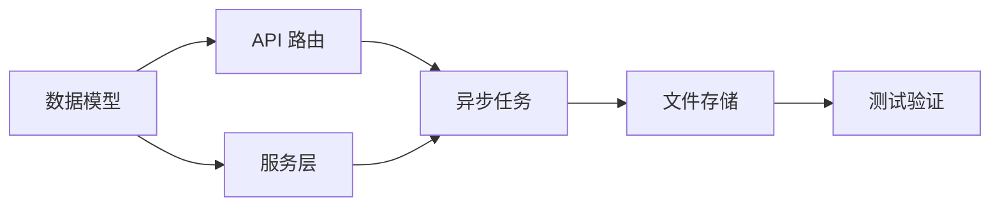

# M6: 新需求设计流程模块

## 1. 模块概述

新需求设计流程模块负责处理被分类为 Feature 或 Enhancement 的需求，通过 AI Agent 生成专业的设计方案。

### 1.1 核心功能

- 用户故事分析
- 技术架构设计
- API 接口设计
- 数据模型设计
- 实施计划制定

### 1.2 模块定位

```
Feature 类需求 → 新需求设计流程 → 设计方案
                      │
                      ├─ 需求理解 → 用户故事
                      │
                      ├─ 架构设计 → 技术方案
                      │
                      ├─ 接口设计 → API 规范
                      │
                      └─ 实施计划 → 开发任务
```

## 2. 功能设计 Agent

### 2.1 Agent 配置

```yaml
name: feature_agent
display_name: 功能设计 Agent
description: 针对功能需求生成设计方案
skills:
  - feature-design
  - deep-research
settings:
  model: gpt-4o
  temperature: 0.5  # 平衡创意和稳定性
  max_iterations: 8
```

### 2.2 feature-design Skill

Skill 核心内容：

```markdown
# feature-design Skill

## 设计流程

### 第一阶段：需求理解
1. 用户故事分析
2. 功能拆解
3. 边界定义

### 第二阶段：技术方案
1. 架构设计
2. 接口设计
3. 数据模型

### 第三阶段：实施计划
1. 任务分解
2. 里程碑规划
3. 风险识别
```

## 3. 用户故事分析

### 3.1 用户故事格式

```
作为 [用户角色]
我希望 [功能描述]
以便 [业务价值]

验收标准：
- 标准 1
- 标准 2
- 标准 3
```

### 3.2 示例

```
作为 系统管理员
我希望 能够批量导出用户数据
以便 进行数据分析和备份

验收标准：
- 支持选择导出字段
- 支持 CSV 和 Excel 格式
- 导出大数据量时不超时
- 导出文件可下载
```

### 3.3 功能拆解

```python
class FeatureBreakdown:
    must_have: List[str]    # 必须实现
    should_have: List[str]  # 应该实现
    could_have: List[str]   # 可以实现
    wont_have: List[str]    # 暂不实现
```

### 3.4 MoSCoW 分析

| 优先级 | 说明 | 示例 |
|--------|------|------|
| **Must** | 必须有 | 基础导出功能 |
| **Should** | 应该有 | 格式选择 |
| **Could** | 可以有 | 定时导出 |
| **Won't** | 暂不做 | 导出到云存储 |

## 4. 技术架构设计

### 4.1 架构设计模板

```markdown
## 架构设计

### 组件图
[描述或 Mermaid 图]

### 组件说明
| 组件 | 职责 | 技术选型 |
|------|------|----------|
| ... | ... | ... |

### 数据流
[描述数据如何在组件间流转]

### 依赖关系
[外部依赖和内部依赖]
```

### 4.2 架构示例

```yaml
architecture:
  components:
    - name: ExportController
      responsibility: 处理导出请求
      technology: FastAPI Router
    
    - name: ExportService
      responsibility: 导出业务逻辑
      technology: Python Service
    
    - name: ExportTask
      responsibility: 异步导出任务
      technology: Celery Task
    
    - name: FileStorage
      responsibility: 文件存储
      technology: MinIO/本地文件
  
  data_flow: |
    用户请求 → Controller → Service → 创建Task
                                         ↓
    用户下载 ← Controller ← Service ← Task完成
```

### 4.3 技术选型建议

```python
def suggest_technology(requirement: str) -> dict:
    suggestions = {}
    
    # 根据需求特征推荐技术
    if "大数据量" in requirement:
        suggestions["async"] = "使用 Celery 异步处理"
        suggestions["pagination"] = "分批处理"
    
    if "实时" in requirement:
        suggestions["cache"] = "使用 Redis 缓存"
        suggestions["websocket"] = "考虑 WebSocket"
    
    return suggestions
```

## 5. API 接口设计

### 5.1 RESTful 设计原则

| 原则 | 说明 |
|------|------|
| **资源命名** | 使用名词复数，如 /users |
| **HTTP 方法** | GET 查询，POST 创建，PUT 更新，DELETE 删除 |
| **状态码** | 正确使用 HTTP 状态码 |
| **版本控制** | URL 路径版本 /api/v1/ |

### 5.2 API 设计模板

```yaml
api_design:
  - endpoint: POST /api/v1/exports
    description: 创建导出任务
    request:
      body:
        type: object
        properties:
          resource_type:
            type: string
            description: 资源类型
            example: users
          fields:
            type: array
            description: 导出字段
            example: ["id", "name", "email"]
          format:
            type: string
            enum: [csv, xlsx]
            description: 导出格式
          filters:
            type: object
            description: 过滤条件
    response:
      201:
        body:
          task_id: string
          status: pending
          message: 导出任务已创建
      400:
        body:
          error: 参数错误
          details: ...
    
  - endpoint: GET /api/v1/exports/{task_id}
    description: 查询导出任务状态
    response:
      200:
        body:
          task_id: string
          status: pending|processing|completed|failed
          progress: number
          download_url: string (完成时)
```

### 5.3 接口文档生成

系统自动生成 OpenAPI 格式文档：

```json
{
  "openapi": "3.0.0",
  "paths": {
    "/api/v1/exports": {
      "post": {
        "summary": "创建导出任务",
        "requestBody": {...},
        "responses": {...}
      }
    }
  }
}
```

## 6. 数据模型设计

### 6.1 实体设计

```python
class ExportTask:
    """导出任务实体"""
    id: str                    # 任务ID
    user_id: str               # 创建用户
    resource_type: str         # 资源类型
    fields: List[str]          # 导出字段
    format: ExportFormat       # 导出格式
    filters: dict              # 过滤条件
    status: TaskStatus         # 任务状态
    progress: int              # 进度(0-100)
    file_path: str             # 文件路径
    file_size: int             # 文件大小
    error_message: str         # 错误信息
    created_at: datetime       # 创建时间
    completed_at: datetime     # 完成时间
```

### 6.2 数据库设计

```sql
CREATE TABLE export_tasks (
    id VARCHAR(36) PRIMARY KEY,
    user_id VARCHAR(36) NOT NULL,
    resource_type VARCHAR(50) NOT NULL,
    fields JSON,
    format VARCHAR(10) NOT NULL,
    filters JSON,
    status VARCHAR(20) NOT NULL DEFAULT 'pending',
    progress INT DEFAULT 0,
    file_path VARCHAR(255),
    file_size BIGINT,
    error_message TEXT,
    created_at TIMESTAMP DEFAULT CURRENT_TIMESTAMP,
    completed_at TIMESTAMP,
    
    INDEX idx_user_id (user_id),
    INDEX idx_status (status),
    INDEX idx_created_at (created_at)
);
```

### 6.3 索引设计

| 索引 | 字段 | 用途 |
|------|------|------|
| 主键 | id | 唯一标识 |
| 普通 | user_id | 用户查询 |
| 普通 | status | 状态筛选 |
| 普通 | created_at | 时间排序 |

## 7. 实施计划

### 7.1 任务分解

```yaml
implementation_plan:
  phases:
    - name: 阶段一：基础框架
      duration: 2天
      tasks:
        - 创建数据模型
        - 实现 API 路由
        - 编写基础服务
      deliverables:
        - 数据库表
        - API 框架
    
    - name: 阶段二：核心功能
      duration: 3天
      tasks:
        - 实现导出逻辑
        - 集成文件存储
        - 异步任务处理
      deliverables:
        - 导出功能可用
    
    - name: 阶段三：完善优化
      duration: 2天
      tasks:
        - 错误处理
        - 性能优化
        - 单元测试
      deliverables:
        - 功能完整
        - 测试通过
```

### 7.2 里程碑

| 里程碑 | 目标 | 验收标准 |
|--------|------|----------|
| M1 | 框架搭建 | API 可访问 |
| M2 | 功能实现 | 导出可用 |
| M3 | 测试完成 | 覆盖率>80% |
| M4 | 上线 | 生产环境可用 |

### 7.3 依赖关系



## 8. 设计方案 API

### 8.1 生成设计方案

```http
POST /api/v1/solutions/feature
Content-Type: application/json

{
  "requirement_id": "req_123"
}
```

响应：
```json
{
  "solution_id": "sol_789",
  "requirement_id": "req_123",
  "type": "feature",
  "status": "draft",
  "overview": {
    "title": "批量数据导出功能",
    "description": "...",
    "user_story": "作为系统管理员...",
    "business_value": "提高数据管理效率"
  },
  "scope": {
    "in_scope": ["导出用户数据", "支持CSV/Excel"],
    "out_of_scope": ["导出到云存储"],
    "dependencies": ["文件存储服务"],
    "constraints": ["单次导出最大100万条"]
  },
  "technical_design": {
    "architecture": {...},
    "api_design": [...],
    "data_model": {...}
  },
  "implementation_plan": {
    "phases": [...],
    "milestones": [...],
    "estimated_effort": "7-10天"
  },
  "risk_assessment": {...}
}
```

### 8.2 获取方案详情

```http
GET /api/v1/solutions/{solution_id}
```

### 8.3 更新方案

```http
PUT /api/v1/solutions/{solution_id}
```

## 9. 风险评估

### 9.1 风险类别

| 类别 | 说明 |
|------|------|
| **技术风险** | 技术实现难度、性能问题 |
| **资源风险** | 人力、时间不足 |
| **依赖风险** | 外部服务、第三方库 |
| **变更风险** | 需求变更 |

### 9.2 风险矩阵

```
         概率
         高 │ ③ │ ⑤ │
           ├───┼───┤
         中 │ ② │ ④ │
           ├───┼───┤
         低 │ ① │ ③ │
           └───┴───┘
             低   高
             影响
```

### 9.3 风险应对

| 风险 | 应对策略 |
|------|----------|
| 性能问题 | 提前压测、分批处理 |
| 时间紧张 | 砍需求、增加资源 |
| 需求变更 | 控制范围、迭代开发 |

## 10. 设计评审

### 10.1 评审要点

- [ ] 需求理解准确
- [ ] 架构设计合理
- [ ] API 设计规范
- [ ] 数据模型完整
- [ ] 实施计划可行
- [ ] 风险识别充分

### 10.2 评审流程

```
方案生成 → 自动检查 → 人工评审 → 修改完善 → 评审通过
                          │
                          └→ 需要修改 → 返回修改
```

## 11. 最佳实践

### 11.1 设计原则

1. **简单优先**：不过度设计
2. **可扩展**：预留扩展点
3. **可测试**：便于测试验证
4. **可维护**：代码清晰可读

### 11.2 常见陷阱

- 需求理解偏差
- 过度设计
- 忽视非功能需求
- 低估工作量

## 12. 常见问题

### Q1: 设计方案需要多详细？

根据需求复杂度：
- 简单功能：概要设计即可
- 复杂功能：详细设计+伪代码

### Q2: 设计方案如何迭代？

支持多次生成和修改，保留历史版本。

### Q3: 如何处理需求变更？

重新分析变更影响，更新设计方案。

---

*文档版本: 1.0*
*所属模块: M6 - 新需求设计流程*
