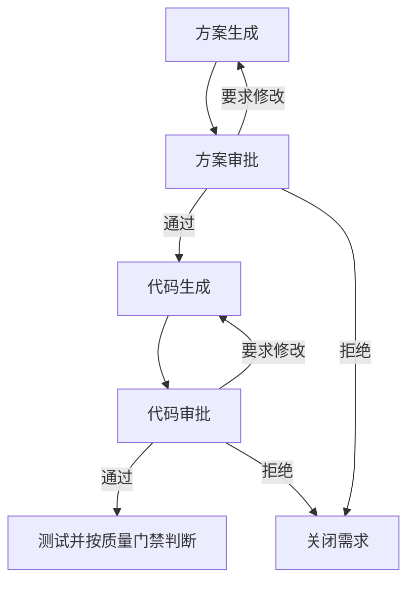
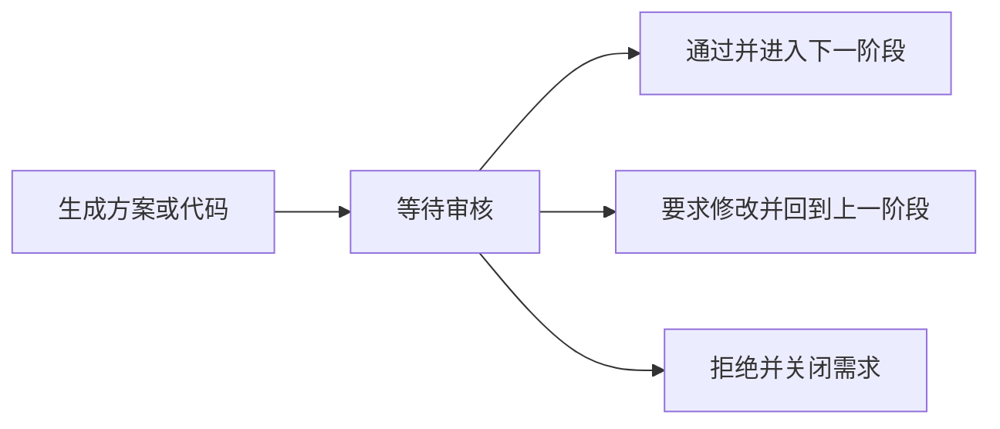

# M7: 人工 Review 工作台模块

## 1. 模块概述

人工 Review 工作台是 OpsPilot HITL（Human-in-the-Loop）机制的核心模块，确保 AI 生成的方案经过人工审核后才能执行。

### 1.1 核心功能

- 待审核任务管理
- 方案审核与批注
- 审批决策（通过/修改/拒绝）
- 审核历史追踪

### 1.2 模块定位



对话流里的审批卡片和 Review 工作台操作的是同一条审核记录。通过后由流程推进服务进入下一阶段。测试结果默认不进入人工审批，未过门禁时回到代码生成。

## 2. HITL 机制

### 2.1 为什么需要 HITL

| 原因 | 说明 |
|------|------|
| **质量保障** | AI 可能产生不准确的结果 |
| **风险控制** | 重要决策需人工把关 |
| **知识补充** | 人类专家提供领域知识 |
| **责任明确** | 明确决策责任人 |
| **持续改进** | 反馈帮助 AI 学习 |

### 2.2 审核触发条件

方案和代码是两道必经审批，不按风险跳过。测试使用失败数和覆盖率门禁，不默认创建人工审核。

```yaml
review_triggers:
  required:
    - solution   # Bug 修复方案与新需求设计方案
    - code       # 语法检查之后的代码变更
  quality_gate:
    - test       # 失败数必须为 0；已统计覆盖率时不低于 80%
```

### 2.3 审核流程



## 3. 审核数据模型

### 3.1 审核任务

```python
class Review:
    id: str                     # 审核 ID
    solution_id: str            # 方案 ID
    requirement_id: str         # 需求 ID
    project_id: str             # 项目 ID
    type: ReviewType            # 审核类型
    status: ReviewStatus        # 审核状态
    priority: ReviewPriority    # 优先级
    assignee_id: str            # 审核人
    created_at: datetime        # 创建时间
    due_at: datetime            # 截止时间
    completed_at: datetime      # 完成时间
    decision: ReviewDecision    # 审核决策
    comments: List[Comment]     # 评论/批注
    history: List[ReviewEvent]  # 历史记录
```

### 3.2 审核状态

| 状态 | 说明 |
|------|------|
| `pending` | 待审核 |
| `in_review` | 审核中 |
| `approved` | 已通过 |
| `rejected` | 已拒绝 |
| `changes_requested` | 需修改 |
| `expired` | 已过期 |

### 3.3 审核决策

```python
class ReviewDecision:
    action: str              # approved/rejected/changes_requested
    reason: str              # 决策原因
    comments: str            # 详细评论
    modified_content: dict   # 修改内容（如有）
    reviewer_id: str         # 审核人 ID
    decided_at: datetime     # 决策时间
```

## 4. 审核工作台界面

### 4.1 工作台布局

```
┌─────────────────────────────────────────────────────────────┐
│                     审核工作台                               │
├─────────────────────────────────────────────────────────────┤
│  待审核(3)  │  审核中(1)  │  已完成(15)  │  已过期(0)        │
├─────────────────────────────────────────────────────────────┤
│                                                             │
│  ┌─────────────────────────────────────────────────────┐   │
│  │ 审核任务列表                                         │   │
│  │ ┌─────────────────────────────────────────────────┐ │   │
│  │ │ □ [高] 用户登录500错误修复方案    待审核 2h前    │ │   │
│  │ │ □ [中] 批量导出功能设计方案      待审核 5h前    │ │   │
│  │ │ □ [低] API性能优化方案           审核中 1d前    │ │   │
│  │ └─────────────────────────────────────────────────┘ │   │
│  └─────────────────────────────────────────────────────┘   │
│                                                             │
│  ┌─────────────────────────────────────────────────────┐   │
│  │ 方案详情                                             │   │
│  │ ┌─────────────────────────────────────────────────┐ │   │
│  │ │ 标题：用户登录500错误修复方案                    │ │   │
│  │ │ 类型：Bug修复  优先级：高  风险：中              │ │   │
│  │ │                                                   │ │   │
│  │ │ [方案内容展示区域]                               │ │   │
│  │ │                                                   │ │   │
│  │ └─────────────────────────────────────────────────┘ │   │
│  │ ┌─────────────────────────────────────────────────┐ │   │
│  │ │ 审核操作                                         │ │   │
│  │ │ [通过] [需修改] [拒绝]                           │ │   │
│  │ │ 评论：___________________________________        │ │   │
│  │ └─────────────────────────────────────────────────┘ │   │
│  └─────────────────────────────────────────────────────┘   │
└─────────────────────────────────────────────────────────────┘
```

### 4.2 方案展示

审核工作台展示方案的关键信息：

```json
{
  "solution": {
    "title": "用户登录500错误修复方案",
    "type": "bugfix",
    "summary": "通过修复数据库连接池泄漏问题解决登录500错误"
  },
  "analysis": {
    "root_cause": "数据库连接未正确释放",
    "impact": "影响5%用户登录"
  },
  "code_changes": [
    {
      "file": "src/db/connection.py",
      "change_summary": "使用 context manager 确保连接释放"
    }
  ],
  "test_plan": {
    "unit_tests": 3,
    "integration_tests": 2
  },
  "risk_assessment": {
    "level": "medium",
    "factors": ["涉及数据库连接核心逻辑"]
  }
}
```

### 4.3 批注功能

支持对方案进行行内批注：

```python
class Comment:
    id: str
    review_id: str
    user_id: str
    content: str
    target_type: str      # solution/code_change/test_plan
    target_id: str        # 批注目标 ID
    line_number: int      # 代码行号（如适用）
    created_at: datetime
    resolved: bool        # 是否已解决
```

## 5. 审核 API

### 5.1 获取待审核列表

```http
GET /api/v1/reviews?status=pending&assignee=me&page=1&size=20
```

响应：
```json
{
  "reviews": [
    {
      "id": "rev_123",
      "solution_id": "sol_456",
      "title": "用户登录500错误修复方案",
      "type": "bugfix",
      "priority": "high",
      "status": "pending",
      "created_at": "2024-01-15T10:00:00Z",
      "due_at": "2024-01-16T10:00:00Z"
    }
  ],
  "total": 3,
  "page": 1,
  "size": 20
}
```

### 5.2 获取审核详情

```http
GET /api/v1/reviews/{review_id}
```

### 5.3 提交审核决策

```http
POST /api/v1/reviews/{review_id}/decision
Content-Type: application/json

{
  "action": "approved",  // approved/rejected/changes_requested
  "reason": "方案合理，可以执行",
  "comments": "建议在部署时增加监控"
}
```

### 5.4 添加批注

```http
POST /api/v1/reviews/{review_id}/comments
Content-Type: application/json

{
  "content": "这里的异常处理可以更完善",
  "target_type": "code_change",
  "target_id": "change_1",
  "line_number": 25
}
```

### 5.5 解决批注

```http
PUT /api/v1/reviews/{review_id}/comments/{comment_id}/resolve
```

## 6. 审核通知

### 6.1 通知类型

| 事件 | 通知内容 |
|------|----------|
| 新审核任务 | 有新的方案需要您审核 |
| 审核即将过期 | 审核任务将在 2 小时后过期 |
| 审核完成 | 您的方案已通过/被拒绝/需修改 |
| 批注回复 | 有人回复了您的批注 |

### 6.2 通知渠道

- 系统内通知
- 邮件通知
- Webhook（可配置）

### 6.3 通知 API

```http
POST /api/v1/notifications/send
Content-Type: application/json

{
  "user_id": "user_123",
  "type": "review_assigned",
  "data": {
    "review_id": "rev_123",
    "title": "用户登录500错误修复方案"
  },
  "channels": ["in_app", "email"]
}
```

## 7. 审核配置

### 7.1 项目级配置

```yaml
review_settings:
  # 审核策略
  require_review: true           # 是否需要审核
  auto_approve_low_risk: false   # 低风险自动通过
  
  # 超时配置
  review_timeout_hours: 24       # 审核超时时间
  reminder_before_hours: 2       # 超时前提醒
  
  # 审核人配置
  default_reviewers:             # 默认审核人
    - user_id: reviewer_1
      role: tech_lead
  
  # 审核规则
  rules:
    - condition: "risk_level == 'high'"
      action: "require_tech_lead_approval"
    - condition: "change_type == 'database'"
      action: "require_dba_approval"
```

### 7.2 审核人分配

```python
def assign_reviewer(review: Review) -> str:
    # 根据方案类型和风险级别分配审核人
    if review.risk_level == 'high':
        return get_tech_lead(review.project_id)
    
    if review.solution_type == 'database_change':
        return get_dba(review.project_id)
    
    # 默认轮询分配
    return get_next_reviewer(review.project_id)
```

## 8. 审核统计

### 8.1 统计指标

| 指标 | 说明 |
|------|------|
| 审核数量 | 各状态审核数量 |
| 平均审核时间 | 从创建到完成的时间 |
| 通过率 | 通过/总数 |
| 超时率 | 超时/总数 |

### 8.2 统计 API

```http
GET /api/v1/reviews/stats?project_id={project_id}&period=30d
```

响应：
```json
{
  "period": "30d",
  "total_reviews": 50,
  "by_status": {
    "approved": 35,
    "rejected": 5,
    "changes_requested": 8,
    "expired": 2
  },
  "avg_review_time_hours": 4.5,
  "pass_rate": 0.7,
  "timeout_rate": 0.04
}
```

## 9. 最佳实践

### 9.1 高效审核

1. **优先处理高优先级**
   - 先审核紧急任务
   - 避免阻塞关键流程

2. **提供有价值的反馈**
   - 具体的修改建议
   - 而非简单的通过/拒绝

3. **及时处理**
   - 避免超时
   - 保持流程顺畅

### 9.2 审核要点

| 类型 | 审核重点 |
|------|----------|
| Bug修复 | 根因分析是否准确，修复是否彻底 |
| 功能设计 | 架构是否合理，是否满足需求 |
| 代码变更 | 代码质量，测试覆盖 |

### 9.3 常见问题处理

1. **审核人不在线**
   - 自动转发给备选审核人
   - 超时后升级

2. **方案需要多次修改**
   - 保留修改历史
   - 追踪修改进度

## 10. 常见问题

### Q1: 如何跳过审核？

项目设置中可配置 `require_review: false`，但不建议在生产环境使用。

### Q2: 审核超时怎么办？

超时后会：
1. 发送提醒通知
2. 自动转发给其他审核人
3. 或标记为需人工干预

### Q3: 如何追踪审核历史？

每个审核任务都有完整的历史记录，包括：
- 状态变更
- 批注记录
- 决策记录

---

*文档版本: 1.0*
*所属模块: M7 - 人工 Review 工作台*
